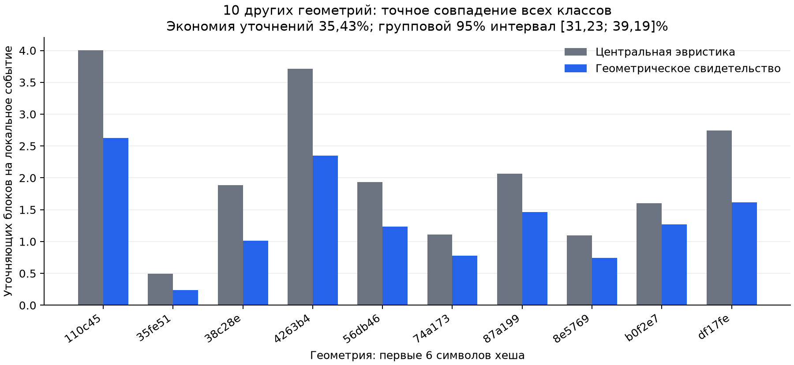

# H7: отбор кандидата, реализация и две минимальные проверки

25 октября 2026 года. **Работа завершена: три кандидата разобраны по литературе,
выбран и реализован геометрический анализ частичного наблюдения, обучены два
общих CNN, выполнены первый опыт и отдельная проверка экономии уточнений.**

Есть положительный результат для узкой H7.1: на десяти других геометриях
получено **35, 43% меньше уточняющих запросов** против сильной центральной
эвристики при точном воспроизведении всех классов. Описательный групповой
95%-интервал экономии **[31, 23%; 39, 19%]**. Это результат в идеализированной
модели доступа к бинарному изображению; достаточная Q1-новизна и аппаратный
эффект не установлены.

## Выбранная постановка

[Три кандидата и причины выбора](CANDIDATES.md),
[проверка ближайшей литературы](LITERATURE.md),
[текущая точная гипотеза H7.1](HYPOTHESIS.md).

Классифицируется уже полученный литографический рисунок: сужение,
непредусмотренное объединение и отсутствие проектной опоры. Начальный вход —
точные суммы пикселей в блоках 8×8 и проектные области контроля. Политика
может запросить детали некоторых блоков. Из нижней/верхней допустимых масок
выводится достаточное условие однозначности класса. Если сведений мало,
выбираются фрагменты около возможного соединения нужной толщины и
неоднозначных опор. Нативные закрытые пиксели и класс не входят в политику.

Это другая задача, чем прежняя H6.2: здесь результат литографии наблюдается
частично; в H6.2 он целиком был недоступен на инференсе. Сравнивать их F1
как последовательное улучшение одной модели нельзя.

## Первый опыт: главный критерий полностью не пройден

До расчёта зафиксированы [протокол](PROTOCOL.md), восемь прежних геометрий,
четыре TRAIN/четыре EVALUATION по хеш-правилу, по одному рецепту и девяти
состояниям на геометрию. Итого 72 состояния/4032 локальных события.
На EVALUATION 36 состояний, четыре положительных сужения на двух геометриях
и пять объединений на трёх геометриях. Это небольшой разработческий опыт,
не независимый тест статьи.

Общий резервный CNN имеет 8619 параметров. Два seed, по 1200 шагов, MPS без
CPU fallback, суммарно 29, 96 с. Одна и та же модель применяется ко всем
политикам; у всех одинаковы интервальное правило подтверждения, приоритет
неоднозначных опор, действия и бюджеты. При неоднозначном классе после
исчерпания бюджета отвечает CNN. Все примеры включены в F1.

| Политика | Macro-F1 при бюджете 32 | Доля однозначных локальных классов | Среднее уточнений на событие |
|---|---:|---:|---:|
| Энтропия | 86, 36% | 96, 53% | 2, 071 |
| Центр окна | **100%** | 99, 65% | 1, 861 |
| Случайный порядок | 86, 36% | 96, 48% | 2, 023 |
| Геометрическое свидетельство | **100%** | **99, 85%** | **1, 321** |

Здесь бюджет 32 означает максимум 32 блока из 1024 на одно локальное событие;
многие события определяются без уточнений. F1 — среднее двух глобальных
нарушений с равным весом геометрии, затем среднее seed. В этом опыте
глобальные показатели двух seed совпали; это не делает число seed независимыми
геометрическими наблюдениями.

Главное сравнение с энтропией: **+13, 64 п.п., интервал[0;+35, 71]п.п.**
Нижняя граница не строго положительна, поэтому заранее заданный сравнительный
допуск не пройден. Кроме того, сильная центральная эвристика достигла того же
F1. Результат не представлен как подтверждение превосходства по качеству.
[Сводка и все бюджеты](evaluation/SUMMARY.json).

## Вторая проверка: положительный узкий результат по стоимости

По вторичному показателю возникла гипотеза об экономии уточнений при
обязательном точном классе. Она зафиксирована **после первого опыта, до
измерения нового показателя** в [отдельном протоколе](COST_EXTENSION_PROTOCOL.md).
Главный контроль — центральная эвристика, минимальный ориентир экономии 10%
и положительная нижняя граница группового интервала.

Взяты все десять других геометрий старого H6-кэша, не использованных для H7
обучения или разработки политики. По первому рецепту и девяти состояниям:
90 состояний/5040 событий. Включены рисунки без нарушений, без замены по
исходам. Эти изображения были известны в прежних H6-опытах; новым является
показатель H7 при заранее замороженной политике. Они не называются новыми
чипами или ранее закрытым опубликованным test.

Нейросети не переобучались и не используются в конечном точном решении
этого опыта. Все политики продолжают запросы до однозначного локального
класса; при необходимости разрешено полное раскрытие. Все 5040 классов и
производные глобальные классы совпали с нативным эталоном.

| Политика | Блоков на событие | Блоков на первоначально неоднозначное событие | Время расчёта политики |
|---|---:|---:|---:|
| Энтропия | 2, 940 | 29, 996 | 38, 92 с |
| Центр окна | 2, 065 | 21, 073 | 38, 11 с |
| Случайный порядок | 2, 884 | 29, 421 | 39, 05 с |
| Геометрическое свидетельство | **1, 334** | **13, 607** | 41, 42 с |

Относительная экономия против центра **35, 43%**, групповой интервал
**[31, 23%; 39, 19%]**; запросов меньше на каждой из десяти геометрий. Узкий
предварительный критерий экономии пройден. В положительных локальных
нарушениях стоимость также ниже: 5, 82 против 10, 18 блока, но это дополнительный
срез всего 33 событий. Самостоятельную статистическую значимость ему не
приписываем. [Полная сводка](cost_extension/SUMMARY.json).



## Что ограничивает практическую интерпретацию

**35, 43% относится к дополнительным запросам, не ко всей передаче или
времени инспекции.** Например, если каждое из 1024 начальных чисел хранить
в 8 битах, а раскрываемый бинарный блок передавать 64 битами, общая стоимость
равна 8192+64×число уточнений. Тогда наблюдаемая экономия всей такой передачи
против центральной эвристики составляет лишь **0, 56%**. Это иллюстрация
важности начального фиксированного расхода, не измеренная аппаратная модель.

Программный выбор геометрического свидетельства в данном запуске занял
41, 42 с против 38, 11 с у центра: **ускорение вычислений не получено**.
Реальная ценность зависит от цены одного уточнения относительно исходного
кадра и вычислений. В существующем offline-файле всё изображение уже есть;
его чтение целиком не объявляется сэкономленным физическим измерением.
Перекрытия локальных окон оплачиваются повторно. Точные бинарные суммы,
безошибочная сегментация и доступность проектных опор — допущения опыта.

## Проверка механизма

На 200 первоначально неоднозначных оценочных событиях проверены четыре
фиксированные перестановки внутри блоков, сохраняющие **все начальные
суммы точно**. В 78 событиях хотя бы одна перестановка меняет класс;
196 изменений среди 800 проверок. Это показывает недостаточность агрегатов
для определения класса в принятом семействе бинарных изображений.
Такие перестановки не обязаны быть достижимыми результатами реальной
литографии и не выдаются за физическую аугментацию.
[Результаты механизма](MECHANISM.json), [примеры](figures/ambiguity.png).

## Что можно писать о новизне и статье

Общие идеи промежуточных геометрических признаков, активного получения
наблюдений, топологической неопределённости и остановки при определённом
решении уже известны. Дополнительный разбор DRD/ECD 2010–2014 прямо запрещает
выдавать общий замысел «определить класс, не восстанавливая всё» за новый.
Возможное предметное отличие — вычислимые условия для ширины/опор и политика
проверки их свидетельств в литографической классификации. Точного дубликата
этой совокупности в просмотренных доступных источниках не найдено; мировой
приоритет этим не доказан. [Полная карта](LITERATURE.md).

**Для диплома подготовлены проверяемая постановка, доказательство условий,
работающая реализация, сильные контроли и положительный ограниченный результат.**
[Текст постановки и метода](DIPLOM_DRAFT.md) можно использовать как основу главы.
Согласование темы/оформления с требованиями кафедры остаётся за автором диплома.

Для Q1 пока не хватает обоснованной полезной стоимости, шумных наблюдений,
независимых семейств дизайнов и контроля относительно сильных методов
платных признаков/DRD. Увеличение числа эпох это не исправит. Обещать,
что Q1-статья уже обеспечена, оснований нет.

## Проверка, артефакты и воспроизведение

[Независимый QA](VERIFICATION.json): 32 глобальные оценки через sklearn,
повторное построение 128 записанных наблюдений, 81639 проверок выданных
сертификатов/конечных классов (это повторные проверки, не 81639 независимых
изображений), отдельный пересчёт экономии и bootstrap. Проверка отсутствия
утечки скрытых пикселей пройдена; сохранённые CNN повторно применены на CPU,
расхождение вероятностей с MPS меньше 0, 000001. Четыре аналитических теста
включают полный перебор 192 малых комбинаций и немонотонность нарушения
при исчезновении опоры. Все процессы завершены.

Сохранены все исходники, веса, планы до расчёта, локальные прогнозы и трассы
запросов. Две технически неуспешные подготовки первого набора и одна попытка
чтения смешанных форматов архивов расширения сохранены отдельно; причины
и исправления отражены в `FAILED.json`. Выбор данных/критерии из-за них не менялись.

Повтор требует новых выходных папок; имена исходных запусков защищены от
перезаписи. Из корня репозитория проверка завершённых результатов:

```bash
env PYTHONDONTWRITEBYTECODE=1 .venv/bin/python -m pytest -q -p no:cacheprovider gipoteza/h7_readout_20261025/test_core.py
env PYTHONDONTWRITEBYTECODE=1 .venv/bin/python gipoteza/h7_readout_20261025/verify_and_mechanism.py
```

По умолчанию последняя команда детерминированно пересчитывает файлы QA и
механизма; она не обучает модель и не меняет сохранённые численные эксперименты.
Процессы обучения и сравнения запускаются скриптами в [README](README.md).
