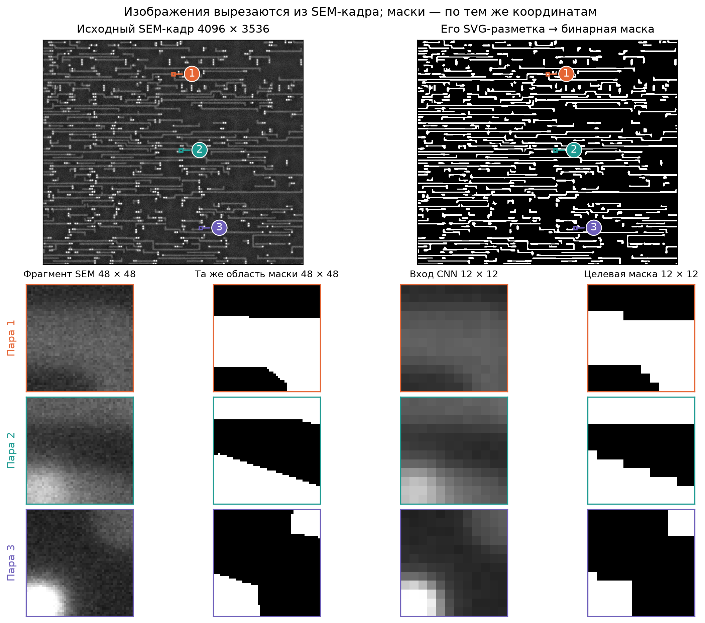
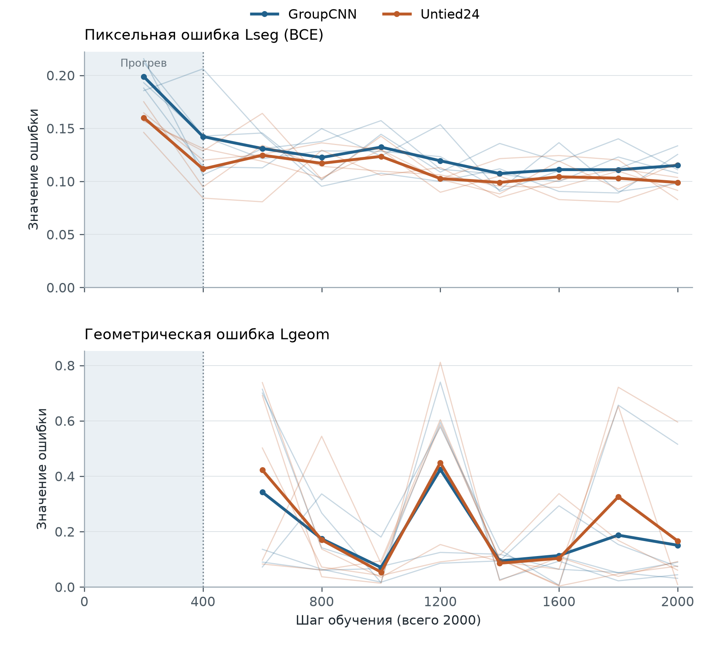

# Сегментация SEM-изображений и классификация геометрии металлизации

## Постановка задачи

По SEM-изображению участка металлизации интегральной схемы требуется восстановить маску металла и определить геометрическое состояние участка. Задача связана с восстановлением топологии по изображениям и контролем ошибок распознавания проводящих структур.

Небольшая ошибка сегментации может разорвать тонкую перемычку или создать ложное соединение между областями металла. Поэтому совпадение масок по площади дополняется оценкой геометрического класса.

Конвейер обработки:

SEM-фрагмент → CNN → вероятность металла → бинарная маска → геометрический класс.

Обучаемая часть метода - сегментационная CNN. Класс вычисляется из полученной маски фиксированным геометрическим алгоритмом.

## Данные и разметка

Используется открытый набор A Real-World Metal-Layer SEM Image Dataset with Partial Labels. Выбрана часть M2: второй слой металлизации одной интегральной схемы.

| Характеристика | Значение |
|---|---|
| Исходный объём M2 | 321 SEM-кадр и соответствующие SVG-разметки |
| Размер кадра | 4096 × 3536 пикселей |
| Дискретизация по описанию авторов | 14,65 нм/пиксель |
| Эталон сегментации | Бинарная маска металла из SVG-контуров |
| Нативный размер рабочего участка | 48 × 48 пикселей |
| Размер входа CNN | 12 × 12 пикселей |

Авторская разметка имеет частичный характер и получена с ручной проверкой автоматически выделенных структур. Готовых экспертных меток производственных дефектов в выбранной постановке нет.

## Геометрические классы

Для каждого направления - слева направо и сверху вниз - определяется одно из трёх состояний. Маска рассматривается как условная резисторная решётка; отклик нормируется на отклик полностью заполненного металлом квадрата.

| Состояние | Смысл |
|---|---|
| 0 | Между противоположными границами нет металлического пути |
| 1 | Путь есть, нормированный геометрический отклик меньше 0,5 |
| 2 | Нормированный геометрический отклик не меньше 0,5 |

Два трёхзначных состояния образуют девять классов: y = 3 × sLR + sTB. Эталонный класс вычисляется по авторской маске, предсказанный - по маске CNN. Эти метки описывают геометрию; сами по себе они не обозначают годность изделия, реальный обрыв или замыкание цепи.

<!-- pagebreak -->

## Подготовка изображений и масок

Каждому большому SEM-кадру соответствует разметка того же поля. SVG-контуры переводятся в пиксельную маску исходного размера: металл обозначается единицей, фон - нулём.

Изображение и маска обрабатываются согласованно. Из исходных кадров исключается краевая полоса 512 пикселей. Интенсивности усредняются блоками 4 × 4, а маска уменьшается по правилу большинства: пиксель считается металлом, если металл занимает не менее половины блока. Затем извлекаются окна 12 × 12 с шагом 6.

В нативном масштабе это соответствует окнам 48 × 48 со сдвигом 24 пикселя. Соседние окна перекрываются.

Из одной большой пары «кадр + маска» получается много маленьких пар. Изображения не генерируются из масок: каждый фрагмент изображения вырезается из исходного SEM, а его целевая маска - из той же области разметки.

На схеме показаны три участка одного кадра. У каждого участка совпадают координаты исходного изображения и маски. Вход 12 × 12 представляет усреднённый SEM-фрагмент; целевая маска 12 × 12 получена согласованным уменьшением разметки.

<!-- pagebreak -->

## Разбиение и контроль данных

Проведён EDA: проверены изображения и маски, распределения яркости и доли металла, геометрические состояния, баланс классов и разбиения. Обучение и исходная валидация разделены по кадрам: кадры 0-5 и 6-7 соответственно; валидация содержит 695 фрагментов.

Из пула исключаются однородные маски и точные повторы масок и интенсивностей с учётом поворотов и отражений. Истинные маски участвуют в фильтрации кандидатов; последующее хеш-ранжирование тестовых фрагментов не использует класс и предсказания модели.

В исходных данных соседние кадры частично перекрываются. Разбиение по кадрам и удаление точных повторов снижают риск утечки, но отсутствие всех почти совпадающих областей между кадрами без физической регистрации не установлено.

## Архитектурная гипотеза

При ограниченном плотном надзоре C4-связи весов CNN улучшают сегментацию металлизации и последующую классификацию её геометрических состояний относительно свободной CNN той же ширины и вычислительной стоимости при одинаковом обучении и процедуре калибровки.

В GroupCNN используются четыре ориентации фильтров: 0°, 90°, 180° и 270°. Шесть семейств признаков дают 24 фактических канала. Веса повёрнутых фильтров связаны между собой. При повороте изображения маска должна поворачиваться вместе с ним; числовой геометрический класс при этом может изменяться, поскольку направления LR и TB меняются местами.

## Работа слоёв CNN

Входные интенсивности нормируются как 5 × (X - 0,2). Первый слой применяет шесть обучаемых фильтров 3 × 3 в четырёх ориентациях. Повороты одного фильтра получаются из общих коэффициентов, поэтому четыре ориентации не обучаются независимо.

| Этап | Операция | Выход на один фрагмент |
|---|---|---|
| Вход | Полутоновое изображение после нормировки | 1 × 12 × 12 |
| Первый слой | Свёртка 3 × 3, шесть семейств и четыре ориентации | 24 × 12 × 12 |
| Второй слой | Групповая свёртка 3 × 3, dilation 2 | 24 × 12 × 12 |
| Третий слой | Групповая свёртка 3 × 3, dilation 4 | 24 × 12 × 12 |
| Объединение ориентаций | Среднее по четырём ориентациям каждого семейства | 6 × 12 × 12 |
| Выходной слой | Свёртка 1 × 1 | 1 × 12 × 12 |

В групповых слоях признаки объединяются с учётом относительной ориентации. При повороте входа ориентационные каналы переставляются согласованно, а пространственная карта поворачивается вместе с изображением. Повороты на 90° выполняются без интерполяции пикселей.

Dilation задаёт расстояние между элементами фильтра: ядро 3 × 3 при dilation 2 охватывает область 5 × 5, при dilation 4 - область 9 × 9. Это размеры области одного ядра соответствующего слоя. Размер карт сохраняется равным 12 × 12. После трёх основных свёрток используется GELU.

Усреднение ориентаций выполняется отдельно в каждой пространственной позиции и не превращает изображение в один общий вектор. Выходной слой формирует логит z для каждого пикселя. Сигмоида p = sigmoid(z) переводит его в вероятность металла; затем фиксированный порог даёт бинарную маску, по которой рассчитывается класс. Отдельного обучаемого выхода на девять классов нет.

При применении связанные фильтры один раз разворачиваются в обычные 24-канальные свёртки. Это один проход CNN, а не четыре независимых запуска для четырёх поворотов.

<!-- pagebreak -->

## Устройство функции потерь

При обучении используются два источника надзора: полная пиксельная маска для небольшой части примеров и геометрический класс для дополнительных изображений.

Пиксельная часть Lseg - бинарная кросс-энтропия BCE. Она сопоставляет логиты CNN с эталонной маской и штрафует ошибочные вероятности металла и фона. Геометрическая часть Lgeom передаёт в CNN информацию о состоянии проводящих путей. После прогрева общая ошибка имеет вид:

L = Lseg + λ × Lgeom, где λ = 1.

Lseg считается на примерах с полной маской, Lgeom - на других примерах со слабой классовой меткой. Это два минибатча одной итерации, а не требование полной маски для каждого изображения.

### Мягкая маска и условная резисторная решётка

Жёсткая бинаризация и проверка наличия пути неудобны для передачи градиента. Поэтому для геометрического лосса из логитов z строится мягкая карта q = sigmoid(4z). Множитель 4 делает переход между фоном и металлом более резким; значения q остаются непрерывными. Для устойчивости они ограничиваются диапазоном от 0,00001 до 0,99999.

Каждому пикселю соответствует узел четырёхсвязной решётки. Для соседних пикселей i и j проводимость ребра задаётся как w(i,j) = min(q_i, q_j). Если один из двух пикселей имеет малую вероятность металла, связь между ними получается слабой.

Для направления слева направо на противоположных границах задаются потенциалы 0 и 1. Решаются уравнения Кирхгофа, по току определяется отклик G. Он нормируется на отклик полного квадрата: g = G / (12/11). Для направления сверху вниз тот же расчёт выполняется на транспонированной карте.

### Как отклик сопоставляется с классовой меткой

Известное состояние s каждого направления переводится в два порядковых признака: s > 0 и s > 1. Поэтому состояние 0 даёт пару (0, 0), состояние 1 - (1, 0), состояние 2 - (1, 1).

Для этих двух признаков из отклика формируются логиты:

a1 = 4 × ln(g / g0); a2 = 40 × (g - 0,5), где g0 = 1/312 ≈ 0,003205.

Первый логит различает условное отсутствие пути и наличие связи, второй - две градации отклика. Геометрическая ошибка равна средней BCE с этими логитами и двумя целевыми признаками для обоих направлений и всего минибатча.

Значение g0 - положительная граница мягкой обучающей аппроксимации, а не физический норматив разрыва. Непрерывного эталонного сопротивления или проводимости в разметке нет: лосс использует только геометрический класс.

Градиент проходит от ошибки классовых признаков через расчёт отклика и мягкую маску к весам CNN. Малые линейные системы решаются на CPU в float64 с сохранением дифференцирования; CNN выполняется на MPS. При оценке используется отдельное жёсткое правило по бинарной маске, с обработкой отсутствующих путей и изолированных компонент.

<!-- pagebreak -->

## Проверки геометрического лосса

Сначала реализована непрерывная резисторная аппроксимация для передачи классового надзора в сегментатор. Расчёт проверен на простых масках: однородных решётках и горизонтальных полосах разной ширины, для которых известен ожидаемый отклик. Также проверены совпадение с исходной реализацией и прохождение конечных ненулевых градиентов до CNN. Эти проверки подтверждают корректность вычислений, но сами по себе не доказывают улучшения качества.

Затем выполнена абляция: обычная и групповая CNN обучались с одним BCE и с BCE + геометрическим надзором. На прежней валидации дополнительный надзор не повысил средний Macro-F1 GroupCNN: 84,42% при BCE против 83,75% при BCE + aux. Это средние по бюджетам 18/27 масок и трём инициализациям, а не показатели окончательного теста.

В отдельной проверке новых кадров режим BCE также не дал подтверждённого архитектурного преимущества. Поэтому общий вывод о пользе именно формулы геометрического лосса не делается. Режим aux дополнительно использует 1152 классовые метки: сравнение с одним BCE меняет и функцию потерь, и доступную обучающую информацию.

В окончательном архитектурном эксперименте геометрический лосс и классовые метки одинаковы у обеих сетей. Он служит общей основой обучения, а проверяемое изменение относится к связям весов внутри CNN. Сохранены начальные и конечные состояния и градиентные пробы для проверки реализации.

## Контрольная модель и обучение

Основной контроль Untied24 получается развёртыванием начальных весов GroupCNN в обычные свёртки. До обучения функции сетей совпадают с численной точностью. Затем коэффициенты Untied24 обучаются независимо, а в GroupCNN связи сохраняются.

| Свойство | GroupCNN | Untied24 |
|---|---:|---:|
| Фактическая ширина | 24 канала | 24 канала |
| Независимых параметров | 2671 | 10681 |
| MAC на фрагмент | 1 527 552 | 1 527 552 |
| Проходов CNN | 1 | 1 |

Основной бюджет обучения: 27 полных масок, по три на класс, и 1152 изображения со слабой классовой меткой. Дополнительно 512 классовых меток старых данных разработки используются для настройки порога. Слабые метки вычислены из имеющихся масок; стоимость их получения отдельно не измерялась.

Все сети обучаются с нуля: 400 шагов BCE на полных масках, затем 1600 шагов BCE с общим геометрическим лоссом на слабых метках. AdamW, скорость обучения 0,0005, weight decay 0,0001, минибатчи 8 + 8. Дополнительный лосс одинаков у сравниваемых архитектур.

Для каждого состояния сети выбирается один порог бинаризации из 81 значения 0,10-0,90 по Macro-F1 на одинаковых 512 калибровочных метках. Пороги фиксируются до итогового теста. Пиксельные маски и IoU не используются для выбора порога.

<!-- pagebreak -->

## Динамика обучения

Показаны все пять пар запусков окончательного сравнения: 5701, 5721, 5757, 5801 и 5821. В каждой паре обе модели используют одинаковый порядок минибатчей, 27 полных масок и 1152 слабые метки. Журнал содержит значения через каждые 200 шагов.

Серая область соответствует прогреву только с BCE. Геометрический лосс включён на шаге 401; его первая сохранённая точка - шаг 600. До включения геометрический лосс не вычислялся, поэтому нули вместо пропусков не добавлены.

Точки относятся к текущим обучающим минибатчам до обновления весов, а не ко всей выборке или среднему за эпоху. Их колебания отражают в том числе смену примеров. Валидационные метрики по ходу обучения не записывались; по этим кривым нельзя установить момент переобучения или доказать сходимость.

Средний BCE в первой и последней записанных точках изменился с 0,199 до 0,115 у GroupCNN и с 0,160 до 0,099 у Untied24. Более низкий обучающий BCE контроля не противоречит лучшему качеству GroupCNN на отложенных кадрах: основной вывод основан на тестовых AP, IoU и Macro-F1, а не на минимальном обучающем лоссе.

<!-- pagebreak -->

## Последовательность проверок

1. На 4096 фрагментах 16 новых кадров GroupCNN превзошла узкую обычную CNN с усреднением четырёх поворотов по Macro-F1 на 1,85 п.п. Отдельное требование сохранения качества более крупной CNN при меньших вычислениях статистически не подтвердилось.
2. Проверка обучения только с BCE не подтвердила универсальность преимущества: на других 24 кадрах разность с узким контролем составила -1,92 п.п. При общем пороге 0,5 преимущество перед Untied24 на прежней валидации также не сохранилось.
3. На 40 уже просмотренных кадрах отдельно исследованы AP и перенос порога между кадрами: пять циклов с 32 кадрами калибровки и восемью отложенными. Это этап разработки, а не новое независимое подтверждение.
4. После фиксации моделей и окончательных порогов проведён тест на других 24 новых кадрах, 6144 фрагмента, три инициализации. Затем добавлены две парные инициализации при прежних настройках.

## Результаты

В закрытом сравнении на 6144 фрагментах новых 24 кадров GroupCNN получила Macro-F1 76,29% против 73,35% у Untied24. Разность +2,94 п.п.; 97,5%-интервал разности [+1,35; +4,53] п.п. AP и IoU также выше. Веса и пороги были зафиксированы до загрузки этих кадров.

После добавления двух пар обучения получено пять инициализаций. Они оценены на тех же 24 кадрах: это репликация по инициализациям, а не новая тестовая выборка. Средние показатели отдельных запусков:

| Показатель | GroupCNN | Untied24 | Разность, п.п. |
|---|---:|---:|---:|
| Macro-F1 классификации, % | 75,95 | 73,20 | +2,75 |
| Покадровый AP сегментации, % | 98,348 | 97,895 | +0,453 |
| IoU сегментации, % | 86,88 | 85,83 | +1,047 |

Macro-F1 даёт девяти классам равные веса. AP оценивает ранжирование пикселей металла и фона без одного рабочего порога; IoU - совпадение бинарных масок. Среднее пяти запусков не является ансамблевым предсказанием.

| Инициализация | Разность Macro-F1, п.п. |
|---|---:|
| 5701 | +2,97 |
| 5721 | +3,71 |
| 5757 | +2,14 |
| 5801 | +2,01 |
| 5821 | +2,91 |

Все пять пар дали положительные разности трёх показателей. Две новые пары отдельно: +2,46 п.п. Macro-F1. Для пяти запусков описательный 97,5%-интервал разности F1 составляет [+1,60; +3,97] п.п.; AP - [+0,329; +0,576] п.п. Применены 10 000 парных пересэмплирований кадров и инициализаций с поправкой на два основных исхода.

<!-- pagebreak -->

## Анализ ошибок и вычислительная стоимость

По трём первоначальным запускам Group исправила 726 ответов контроля и ухудшила 434. Это суммы по 18 432 парам «фрагмент × запуск» с повторным использованием 6144 изображений. Средний F1 вырос во всех девяти классах, однако изменения отдельных типов геометрических ошибок неодинаковы.

Полный локальный конвейер на MPS и CPU занимает около 0,934 мс на одиночный фрагмент у обеих моделей. Время включает подготовку входа, CNN, переносы, бинаризацию и геометрическую классификацию; исходный фрагмент уже находится в памяти. Чтение PNG, загрузка весов и обработка целого кадра не включены. Ускорение относительно Untied24 не установлено.

## Вывод и границы применимости

В данной постановке C4-связи весов дали воспроизводимый прирост качества относительно свободной CNN24 при одинаковых ширине, MAC, обучающем надзоре и процедуре калибровки. Число независимых параметров уменьшено примерно в четыре раза.

Проверены новые кадры одной ИС и модельные геометрические классы из масок. Перенос между микросхемами и распознавание экспертно размеченных производственных дефектов не проверены. Вход 12 × 12 ограничивает представление тонких деталей. Узкая обычная CNN с четырьмя видами имеет более высокий AP, чем Group, поэтому превосходство над всеми контролями по всем метрикам не заявляется. C4-свёртки являются известной конструкцией.

## Источники

1. Rothaug et al. A Real-World Metal-Layer SEM Image Dataset with Partial Labels. https://doi.org/10.17617/3.HY5SYN
2. Towards Unsupervised SEM Image Segmentation for IC Layout Extraction. https://doi.org/10.1145/3605769.3624000
3. Cohen T., Welling M. Group Equivariant Convolutional Networks. ICML, 2016. https://proceedings.mlr.press/v48/cohenc16.html

