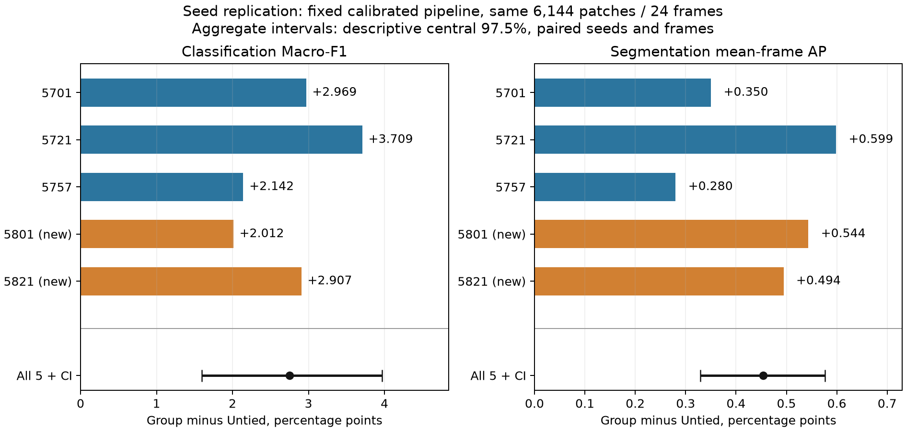
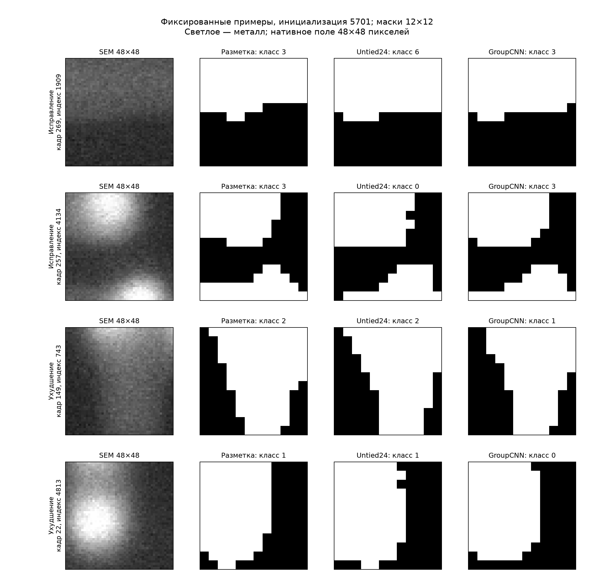

# Как рассказать научному руководителю о выполненной работе

Подготовлено 4 ноября 2026 года к встрече 5 ноября. Это материал для понимания и устного рассказа. Здесь описана последовательность работы над текущей моделью, включая проверки, которые ограничивают наши выводы. Основные результаты собраны в разделе 10; короткий вариант выступления — в разделе 1.

## 1. С чего начать разговор: короткий рассказ на две-три минуты

«Я работаю с SEM-изображениями слоя металлизации интегральной схемы. Задача состоит из двух связанных этапов: сначала нейросеть выделяет металл на изображении, затем по полученной маске определяется геометрическое состояние участка. Нас интересует, сохраняются ли соединения между областями металла и насколько правильно воспроизводится их геометрия.

Особенность задачи в том, что несколько ошибочных пикселей могут изменить соединение дорожек. Маска при этом остаётся в целом похожей на правильную, но итоговый геометрический класс уже получается неверным. Поэтому я оцениваю и сегментацию, и классификацию по её результату.

Для исследования взят открытый набор SEM-изображений с разметкой металлизации. Используется второй слой металлизации одной микросхемы. Я подготовил данные, провёл EDA, разделил изображения по исходным кадрам и проверил точные повторы. Основной эксперимент моделирует ограниченную плотную разметку: при обучении доступны 27 полных масок и 1152 дополнительных примера с классовой меткой.

Главное изменение внесено в архитектуру CNN. Использована групповая свёрточная сеть: фильтры для четырёх поворотов связаны общими весами. Для контроля построена обычная CNN той же ширины и с тем же числом операций. В начале обучения обе модели реализуют одинаковую функцию, затем у контрольной сети веса могут изменяться независимо.

После проверки калибровки я зафиксировал веса и пороги и провёл оценку на 6144 фрагментах 24 новых кадров. Затем добавил две инициализации, чтобы получить пять пар запусков. В среднем Macro-F1 вырос с 73,20 до 75,95%, то есть на 2,75 процентного пункта. Также улучшились AP и IoU сегментации. Прирост наблюдается во всех пяти парах запусков. Время обработки практически одинаковое.

Сейчас готовы код, веса, результаты, анализ ошибок и примеры. Основной вывод относится к классификации геометрических состояний металлизации одной ИС. Перенос на другие микросхемы и распознавание экспертно размеченных производственных дефектов пока не проверялись».

Дальше можно раскрывать каждый пункт по вопросам руководителя. Ниже — объяснение того, что стоит за этим рассказом.

## 2. Какую задачу мы действительно решаем и зачем она нужна

На изображении металлизации видны проводящие области и фон. Чтобы анализировать такую структуру, сначала нужно получить её цифровое представление: для каждого пикселя определить, относится ли он к металлу. Это сегментация.

Но одинаковая площадь ошибки может иметь разное значение. Представь две ситуации:

- сеть немного сдвинула край широкой металлической области;
- сеть удалила несколько пикселей тонкой перемычки и разорвала путь между двумя областями.

В обоих случаях число ошибочных пикселей может быть небольшим. Однако во втором случае изменяется связность распознанной структуры. Для анализа металлизации такая ошибка особенно существенна.

Поэтому наш конечный результат — не только картинка с выделенным металлом. После сегментации мы вычисляем геометрическое состояние фрагмента и проверяем, совпало ли оно с состоянием эталонной маски.

Общая схема:

```text
SEM-изображение участка
          ↓
CNN: вероятность металла для каждого пикселя
          ↓
Бинарная маска металлизации
          ↓
Фиксированное геометрическое правило
          ↓
Один из девяти геометрических классов
```

Связь с микроэлектроникой здесь прямая: мы обрабатываем реальные изображения слоя металлизации интегральной схемы и оцениваем сохранение её геометрии. Возможное применение — восстановление топологии по SEM и анализ геометрически значимых ошибок такого восстановления.

При этом наша проверка не измеряет выход годных изделий и не диагностирует электрический отказ конкретной цепи. Чтобы говорить именно об обрыве или замыкании изделия, нужна дополнительная информация: например, проектная топология, экспертная разметка дефектов или электрические измерения.

## 3. Что за датасет и какая в нём разметка

Использован открытый набор A Real-World Metal-Layer SEM Image Dataset with Partial Labels, связанный с работой Towards Unsupervised SEM Image Segmentation for IC Layout Extraction.

SEM — scanning electron microscopy, растровая электронная микроскопия. В нашем случае это полутоновые изображения поверхности слоя металлизации микросхемы после подготовки образца.

| Что важно | Что используется у нас |
|---|---|
| Объект | Одна физическая интегральная схема |
| Слой | M2, второй слой металлизации |
| Объём исходной части M2 | 321 SEM-кадр и соответствующие SVG-разметки |
| Размер кадра | 4096 × 3536 пикселей |
| Дискретизация по описанию авторов | 14,65 нм на пиксель |
| Разметка | Контуры структур в SVG, из которых строится бинарная маска металла |
| Лицензия | CC BY 4.0 |

SVG в данном случае — файл с контурами областей. Мы переводим эти контуры в пиксельную маску: металл обозначается единицей, фон — нулём. Это даёт эталон для оценки сегментации.

Исходная разметка имеет частичный характер. По описанию авторов, контуры получены автоматически с ручной проверкой и исправлением; отмечены возможные повторные контуры контактов и неполнота разметки дорожек, пересекающих несколько кадров. Поэтому под эталоном здесь понимается предоставленная авторская разметка, со своими ограничениями.

Следовательно, разметка в исходных данных есть. Но это разметка металлизации, а не готовые метки вроде «царапина», «загрязнение», «обрыв» или «замыкание». Девять классов нашей задачи мы дополнительно вычисляем из этих масок.

Важно различать два масштаба данных: 321 кадр — весь доступный исходный M2-набор; это не означает, что все 321 кадр использованы для обучения. Мы работаем с фиксированными подвыборками, а новые кадры выделяем для отдельных проверок.

Набор показывает участки металлизации микросхемы, а не обзорные снимки целой кремниевой пластины. При обсуждении названия ВКР стоит согласовать эту конкретизацию: текущая экспериментальная часть посвящена локальной геометрии металлизации ИС.

Источники: [датасет](https://doi.org/10.17617/3.HY5SYN), [статья авторов](https://doi.org/10.1145/3605769.3624000), [авторский репозиторий](https://github.com/emsec/unsupervised-ic-sem-segmentation).

## 4. С чего начали: EDA и подготовка данных

Сначала провели разведочный анализ данных — EDA. Его задача была понять, с чем работает модель, как устроены маски и какие свойства данных необходимо учитывать в эксперименте.

В [ноутбуке EDA](EDA_IC_SEM_M2.ipynb) проверены размеры и типы данных, примеры изображений с масками, распределения яркости и доли металла, геометрические классы, баланс классов, разбиения и повторы. Рабочая подвыборка этого EDA содержит 15 105 фрагментов из 16 кадров. Она предшествует последующим расширенным проверкам и не равна последней тестовой выборке.

Главные выводы анализа:

1. Классы распределены неравномерно. Поэтому общей доли правильных ответов недостаточно: нужны метрика с равным весом классов и отдельный разбор редких состояний.
2. Соседние фрагменты одного кадра похожи и могут перекрываться. Их нельзя бездумно перемешать между обучением и тестом.
3. Яркости недостаточно для определения класса: важны расположение металла, перемычки и пути между границами.
4. Уменьшение изображения может менять тонкие геометрические детали. Поэтому качество нужно оценивать и по площади маски, и по её геометрическому состоянию.

### Как получили вход модели

В исходных кадрах использована фиксированная предобработка: убрана краевая полоса шириной 512 нативных пикселей, затем изображение уменьшено в четыре раза по каждой координате.

Для входа усредняются блоки 4×4. Поэтому один фрагмент модели размером 12×12 соответствует исходному участку 48×48 пикселей. Для целевой маски используется правило большинства: если металл занимает не менее половины блока, уменьшенный пиксель считается металлом.

Затем извлекаются фрагменты 12×12 с шагом 6. Фрагменты могут перекрываться. Перед CNN интенсивности приводятся к фиксированному масштабу: `5 × (X − 0,2)`, где `X` находится в диапазоне от 0 до 1.

Размер 12×12 — упрощение для небольшого воспроизводимого эксперимента. Мы не доказали, что это оптимальное разрешение или что на нём сохраняется вся исходная геометрия.

### Как разделяли данные и контролировали повторы

Первичное обучение использует кадры 0–5, прежняя валидация — кадры 6–7. Валидация содержит 695 фрагментов. Впоследствии для проверок выбирались другие ID кадров.

Удалялись точные повторы исходных интенсивностей и масок с учётом поворотов и отражений. Это называют D4-дедупликацией: сравниваются восемь вариантов ориентации, чтобы повёрнутая копия не считалась новым уникальным примером.

Из пула также исключались полностью однородные маски: только фон или только металл. Следовательно, проверка относится к отфильтрованным фрагментам со структурой, а не ко всем возможным участкам кадра.

Здесь нужна точная оговорка: истинные маски участвовали в фильтрации кандидатов. Уже после неё выбор тестовых фрагментов выполнялся воспроизводимым хеш-ранжированием без учёта класса и предсказаний сети.

В исходном наборе соседние кадры имеют перекрытие около 10%. Разбиение по кадрам и удаление точных повторов снижают риск утечки, но мы не выполняли независимую физическую регистрацию всех полей съёмки. Поэтому не утверждаем, что исключена любая похожая область между кадрами.

## 5. Откуда берутся девять классов

Берём бинарную маску металла и рассматриваем два направления: слева направо, LR, и сверху вниз, TB.

Для каждого направления определяем три состояния:

| Состояние | Простое объяснение |
|---|---|
| 0 | Между противоположными границами нет металлического пути |
| 1 | Путь есть, относительный геометрический отклик меньше 0,5 |
| 2 | Путь есть, относительный геометрический отклик не меньше 0,5 |

Что означает «геометрический отклик»? Маску представляем как условную резисторную решётку. Соседние металлические пиксели соединены рёбрами; на противоположных границах задаётся условная разность потенциалов. По этой решётке рассчитывается отклик, который нормируется на отклик полностью заполненного металлом квадрата.

Так получаем характеристику всей геометрии пути. На неё влияет не только наличие соединения, но и устройство проводящих областей. Называть её просто шириной дорожки было бы неточно.

Три состояния по горизонтали и три по вертикали дают девять сочетаний:

`класс = 3 × состояние_LR + состояние_TB`.

Например:

- класс 0 — `(0, 0)`, пути нет в обоих направлениях;
- класс 3 — `(1, 0)`, по горизонтали путь с малым откликом есть, по вертикали пути нет;
- класс 8 — `(2, 2)`, в обоих направлениях отклик не ниже заданной границы.

Это удобная проверяемая классификация геометрии. Сам по себе класс 0 не означает дефект: в конкретном фрагменте по проекту может вообще не требоваться путь между его границами. Так же класс 2 не означает автоматически «годное изделие».

Порог 0,5 — установленная граница модельного класса. Это не производственный норматив сопротивления. В расчёте нет измеренных толщины металла, удельного сопротивления и реальных контактов конкретной цепи, поэтому результат не выражается в омах или сименсах.

Эталонный класс вычисляем по авторской маске. Предсказанный — по маске CNN. Их сравнение показывает, насколько хорошо восстановлена выбранная геометрическая характеристика по изображению.

## 6. В чём текущая гипотеза и что изменили в CNN

Основная проверяемая идея такая:

> При ограниченном плотном надзоре C4-связи между весами CNN позволяют точнее восстанавливать геометрические состояния металлизации и маску металла, чем свободная CNN той же ширины и вычислительной стоимости, при одинаковом обучении и процедуре калибровки.

Это гипотеза об архитектурном ограничении весов. Обоснование идеи: в металлизации встречаются похожие локальные структуры в разных ориентациях, поэтому можно связать обработку их повёрнутых вариантов вместо независимого обучения всех фильтров.

### Что такое C4 простыми словами

C4 — четыре поворота: 0°, 90°, 180° и 270°.

Обычная сеть может отдельно выучить фильтр для горизонтального элемента и отдельно — для похожего вертикального элемента. В групповой сети эти варианты связаны: один обучаемый шаблон используется в разных ориентациях. Это уменьшает число независимо настраиваемых коэффициентов и задаёт структуру обработки поворотов.

В нашей сети шесть базовых семейств признаков, каждое с четырьмя ориентациями. Поэтому фактически получаются 24 канала: `6 × 4`.

Связи организованы не только в первом слое, но и в следующих групповых свёртках: учитывается относительная ориентация входных и выходных признаков.

### Что означает эквивариантность

Если повернуть изображение, ожидается, что маска повернётся вместе с ним. Именно это свойство нужно сегментации.

Конечный числовой класс при повороте не обязан оставаться прежним: горизонтальное и вертикальное направления меняются местами. Например, путь по горизонтали может превратиться в путь по вертикали. Поэтому мы сохраняем геометрию маски, а класс вычисляем с учётом её новых направлений.

### Как выглядит модель

```text
Вход 12×12, один полутоновый канал
    ↓
Первая свёртка 3×3: 6 семейств × 4 ориентации
    ↓
Групповая свёртка 3×3, dilation = 2
    ↓
Групповая свёртка 3×3, dilation = 4
    ↓
Среднее по четырём ориентациям признаков
    ↓
Выходная свёртка 1×1
    ↓
Карта вероятности металла размером 12×12
```

После первых трёх свёрток используется нелинейность GELU. Dilation, или расширение свёртки, позволяет учитывать более далёкие пиксели, расставляя элементы фильтра с промежутками. Размер карты при этом сохраняется. Это компактная CNN без уменьшения размера карт внутри сети.

Усреднение по ориентациям не означает усреднение всех пространственных пикселей: маска остаётся двумерной и сохраняет положение структур.

Отдельной обучаемой головы на девять классов в итоговом варианте нет. Обучаемая часть — сегментатор; последующая классификация выполняется фиксированным геометрическим алгоритмом.

Групповые свёртки — известная конструкция. Вклад нашей работы состоит в реализации и контролируемой проверке такой архитектуры в конкретной SEM-постановке. Представлять сам оператор C4 как изобретённый нами нельзя.

## 7. С чем сравнивали и как обучали

### Зачем нужен специальный контроль Untied24

Если просто взять две случайные сети разных размеров, трудно понять, чем вызвана разница: архитектурой, числом операций, начальным состоянием или режимом обучения.

Поэтому для основного сравнения использован строгий контроль:

1. Создаём начальную GroupCNN.
2. Разворачиваем её связанные фильтры в обычные 24-канальные свёртки.
3. Получаем обычную CNN, которая до обучения выдаёт практически тот же ответ.
4. В GroupCNN сохраняем связи весов; у обычной CNN разрешаем каждому коэффициенту меняться независимо.
5. Обучаем обе сети на одинаковых данных, с одинаковыми настройками и парными последовательностями минибатчей.

Эту свободную контрольную сеть называем Untied24: «untied» означает, что связи между коэффициентами сняты.

| Свойство | GroupCNN | Untied24 |
|---|---:|---:|
| Фактическая ширина внутренних карт | 24 канала | 24 канала |
| Независимых обучаемых параметров | 2671 | 10681 |
| MAC на фрагмент | 1 527 552 | 1 527 552 |
| Проходов CNN при применении | 1 | 1 |
| Начальная функция в паре | Совпадает с контролем | Совпадает с Group |

MAC — операция умножения с накоплением; это ориентир вычислительного объёма. Здесь мы специально сравниваем модели с одинаковым числом таких операций.

У Group меньше независимых параметров примерно в четыре раза. При исполнении связанные коэффициенты разворачиваются в обычные свёртки, поэтому число хранимых коэффициентов развёрнутой сети и число операций остаются такими же, как у Untied24. Меньшее число свободных параметров само по себе не обещает ускорения.

В этом сравнении одновременно меняются связи между весами, число независимых параметров и пространство возможных решений оптимизатора. Мы проверяем эффект всей этой архитектурной конструкции и не приписываем выигрыш отдельному из этих факторов без дополнительного опыта.

### Какие ещё контроли были в текущей серии

Использовалась узкая Plain12 C4: обычная CNN с 12 каналами, для которой усредняются предсказания четырёх повёрнутых входов после обратного совмещения. Её число свободных параметров и суммарный MAC близки к GroupCNN. Также проверялась более крупная Plain24 C4 с четырьмя видами.

Это позволяет различать два подхода: учитывать повороты внутри устройства сети или обрабатывать четыре поворота обычной CNN и объединять ответы.

### Что было доступно при обучении

В исходном обучающем пуле есть 54 полные маски. Основной финальный режим использует 27 из них, по три фрагмента на класс. Ранние архитектурные сравнения дополнительно рассматривали бюджет 18 масок, по две на класс.

Кроме того, используются 1152 обучающих изображения с классовыми метками. Для них при оптимизации не передаётся пиксельная маска. Это слабый надзор: мы сообщаем сети геометрическое состояние участка, но не указываем правильный ответ для каждого его пикселя.

Важная граница эксперимента: эти слабые классы были заранее вычислены из доступных масок. Мы моделируем ограничение информации, передаваемой при обучении; реальную экономию труда разметчика этим не измеряем.

### Как работает обучение

Для каждого состояния модели выполняется 2000 обновлений AdamW:

- первые 400 шагов — только пиксельная ошибка BCE на примерах с полной маской;
- следующие 1600 — та же пиксельная ошибка плюс общий вспомогательный геометрический лосс на примерах с классовой меткой.

BCE — бинарная кросс-энтропия. Простыми словами, она штрафует сеть, если та даёт низкую вероятность металла на металлическом пикселе или высокую — на фоне.

Геометрический компонент оценивает, согласуется ли мягкая маска сети с известным геометрическим состоянием. Для обучения используется непрерывная версия условной резисторной модели, через которую можно передать градиент в CNN. Она нужна потому, что жёсткое определение наличия пути в бинарной маске не даёт удобного обычного градиента.

Для второй части обучения схематически:

`общая ошибка = BCE сегментации + геометрическая ошибка`.

Вес дополнительного слагаемого равен 1. В минибатче восемь примеров с полной маской и восемь — со слабой меткой. Скорость обучения — 0,0005, weight decay — 0,0001. Все сети обучались с нуля.

2000 шагов — это 2000 обновлений параметров, а не 2000 полных проходов по датасету. Небольшие обучающие наборы многократно используются при формировании минибатчей.

Главное для сравнения: при основном архитектурном опыте обе сети получают одинаковый вспомогательный лосс и одинаковые метки. Мы не приписываем разницу архитектуре, одновременно поменяв ей обучение относительно контроля.

CNN обучалась на Mac через MPS. Небольшие линейные системы геометрического компонента решались на CPU с двойной точностью; автоматическая скрытая подмена MPS на CPU была отключена.

## 8. Как оцениваем качество и зачем нужен порог

### Macro-F1: правильно ли определено геометрическое состояние

Для каждого из девяти классов считаем F1 — показатель, учитывающий одновременно пропуски этого класса и ошибочное отнесение других примеров к нему. Затем берём среднее девяти F1 с одинаковыми весами.

Это важно при дисбалансе: самый частый класс не должен полностью определять итоговый показатель. В окончательном тесте у класса 0 было 2605 примеров, а у класса 7 — только 79.

Macro-F1 75,95% не означает, что ровно 75,95% всех ответов правильные. Это другая метрика, не обычная accuracy.

### IoU: насколько совпала бинарная маска

IoU — площадь пересечения предсказанного и эталонного металла, делённая на площадь их объединения. Если маски совпадают, IoU равна 1. В наших итоговых таблицах усредняются IoU отдельных фрагментов.

Она оценивает пространственное совпадение масок после бинаризации. Но небольшая ошибка перемычки может слабо изменить IoU и сильно изменить конечный класс.

### AP: насколько хорошо разделяются пиксели металла и фона

AP, average precision, оценивает качество ранжирования пикселей по вероятности металла при рассмотрении разных порогов. Она не зависит от одного выбранного рабочего порога.

Мы считаем AP по пикселям выбранных фрагментов каждого кадра, затем усредняем по кадрам и отдельным запускам. Это AP сегментации металла, а не AP девяти геометрических классов.

Поэтому AP около 98% и Macro-F1 около 76% не противоречат друг другу: они отвечают на разные вопросы. Пиксели в целом можно хорошо разделять, но часть тонких соединений и редких геометрических состояний всё равно определять неправильно.

### Что такое калибровка порога у нас

CNN выдаёт вероятности, а геометрическому правилу нужна бинарная маска. Значит, нужен порог: например, при пороге 0,4 пиксель становится металлом, если его вероятность не меньше 0,4.

Это порог бинаризации, а не температура softmax и не дополнительное обучение CNN.

Мы выбираем по одному порогу для каждого обученного состояния модели по одинаковым 512 классовым меткам старых данных разработки. Проверяются 81 значение от 0,10 до 0,90. Выбирается максимум Macro-F1; при равенстве — ближайший к 0,5, затем меньший.

Для этого достаточно классовых меток: при каждом пороге получаем маску, вычисляем её класс и сравниваем с эталонным классом. Пиксельные эталоны и IoU для выбора порога не используются.

Порог фиксируется до окончательного теста. Подбирать его по ответам тестовой выборки нельзя: тогда мы настраивали бы метод на данных, по которым затем отчитываемся.

Итак, в основном режиме есть три разных вида данных, и их нужно называть отдельно:

| Назначение | Объём |
|---|---:|
| Плотный надзор при обучении CNN | 27 масок |
| Дополнительный классовый надзор при обучении CNN | 1152 метки |
| Окончательная настройка порога без изменения весов | 512 классовых меток |

Фраза «мы использовали только 27 размеченных примеров» была бы неверной.

## 9. В какой последовательности проходили эксперименты

Ниже описаны проверки текущего архитектурного направления. Их смысл — последовательно проверить полезность модели, роль обучения, зависимость от порога и устойчивость результата.

### Шаг 1. Сравнили групповую сеть с обычными CNN, учитывающими повороты

Сначала проверили GroupCNN и обычные сети с усреднением четырёх поворотов. Рассматривались бюджеты 18 и 27 полных масок и три инициализации.

После разработки зафиксировали модели и проверили их на 4096 фрагментах 16 новых кадров. Против узкой Plain12 C4 получили:

- GroupCNN: Macro-F1 75,90%;
- Plain12 C4: 74,04%;
- прирост: +1,85 процентного пункта.

Интервал разности был положительным. Это поддержало полезность архитектуры относительно контроля с близкими параметрами и вычислениями.

Отдельная цель — сохранить качество более крупной Plain24 C4 при меньших вычислениях — статистически не подтвердилась. Средняя разность была положительной, но интервал неопределённости оказался слишком широким для установленного требования. Поэтому такое преимущество не заявляем.

### Шаг 2. Проверили, как результат связан с режимом обучения

Чтобы не смешивать архитектуру и вспомогательный надзор, рассмотрели четыре сочетания: обычная/групповая CNN и BCE/BCE с дополнительным геометрическим обучением.

На прежней валидации архитектурная разность была положительной и при одном BCE: около +1,19 п.п. Macro-F1. Однако проверка на других 24 новых кадрах, 6144 фрагмента, это преимущество не подтвердила:

- GroupCNN с BCE: 71,08%;
- Plain12 C4 с BCE: 73,00%;
- разность: −1,92 п.п.

Этот отрицательный результат важен: мы не можем утверждать, что C4-архитектура выигрывает в любом режиме обучения. Основным оставили проверяемый режим с общим дополнительным надзором. При этом сравнение BCE и BCE+aux меняет не только формулу ошибки, но и доступ к 1152 дополнительным меткам; это не чистый опыт о форме лосса при равной информации.

### Шаг 3. Построили контроль с той же начальной функцией и вычислениями

Затем ввели Untied24, чтобы сравнение было точнее: одинаковые начальный ответ, ширина, число операций и один проход сети; различаются связи весов.

На прежней валидации GroupCNN имела преимущество при выбранных порогах. Но при общем пороге 0,5 преимущество F1 не сохранилось: разность была около −2,61 п.п. Дополнительное условие устойчивости этой постановки не прошло.

Это указало, что нужно отдельно исследовать калибровку, а также проверить вероятности метрикой, не зависящей от выбранного порога. Такой промежуточный исход не был объявлен успешным закрытым подтверждением.

### Шаг 4. Отдельно проверили AP и перенос порога между кадрами

Использовали 40 уже просмотренных кадров: 16 из первой проверки и 24 из BCE-проверки. Теперь они явно считаются данными разработки, DEV.

Разделили их на пять групп. В каждом цикле на 32 кадрах выбирали порог по 512 классовым меткам, а на восьми других оценивали результат. Затем меняли отложенную группу. Веса CNN не изменялись.

Group относительно Untied24 получила:

- +0,413 п.п. покадрового AP;
- +1,55 п.п. Macro-F1 по отложенным предсказаниям;
- +1,04 п.п. IoU.

Положительная разность F1 наблюдалась во всех пяти циклах. Это дало основание перейти к отдельному тесту новой фиксированной процедуры.

Важно: пять циклов не являются пятью независимыми датасетами. Данные ранее просматривались, а калибровочные части пересекаются. Этот этап был разработкой, а не новым закрытым подтверждением.

### Шаг 5. Зафиксировали окончательную калибровку и проверили новые кадры

По заранее определённому правилу выбрали 32 из 40 старых DEV-кадров и 16 фрагментов на каждом: всего 512 классовых меток. Для каждой модели выбрали один порог.

Затем зафиксировали веса, пороги, код, план кадров и условия успешного результата. Только после этого загрузили другие 24 кадра. Они отличаются от 24 кадров BCE-проверки.

В окончательную оценку вошли 6144 фрагмента, по 256 с каждого кадра. Использовали три парные инициализации.

Основной критерий требовал одновременно положительного эффекта по Macro-F1 классификации и AP сегментации, положительных нижних границ интервалов и соблюдения дополнительных ограничений по IoU и отдельным запускам. Наблюдаемый средний прирост F1 должен был быть не менее 0,5 п.п.

Результат:

- Macro-F1: 76,29% у Group против 73,35% у Untied24;
- разность Macro-F1: +2,94 п.п.;
- интервал разности F1: от +1,35 до +4,53 п.п.;
- AP выше на +0,410 п.п.;
- IoU выше на +0,983 п.п.

Все условия основной проверки прошли. Это наше закрытое подтверждение на новых кадрах одной ИС.

### Шаг 6. Добавили ещё две инициализации

Чтобы проверить, не обусловлен ли результат удачным начальным состоянием сети, выполнили четыре дополнительных обучения: две новые инициализации для Group и две парные для Untied24.

Настройки, обучающие данные и правило калибровки оставили прежними. Каждому новому состоянию выбрали порог по тем же 512 калибровочным меткам. Все новые запуски учтены, без выбора лучших.

Две новые пары отдельно дали +2,46 п.п. Macro-F1 в пользу Group. В итоге получили пять пар запусков, по которым и приводим нынешнюю сводку.

Тестовые кадры в этом повторении те же, что на шаге 5. Поэтому это проверка устойчивости к инициализации, а не ещё одна новая тестовая выборка.

## 10. Основные результаты, которые нужно запомнить

| Показатель, среднее пяти отдельных запусков | GroupCNN | Untied24 | Разность |
|---|---:|---:|---:|
| Macro-F1 классификации | 75,95% | 73,20% | +2,75 п.п. |
| Покадровый AP сегментации | 98,348% | 97,895% | +0,453 п.п. |
| IoU сегментации | 86,88% | 85,83% | +1,047 п.п. |

Для устного рассказа достаточно уверенно помнить первую строку. Остальные показывают, что выигрыш классификации сопровождается улучшением сегментации относительно основного контроля.

По всем пяти парам прирост положительный:

| Инициализация | Прирост Macro-F1 Group относительно Untied24 |
|---|---:|
| 5701 | +2,97 п.п. |
| 5721 | +3,71 п.п. |
| 5757 | +2,14 п.п. |
| 5801, новая | +2,01 п.п. |
| 5821, новая | +2,91 п.п. |

Это пять отдельно обученных сетей каждого типа. На одном изображении мы не усредняем ответы пяти моделей. В таблице усредняются показатели пяти независимых запусков обучения.



### Что означает интервал и как его получили

Для сводки пяти запусков описательный 97,5%-интервал разности Macro-F1 составляет от +1,60 до +3,97 п.п. Для AP — от +0,329 до +0,576 п.п.

Использовали 10 000 повторных пересэмплирований с возвращением: повторно выбирали исходные кадры и инициализации, каждый раз сравнивая сети на одинаково выбранных данных. Это bootstrap.

Мы пересэмплируем кадры, а не выдаём каждый пиксель за независимый эксперимент: фрагменты внутри кадра связаны. Для двух основных показателей применена поправка: отдельные интервалы взяты строже обычных 95%-х.

Положительная нижняя граница поддерживает наличие положительной разности в этой схеме оценки. Она не даёт гарантии для любой микросхемы. Интервалы приближённые; кадров 24, инициализаций пять, а физическая ИС одна.

Прирост +2,75 п.п. — абсолютная разность метрик. Это не утверждение о сокращении числа ошибок ровно на 2,75% и не изменение выхода годных.

### С чем нельзя смешивать главный результат

В финальной трёхзапусковой проверке узкая Plain12 C4 имела AP выше Group: примерно 98,546% против 98,351%. При этом её Macro-F1 и IoU были ниже. Поэтому мы не утверждаем, что Group лучше всех сравниваемых сетей по каждой метрике.

При общем пороге 0,5 средняя F1-разность пяти пар тоже положительна, около +1,01 п.п. Но одна прежняя пара имеет отрицательную разность. Наш главный результат относится к одинаковой заранее фиксируемой процедуре калибровки, а не к любому возможному порогу.

## 11. Что показали разбор ошибок и замер скорости

### Разбор ошибок

Для трёх первоначальных запусков разобрали каждый класс и парные ответы сетей. Средний F1 Group оказался выше во всех девяти классах. Но это не означает, что улучшен каждый отдельный фрагмент.

В сумме по трём запускам:

- в 726 случаях Group исправила ответ, в котором Untied ошиблась;
- в 434 случаях произошла обратная ситуация;
- в остальных случаях модели либо обе были правы, либо обе ошиблись.

Это подсчёт по 18 432 парам «фрагмент × запуск»: одни и те же 6144 изображения оцениваются три раза. Нельзя называть эти числа количеством независимых новых изображений.

Отдельно посчитали геометрические ошибки: ложное появление пути, пропуск существующего пути и путаницу двух градаций отклика. Изменения неодинаковы: у Group меньше горизонтальных пропусков и вертикальных ложных соединений, но немного больше ошибок противоположных категорий. Это помогает описать характер результата, но само по себе не доказывает причину архитектурного выигрыша.

Подготовили восемь воспроизводимо выбранных примеров: улучшения, ухудшения, общие ошибки и общие правильные ответы. На каждом показаны исходный SEM-фрагмент, эталонная маска и маски обеих сетей. Удачные примеры не отбирались вручную по максимальному эффекту.



На такой иллюстрации удобно объяснять руководителю, как небольшая разница масок меняет геометрический класс. Сеть при этом получает усреднённый вход 12×12, хотя для просмотра показан нативный участок 48×48.

### Время обработки

Измерили весь локальный конвейер: подготовка фрагмента, перенос на MPS, CNN, возврат вероятностей на CPU, бинаризация и геометрическая классификация.

| Режим, без заранее сохранённого класса маски | GroupCNN | Untied24 |
|---|---:|---:|
| Медиана запроса из одного фрагмента | 0,9341 мс | 0,9344 мс |
| Медиана запроса из 16 фрагментов | 2,5776 мс | 2,5830 мс |

Скорости практически одинаковы. Уменьшение числа независимых параметров не привело к ускорению: вычислительные структуры после развёртывания одинаковые.

Входной нативный фрагмент уже находится в оперативной памяти. Чтение PNG, загрузка весов, обработка и склейка целого кадра не включены. Поэтому нельзя переводить 0,934 мс в заявление о времени контроля целой пластины.

## 12. Что именно можно считать результатом работы

На данный момент реализован и проверен конвейер «SEM → сегментация металла → классификация геометрического состояния». В его обучаемой части исследована компактная групповая CNN с внутренними C4-связями весов.

Относительно свободной CNN24 с такой же начальной функцией, шириной, вычислительной стоимостью и общим обучающим надзором получен воспроизводимый прирост качества в выбранной постановке. Он подтверждён отдельным опытом на новых кадрах и повторением обучения до пяти инициализаций.

Для ВКР это даёт содержательный набор результатов: постановку, анализ данных, реализацию модели, контролируемое сравнение, проверку влияния компонентов, оценку устойчивости и разбор ошибок.

Веса, код, пороги, предсказания и результаты сохранены. Независимые проверочные скрипты воспроизвели расчёты; последняя проверка репликации прошла 77 из 77 условий. Это подтверждает согласованность реализации и чисел, но не заменяет оценку научной значимости руководителем.

Границы вывода:

- исследован один слой одной ИС;
- вход небольшой, 12×12 после уменьшения;
- классы получены геометрическим правилом из масок;
- реальная экономия разметки и производственный эффект не измерены;
- перенос между микросхемами не проверен;
- известный оператор групповой свёртки не объявляется новым изобретением.

## 13. Вероятные вопросы руководителя и понятные ответы

### «Это всё-таки сегментация или классификация?»

Вся задача включает оба этапа. CNN выделяет металл. По её маске фиксированный алгоритм определяет один из девяти геометрических классов. Классификационное качество измеряем отдельно, но обучаемой головы на девять классов в итоговой сети нет.

### «Что именно вы поменяли в модели?»

Свёрточный экстрактор: использовали четыре ориентации признаков и связи между повёрнутыми фильтрами. Это изменяет допустимые веса сети и снижает число независимых параметров. При основном сравнении лосс и доступная разметка одинаковы.

### «В исходном датасете нет классов. Как тогда проверяется классификация?»

В нём есть маски металла. Из эталонной маски заранее вычисляем класс по фиксированному геометрическому правилу. Из предсказанной маски вычисляем класс тем же правилом и сравниваем. Это проверка восстановления модельного геометрического состояния по изображению.

### «Почему такой маленький набор — только 27 масок?»

Мы исследуем режим ограниченного плотного надзора и роль архитектурного ограничения в нём. 27 — число полных масок, используемых в обучающей ошибке. Ещё есть 1152 слабые обучающие метки и 512 меток для калибровки. Это не попытка обучить максимально сильную модель на всех доступных данных.

### «Слабые метки действительно дешевле?»

В текущем опыте стоимость их получения не измерена. Метки вычислены из доступных масок, а ограничение задаётся тем, какую информацию получает оптимизатор. Это эксперимент с ограниченным плотным надзором, а не доказанная экономия производственной разметки.

### «Почему нельзя просто взять порог 0,5?»

Можно и мы это проверяли. Но небольшой сдвиг вероятностей влияет на тонкие связи и конечный класс, поэтому общий порог не одинаково удачен для всех состояний моделей. Основной протокол разрешает каждой сети один порог, выбранный по одинаковым старым калибровочным данным и зафиксированный до теста.

### «Вы подогнали порог по тесту?»

В закрытом опыте пороги выбраны до загрузки новых кадров по 512 меткам старых DEV-данных. На окончательном тесте они не менялись. Две дополнительные инициализации используют те же калибровочные примеры, а их оценка на прежних тестовых кадрах обозначена как репликация, а не новый закрытый опыт.

### «Если AP 98%, почему F1 только 76%?»

AP измеряет разделение пикселей металла и фона. Macro-F1 измеряет девять состояний всей маски. Ошибка небольшой перемычки может почти не изменить общую пиксельную картину, но перевести фрагмент в другой класс. Кроме того, Macro-F1 даёт редким классам такой же вес, как частым.

### «Почему исходная валидация давала около 84%, а итоговый тест — около 76%?»

Это разные наборы кадров и разные этапы оценки. Прежняя валидация многократно использовалась в разработке, поэтому её абсолютные оценки нельзя считать независимым подтверждением. Основной вывод делается по парному сравнению моделей на одних и тех же окончательных тестовых кадрах.

### «В чём польза меньшего числа параметров, если сеть не быстрее?»

Здесь это ограничение сложности обучаемой модели и способ задать симметрию при небольшом числе масок. Мы показали качество при одинаковых вычислениях. Ускорения не заявляем; размер развёрнутых весов тоже нельзя автоматически считать в четыре раза меньшим.

### «Это новые виды свёрток?»

Нет, использована известная C4-конструкция. В работе реализовано и исследовано её применение к выбранной задаче, с контролем вычислений, начального состояния, надзора и калибровки. Так и следует формулировать вклад бакалаврской ВКР.

### «Это настоящие дефекты кремниевой пластины?»

Это реальные SEM-изображения металлизации микросхемы, а наши метки описывают геометрические состояния её фрагментов. Чтобы перейти к утверждению о производственных дефектах, потребуется независимая разметка или проектный эталон. Конкретизацию темы и терминологии стоит согласовать.

### «На чём работает метод?»

Эксперименты выполнены на Mac с MPS для CNN и CPU для геометрических расчётов. CUDA не является обязательным условием. Веса и код сохранены, а после очистки репозитория проверено выполнение текущих зависимостей и CPU-инференс всех десяти основных состояний сети.

### «Что делать дальше?»

Зафиксировать проверенную модель и оформить ВКР: постановку задачи, EDA, устройство CNN, условия сравнений, результаты, отрицательные проверки и ограничения. На встрече нужно согласовать название и предметные формулировки с тем, что уже реально проверено.

## 14. Что полезно согласовать именно на этой встрече

Первое — конкретную формулировку темы и цели: насколько явно указать металлизацию ИС и классификацию геометрических состояний через сегментацию. Это поможет избежать ожидания готовой системы распознавания всех видов дефектов пластины.

Второе — формулировку вклада: работа прежде всего исследует архитектуру CNN, а геометрический лосс служит общим вспомогательным компонентом проверяемого режима.

Третье — структуру экспериментальной главы: основное сравнение с Untied24, дополнительные контроли, калибровка, новые тестовые кадры и повторения по инициализациям.

Если в прежних слайдах осталась задача выбора областей для дополнительного уточнения изображения, её нужно согласовать с текущей реализацией. В итоговом проверенном конвейере нет адаптивного выбора участков и повторной обработки в повышенном разрешении: вход фиксированного размера. Приписывать модели такую функцию нельзя.

## 15. Короткая памятка перед встречей

| Вопрос | Что запомнить |
|---|---|
| Что на входе? | SEM-фрагмент металлизации: исходный 48×48, вход CNN 12×12 |
| Что на выходе? | Маска металла и вычисленный по ней геометрический класс |
| Сколько классов? | Девять: три состояния по горизонтали × три по вертикали |
| Где изменение модели? | C4-связи весов внутри CNN |
| Основной контроль? | Свободная CNN24 с той же начальной функцией, шириной и MAC |
| Сколько разметки? | 27 полных масок + 1152 слабые обучающие метки; отдельно 512 калибровочных |
| Главный тест? | 6144 фрагмента 24 новых кадров одной ИС |
| Сколько повторений? | Пять пар обучения; последние две пары на тех же тестовых кадрах |
| Главные числа? | Macro-F1 75,95% против 73,20%, разность +2,75 п.п. |
| Что с маской? | IoU 86,88% против 85,83%; AP также выше основного контроля |
| Что со скоростью? | Примерно 0,93 мс на одиночный фрагмент у обеих моделей, без чтения с диска |
| Главная граница? | Одна ИС и геометрические классы из масок, без экспертных меток производственных дефектов |

## 16. Что открыть на компьютере, если попросят показать

1. [EDA](EDA_IC_SEM_M2.ipynb) — изображения, маски, распределения и разбиения.
2. [Код архитектуры](sem_arch_groupcnn_20261102/model.py) — GroupCNN и развёртывание связанных весов.
3. [Примеры и анализ ошибок](sem_arch_error_analysis_20261103/REPORT.md) — наглядная связь маски с классом.
4. [Первое окончательное закрытое сравнение](sem_arch_calibrated_confirmation_20261103/REPORT.md) — три инициализации на новых кадрах, заранее фиксированные пороги.
5. [Все пять пар и результаты повторений](sem_arch_seed_extension_20261103/REPORT.md) — сводные показатели и отдельные запуски.
6. [Общий итоговый отчёт](sem_arch_final_validation_20261103/REPORT.md) — результаты, график, время и ограничения в одном месте.
7. [Скрипт обучения последних четырёх состояний](sem_arch_seed_extension_20261103/runner.py) — точные параметры и сохранение весов.

Для первоначального рассказа достаточно этого файла, графика пяти пар и нескольких примеров масок. Все детали происхождения чисел доступны по ссылкам; не нужно пытаться выучить каждую промежуточную цифру.
