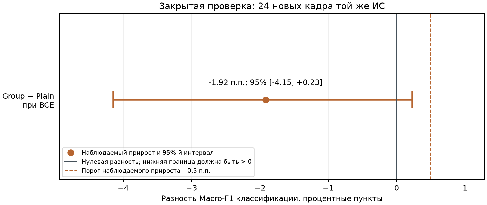
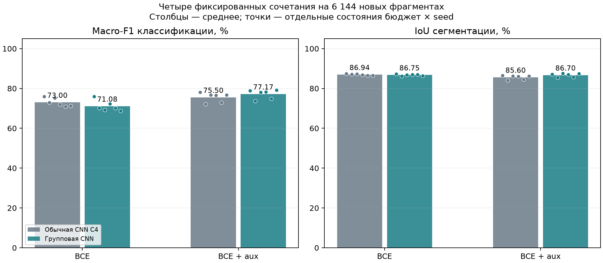

# Закрытая проверка архитектурного преимущества при обычном BCE

3 ноября 2026 года. Основная гипотеза не подтверждена: GroupCNN против обычной Plain12 C4 при одинаковом режиме BCE, близком числе независимых параметров и MAC. Проверены 6 144 фрагмента из 24 ранее неиспользованных кадров одной ИС.

Macro-F1: Group 71.085% против Plain 73.001%; наблюдаемая разность -1.916 п.п., 95%-й интервал [-4.146; +0.227] п.п. Средний ΔIoU -0.188 п.п.

Новых обучений и обновлений оптимизатора — 0. Использованы 24 заранее зафиксированных конечных состояния: четыре сочетания архитектуры/надзора × два бюджета масок × три seed. Веса и прежние VAL-пороги закреплены до загрузки новых изображений. Ни один порог на новой выборке не подбирался.

## Единственная подтверждающая проверка

Первичное сравнение — GroupCNN против Plain12 C4 при обычном BCE. Практический порог +0,5 п.п. относится к наблюдаемому среднему приросту. Дополнительно нижняя граница 95%-го интервала должна быть строго больше нуля. Это разные условия; порог точки нельзя представлять как доказанный минимальный популяционный прирост +0,5 п.п.

| Условие | Исход |
|---|---|
| Наблюдаемый средний ΔF1 ≥ +0,5 п.п. | FAIL |
| Нижняя граница 95%-го интервала строго > 0 | FAIL |
| ΔF1 каждого бюджета ≥ −0,25 п.п. | FAIL |
| Средний ΔIoU ≥ −0,2 п.п. | PASS |
| Расхождение свободных параметров ≤ 3% | PASS |
| Расхождение MAC ≤ 3% | PASS |
| Предшествующая абляция и независимый аудит пройдены | PASS |



Остальные четыре факторных контраста и общий порог 0,5 являются описательными. Для них не строились подтверждающие интервалы или p-value; они не могут заменить исход основной проверки.

## Четыре фиксированных сочетания

В таблице — среднее индивидуальных метрик по трём seed и двум бюджетам. Это качество отдельных моделей, усреднённое для сравнения, а не результат ансамбля. Историческое поле `mask_F1` обозначает Macro-F1 девяти геометрических классов из бинарной маски; IoU отдельно измеряет сегментацию металла.

| Сочетание | Macro-F1, % | IoU, % |
|---|---:|---:|
| Групповая CNN / BCE | 71.085 | 86.749 |
| Обычная CNN C4 / BCE | 73.001 | 86.937 |
| Групповая CNN / BCE + aux | 77.169 | 86.697 |
| Обычная CNN C4 / BCE + aux | 75.498 | 85.602 |



| Описательное сравнение | ΔMacro-F1, п.п. | ΔIoU, п.п. |
|---|---:|---:|
| Архитектура при BCE: Group − Plain | -1.916 | -0.188 |
| Архитектура при BCE + aux: Group − Plain | +1.670 | +1.096 |
| Дополнительный надзор у Group | +6.084 | -0.052 |
| Дополнительный надзор у Plain | +2.497 | -1.336 |
| Взаимодействие двух факторов | +3.587 | +1.284 |

В режиме BCE используются только 18 либо 27 полных масок. Режим BCE + aux дополнительно использует 1 152 классовые метки и прежнюю geometry_loss. Поэтому эффект aux — эффект всего дополнительного надзора, а не одной формулы лосса при одинаковой информации в разметке. Архитектурные сравнения внутри каждого режима используют одинаковую разметку.

## Описательная чувствительность: общий порог 0,5

| Описательное сравнение | ΔMacro-F1, п.п. | ΔIoU, п.п. |
|---|---:|---:|
| Архитектура при BCE: Group − Plain | -0.750 | -0.383 |
| Архитектура при BCE + aux: Group − Plain | -0.022 | +0.503 |
| Дополнительный надзор у Group | +1.706 | +0.346 |
| Дополнительный надзор у Plain | +0.978 | -0.539 |
| Взаимодействие двух факторов | +0.728 | +0.886 |

Общий порог 0,5 применяется к тем же вероятностям без нового обучения. Результат не меняет первичный исход при прежних зафиксированных VAL-порогах.

## Все 24 состояния и фиксированные пороги

| Сочетание | Масок | Seed | Порог | Primary F1, % | Primary IoU, % | F1 при 0,5, % |
|---|---:|---:|---:|---:|---:|---:|
| Групповая CNN / BCE | 18 | 5701 | 0.46 | 75.908 | 87.304 | 76.523 |
| Групповая CNN / BCE | 18 | 5721 | 0.20 | 70.095 | 86.225 | 74.931 |
| Групповая CNN / BCE | 18 | 5757 | 0.20 | 69.279 | 86.782 | 73.353 |
| Групповая CNN / BCE | 27 | 5701 | 0.44 | 72.326 | 86.923 | 73.064 |
| Групповая CNN / BCE | 27 | 5721 | 0.25 | 70.186 | 86.968 | 73.867 |
| Групповая CNN / BCE | 27 | 5757 | 0.39 | 68.715 | 86.295 | 71.545 |
| Обычная CNN C4 / BCE | 18 | 5701 | 0.45 | 75.886 | 87.391 | 76.297 |
| Обычная CNN C4 / BCE | 18 | 5721 | 0.31 | 72.953 | 87.067 | 75.662 |
| Обычная CNN C4 / BCE | 18 | 5757 | 0.42 | 75.161 | 87.200 | 75.466 |
| Обычная CNN C4 / BCE | 27 | 5701 | 0.45 | 71.914 | 86.863 | 73.023 |
| Обычная CNN C4 / BCE | 27 | 5721 | 0.32 | 70.851 | 86.537 | 75.196 |
| Обычная CNN C4 / BCE | 27 | 5757 | 0.44 | 71.242 | 86.565 | 72.138 |
| Групповая CNN / BCE + aux | 18 | 5701 | 0.28 | 78.937 | 87.152 | 71.546 |
| Групповая CNN / BCE + aux | 18 | 5721 | 0.30 | 73.694 | 85.385 | 75.793 |
| Групповая CNN / BCE + aux | 18 | 5757 | 0.42 | 78.129 | 87.525 | 78.494 |
| Групповая CNN / BCE + aux | 27 | 5701 | 0.31 | 78.205 | 86.924 | 73.992 |
| Групповая CNN / BCE + aux | 27 | 5721 | 0.30 | 74.863 | 85.792 | 76.576 |
| Групповая CNN / BCE + aux | 27 | 5757 | 0.38 | 79.183 | 87.407 | 77.120 |
| Обычная CNN C4 / BCE + aux | 18 | 5701 | 0.34 | 78.031 | 86.579 | 74.507 |
| Обычная CNN C4 / BCE + aux | 18 | 5721 | 0.30 | 72.086 | 84.102 | 75.385 |
| Обычная CNN C4 / BCE + aux | 18 | 5757 | 0.34 | 76.648 | 86.150 | 76.662 |
| Обычная CNN C4 / BCE + aux | 27 | 5701 | 0.30 | 76.581 | 86.087 | 75.007 |
| Обычная CNN C4 / BCE + aux | 27 | 5721 | 0.35 | 72.920 | 84.521 | 75.581 |
| Обычная CNN C4 / BCE + aux | 27 | 5757 | 0.37 | 76.724 | 86.171 | 76.509 |

## Новые данные и происхождение

Кадры выбраны детерминированно по SHA-256 до загрузки. Исключены 110 кадров из прежних планов и данных среди 321 доступного M2. Ранжирование 256 фрагментов каждого нового кадра использует SHA исходных интенсивностей, без маски, класса или качества предсказания. Фиксированный набор не заменялся по результатам проверки покрытия.

На стадии формирования кандидатов маски используются для удаления однородных фрагментов и точных геометрических повторов. Утверждение об отсутствии маски и класса относится именно к последующему ранжированию, а не ко всей подготовке набора.

По семи прежним манифестам исключены точные D4-повторы исходных интенсивностей и бинарных масок; такие повторы исключены и внутри нового набора. Используется прежняя подготовка: отступ 512 нативных пикселей, усреднение изображения 4×4, маска по доле металла ≥0,5, фрагменты 12×12 с шагом 6. Это не независимая геометрическая регистрация полей съёмки в координатах микросхемы.

Фиксированные кадры: `[106, 294, 268, 306, 279, 174, 267, 288, 305, 54, 187, 80, 94, 309, 34, 258, 79, 190, 172, 169, 251, 23, 259, 75]`.

| Геометрический класс | Фрагментов | Различных кадров |
|---|---:|---:|
| 0 | 2425 | 24 |
| 1 | 298 | 24 |
| 2 | 204 | 24 |
| 3 | 1941 | 24 |
| 4 | 250 | 24 |
| 5 | 100 | 24 |
| 6 | 747 | 24 |
| 7 | 74 | 23 |
| 8 | 105 | 23 |

У каждого класса требуется ≥8 фрагментов и ≥3 кадров. Вне EVAL остаются другие фрагменты тех же кадров; они не являются ещё одним независимым тестом.

## Статистика и техническая проверка

Для единственного первичного контраста выполнены 10 000 парных crossed-bootstrap повторов: три seed и 24 кадра выбираются с возвращением. Одни индексы используются обеими CNN и обоими бюджетами. Confusion сначала суммируется по выбранным кадрам отдельно для каждого выбранного seed; затем рассчитывается Macro-F1 и усредняется по seed и бюджетам. Confusion разных seed не объединяются до вычисления F1. Использованы процентильные квантили 0,025 и 0,975.

Интервал является приближённой оценкой в заданной схеме пересэмплирования. Всего три инициализации ограничивают оценку вариации обучения; тысячи зависимых фрагментов не считаются независимыми экспериментами.

Независимый аудит данных — 16/16; независимый аудит результата — 12/12. Отчёт проверяет хеши аудированных входов перед построением графиков. Оценка и статистика заняли 25.56 с; это длительность данного прогона, а не измерение полной задержки приложения.

## Границы и связь с прежними опытами

Все новые поля относятся к одной физической ИС и слою металлизации M2. Классы вычисляются из SVG-масок геометрическим правилом. Это не экспертные метки типов производственных дефектов, электрические измерения или измеренный выход годных. Межчиповый перенос не проверялся. Сама C4-групповая свёртка является известным оператором.

[Прежняя абляция на VAL](../sem_arch_loss_factorial_20261103/REPORT.md) сохраняет свои исходные числа. [Зафиксированный вариант с aux](../sem_model_freeze_20261103/MODEL_CARD.md) и [его прежнее закрытое подтверждение](../sem_arch_groupcnn_confirmation_20261102/REPORT.md) также сохранены без изменения. Исход новой проверки не переписывает предыдущие результаты.

[Протокол](PROTOCOL.md) · [Конфигурация](CONFIG.json) · [Выбор и фиксация](selection.py) · [Веса и пороги](MODEL_LOCK.json) · [План данных](SOURCE_PLAN.json) · [Оценка](evaluate.py) · [Статистика](stats.py) · [Результат JSON](RESULT.json) · [Аудит данных](DATA_AUDIT.json) · [Итоговый аудит](AUDIT.json).

Повторное построение отчёта без обучения и предсказаний:

```bash
.venv/bin/python -B gipoteza/sem_arch_bce_confirmation_20261103/report.py
```
