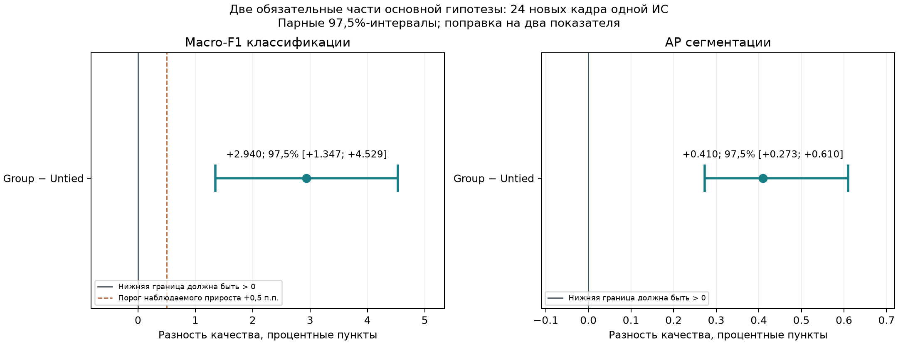
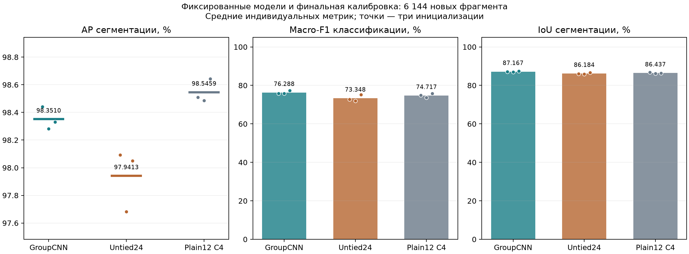

# Закрытая проверка CNN после фиксированной классовой калибровки

3 ноября 2026 года. Основная составная гипотеза подтверждена. Проверены 6 144 фрагмента из 24 новых кадров металлизации M2 одной ИС. GroupCNN сравнивается со свободной Untied24 при одинаковой ширине и MAC. Обязательны одновременно положительные AP и Macro-F1 с установленными ограничениями.

Group−Untied: ΔMacro-F1 +2.940 п.п., 97,5% интервал [+1.347; +4.529] п.п.; ΔAP +0.409689 п.п., 97,5% интервал [+0.273330; +0.609763] п.п.; ΔIoU +0.983 п.п.

Новых обучений CNN и обновлений оптимизатора — 0. Девять конечных весов и девять скалярных порогов закреплены до загрузки новых кадров. Пороги определены только по одним и тем же 512 прежним классовым меткам. Новые маски, классы и предсказания не участвовали в их подборе.

## Основной исход и критерии

Два первичных показателя — Macro-F1 девяти классов после фиксированной бинаризации маски и AP сегментации до выбора порога. Оба 97,5%-интервала должны иметь нижнюю границу строго выше нуля. Использована поправка Бонферрони на два показателя, с номинальным семейным уровнем 95%. Остальные условия применяются одновременно.

| Условие | Исход |
|---|---|
| Наблюдаемый средний ΔF1 ≥ +0,5 п.п. | PASS |
| Нижняя граница 97,5%-интервала ΔF1 строго >0 | PASS |
| Наблюдаемый средний ΔAP строго >0 | PASS |
| Нижняя граница 97,5%-интервала ΔAP строго >0 | PASS |
| ΔF1 каждой инициализации ≥−1 п.п. | PASS |
| Средний ΔIoU ≥−0,2 п.п. | PASS |
| MAC совпадает | PASS |
| Предшествующая разработка и её независимый аудит пройдены | PASS |

Порог +0,5 п.п. относится к наблюдаемой точечной разности F1. Нижняя граница >0 поддерживает положительный эффект в заданной схеме пересэмплирования, но не доказывает минимальный популяционный выигрыш не менее +0,5 п.п.



## Качество трёх фиксированных моделей

AP — non-interpolated average precision, вычисленная по пикселям каждого кадра, затем усреднённая по кадрам и seed. Macro-F1 вычислена отдельно для каждой инициализации, затем усреднена. IoU — среднее по фрагментам. Это средние метрик отдельных сетей, а не результат ансамбля.

| Модель | Покадровое AP, % | Macro-F1, % | IoU, % | Свободных параметров | MAC / фрагмент |
|---|---:|---:|---:|---:|---:|
| GroupCNN | 98.3510 | 76.288 | 87.167 | 2671 | 1527552 |
| Untied24 | 97.9413 | 73.348 | 86.184 | 10681 | 1527552 |
| Plain12 C4 | 98.5459 | 74.717 | 86.437 | 2749 | 1562112 |

Узкая Plain12 C4 имеет более высокое AP, чем GroupCNN, хотя её Macro-F1 и IoU ниже. Основной подтверждённый исход относится к сравнению Group−Untied; превосходство над всеми контролями по каждой метрике не заявляется.



У Group и Untied совпадают фактическая ширина 24, одиночный маршрут исполнения, свёртки и дилатации. Начальная функция Untied получена развёртыванием архивных начальных весов Group, до обучения. Untied затем обучалась с независимыми коэффициентами, включая выходной слой. Число независимых параметров и геометрия оптимизации различаются; этот опыт не отделяет их от эффекта C4-связывания. Вспомогательное обучение одинаково у всех сетей: 27 полных масок и 1152 классовые метки.

## Описательные сравнения

Plain12 C4 — дополнительный контроль. Его оценки и общий порог 0,5 не имеют новых подтверждающих интервалов и не могут заменить основной исход Group−Untied. Общий порог применяется к тем же вероятностям без нового обучения.

| Сравнение | ΔF1, п.п. | ΔAP, п.п. | ΔIoU, п.п. |
|---|---:|---:|---:|
| Group−Untied, финальная калибровка | +2.940 | +0.409689 | +0.983 |
| Group−Plain12 C4, финальная калибровка | +1.571 | -0.194914 | +0.729 |
| Group−Untied, общий порог 0,5 | +0.460 | +0.409689 | +0.956 |
| Group−Plain12 C4, общий порог 0,5 | +0.499 | -0.194914 | +0.619 |

## Все девять состояний

| Модель | Seed | Фиксированный порог | AP, % | F1, % | IoU, % | F1 при 0,5, % |
|---|---:|---:|---:|---:|---:|---:|
| GroupCNN | 5701 | 0.37 | 98.4421 | 75.737 | 87.156 | 70.996 |
| GroupCNN | 5721 | 0.47 | 98.2809 | 75.751 | 86.948 | 75.024 |
| GroupCNN | 5757 | 0.40 | 98.3300 | 77.375 | 87.396 | 76.065 |
| Untied24 | 5701 | 0.48 | 98.0918 | 72.768 | 86.035 | 73.388 |
| Untied24 | 5721 | 0.51 | 97.6824 | 72.042 | 85.833 | 72.097 |
| Untied24 | 5757 | 0.54 | 98.0499 | 75.234 | 86.683 | 75.220 |
| Plain12 C4 | 5701 | 0.41 | 98.5086 | 74.830 | 86.739 | 72.687 |
| Plain12 C4 | 5721 | 0.53 | 98.4861 | 73.584 | 86.201 | 73.569 |
| Plain12 C4 | 5757 | 0.41 | 98.6431 | 75.736 | 86.372 | 74.333 |

## Финальная калибровка до новых кадров

Из 40 ранее просмотренных DEV-кадров выбраны 32 по заранее заданному SHA-ранжированию. В каждом взяты 16 фрагментов по неизменённому хеш-правилу исходных интенсивностей. Все девять состояний используют одинаковые 512 классовых меток. Отбор не использует класс, маску или качество сети.

Для каждой сети выбирается максимум Macro-F1 на общей сетке 0,10…0,90 с шагом 0,01. При равенстве выбирается ближайший к 0,5 порог, затем меньший; сравнение расстояний выполняется в целых сотых. IoU и полные пиксельные маски не входят в выбор порога. Сохранены все 81 калибровочных оценки и выбранные пороги.

Кадры калибровки: `[294, 94, 100, 169, 80, 157, 212, 81, 192, 150, 23, 32, 288, 187, 309, 267, 251, 123, 183, 174, 259, 79, 254, 252, 106, 305, 70, 34, 258, 190, 279, 200]`.

Количество классов 0…8 среди 512 меток: `[219, 21, 14, 141, 23, 7, 68, 8, 11]`.

## Новая выборка и происхождение

Из 321 доступного кадра M2 исключены 134 кадра из прежних планов и данных. Оставшиеся ранжированы SHA-256 до загрузки; выбраны первые 24 без замены. По восьми прежним манифестам и внутри нового набора исключены точные D4-повторы исходных интенсивностей и бинарных масок.

Фиксированные новые кадры: `[11, 177, 149, 283, 98, 297, 161, 269, 176, 91, 60, 121, 103, 83, 119, 307, 257, 224, 22, 72, 298, 66, 108, 311]`.

Подготовка прежняя: отступ 512 нативных пикселей, уменьшение 4×4, маска по доле металла ≥0,5, фрагменты 12×12 с шагом 6. Кандидаты используют маски для удаления однородных фрагментов и точных повторов. Последующее ранжирование 256 фрагментов на кадр использует только raw-D4 хеш интенсивностей, без маски, класса и предсказания. Требования покрытия проверены без замены кадров или пересэмплирования.

| Геометрический класс | Фрагментов | Различных кадров |
|---|---:|---:|
| 0 | 2605 | 24 |
| 1 | 267 | 24 |
| 2 | 167 | 24 |
| 3 | 1851 | 24 |
| 4 | 208 | 24 |
| 5 | 131 | 24 |
| 6 | 731 | 24 |
| 7 | 79 | 24 |
| 8 | 105 | 23 |

Остальные фрагменты того же TEST разделяют эти кадры и не являются ещё одним независимым подтверждением. Геометрическая регистрация полей в физических координатах микросхемы отдельно не проводилась.

## Статистика и аудит

Выполнены 10 000 парных crossed-bootstrap повторов с общими индексами трёх seed и 24 кадров для обеих первичных метрик и сетей. Для Macro-F1 confusion сначала суммируется по выбранным кадрам отдельно каждого выбранного seed, затем вычисляется F1 и усредняется по seed. AP сначала считается по каждому кадру/seed, затем усредняется по выбранным кадрам и seed. Confusion разных seed до F1 не объединяются.

Центральные квантили 0,0125 и 0,9875 дают два 97,5%-интервала с поправкой на два первичных показателя. Это приблизительные интервалы в выбранной схеме пересэмплирования. Три инициализации ограничивают оценку изменчивости обучения; зависимые пиксели и фрагменты не считаются независимыми экспериментами.

Независимый аудит данных — 16/16; итоговый аудит — 12/12. Перед построением отчёта проверены хеши текущих результатов, весов, калибровки, данных, вероятностей и bootstrap. Оценка и статистика заняли 11.71 с; это длительность прогона, а не измерение полной задержки приложения.

## Границы результата

Это новые поля одной физической ИС и одного слоя металлизации M2. Девять классов вычислены из SVG-масок геометрическим правилом. Они не являются экспертными типами производственных дефектов, электрическими измерениями или измеренным выходом годных. Перенос между изделиями не проверялся. Известная C4-конструкция не заявляется новым оператором; результат не устанавливает публикационную новизну.

Прежние [проверка BCE без дополнительного надзора](../sem_arch_bce_confirmation_20261103/REPORT.md), [архитектурный пилот с общим порогом 0,5](../sem_arch_untied_control_20261103/REPORT.md) и [разработка покадровой калибровки](../sem_arch_calibration_dev_20261103/REPORT.md) сохраняют свои исходы. Новая постановка с финальной калибровкой не переписывает их критерии и не превращает прежние кадры в новый тест.

[Протокол](PROTOCOL.md) · [Конфигурация](CONFIG.json) · [Выбор и фиксация](selection.py) · [Финальная калибровка](FINAL_CALIBRATION.json) · [Веса и пороги](MODEL_LOCK.json) · [План данных](SOURCE_PLAN.json) · [Оценка](evaluate.py) · [Статистика](stats.py) · [Результат](RESULT.json) · [Аудит данных](DATA_AUDIT.json) · [Итоговый аудит](AUDIT.json).

Повторное построение отчёта без обучения и предсказаний:

```bash
.venv/bin/python -B gipoteza/sem_arch_calibrated_confirmation_20261103/report.py
```
