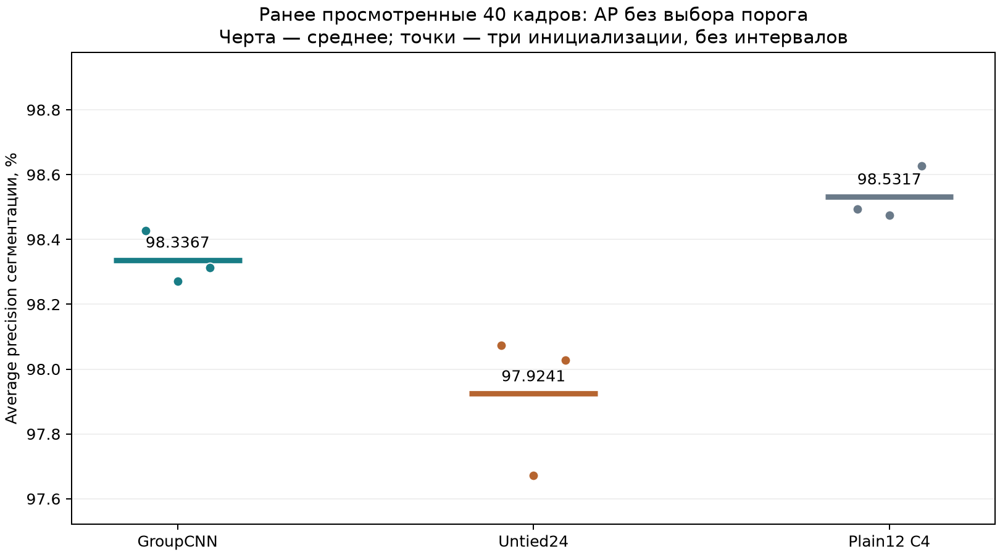
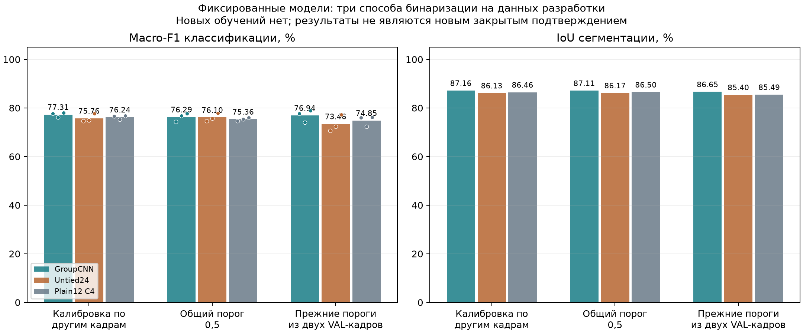

# AP сегментации и перенос калибровки между кадрами

3 ноября 2026 года. Выполнены две проверки фиксированных CNN: порогонезависимое ранжирование пикселей и покадровая проверка калибровки. Использованы 10 240 фрагментов 40 ранее оценённых кадров одной ИС. В этом новом опыте они явно являются данными разработки. Это не новая закрытая выборка и не независимое подтверждение.

Group−Untied24: ΔAP +0.412575 п.п., ΔMacro-F1 после покадровой калибровки +1.553 п.п., ΔIoU +1.037 п.п. Заранее установленный описательный допуск к следующему исследованию пройден.

Новых обучений и обновлений оптимизатора — 0. Сравниваются девять сохранённых состояний: GroupCNN, свободная Untied24 и Plain12 C4 × три seed 5701/5721/5757. Везде бюджет обучения 27 масок и 1152 слабых классовых метки; дополнительный компонент обучения одинаков.

## 1. AP сегментации без выбора порога

Используется non-interpolated average precision: ступенчато взвешенная точность по приращениям полноты, а не площадь трапециями под PR-кривой. Метрика сначала вычисляется по всем пикселям выбранных фрагментов каждого кадра, затем усредняется по 40 кадрам и трём seed. Она оценивает разделение металла и фона, а не девять классов геометрии. Выбор порога 0,5 или VAL-порога на неё не влияет.

| Модель | Среднее покадровое AP, % | Общее пиксельное AP, % |
|---|---:|---:|
| GroupCNN | 98.3367 | 98.3427 |
| Untied24 | 97.9241 | 97.9340 |
| Plain12 C4 | 98.5317 | 98.5376 |

По покадровому AP GroupCNN превосходит Untied24, но уступает узкому контролю Plain12 C4. Поэтому превосходство над всеми контролями по качеству ранжирования пикселей не заявляется.

Общее пиксельное AP приведено только как дополнительная диагностика. Оно может иначе ранжировать сети из-за объединения кадров с разными распределениями яркости и долями металла. Основное AP даёт кадрам равные веса.



Для сопоставления отдельно сохранено AP прежней VAL (695 фрагментов двух других кадров). Абсолютные оценки разных наборов нельзя трактовать как парный прирост: распределение и доля металла различаются.

| Модель | AP прежней VAL, среднее кадров и seed, % |
|---|---:|
| GroupCNN | 99.0576 |
| Untied24 | 98.8767 |
| Plain12 C4 | 99.1480 |

## 2. Калибровка с разделением по кадрам

40 кадров разделены хеш-ранжированием на пять групп по восемь. Для каждого цикла порог выбирается на 32 остальных кадрах, затем используется на восьми отложенных. Каждый фрагмент получает отложенное предсказание ровно один раз. Кадры калибровки и оценки в одном цикле не пересекаются; веса моделей остаются неизменными.

На каждом кадре заранее выбираются 16 калибровочных фрагментов по хешу интенсивностей. В одном цикле используются 512 классовых меток. Всего во всех пяти циклах задействованы 640 уникальных меток, общих для всех девяти состояний моделей. Эти два числа нельзя смешивать: 512 — бюджет одного цикла, 640 — размер объединения.

Порог каждого состояния выбирается на фиксированной сетке 0,10…0,90 с шагом 0,01: максимум Macro-F1 девяти классов, затем близость к 0,5, затем меньший порог. Пиксельная маска и IoU в выборе порога не участвуют. Если какой-то класс отсутствует в фиксированных 512 метках, набор не заменяется; покрытие записано ниже.

OOF Macro-F1 считается отдельно для каждого seed по всем его отложенным предсказаниям, затем усредняется по seed. Confusion разных seed не объединяются. IoU отдельно измеряет качество маски металла.

| Модель | OOF Macro-F1, % | OOF IoU, % | F1 при 0,5, % | IoU при 0,5, % | F1 старых VAL-порогов, % | IoU старых VAL-порогов, % |
|---|---:|---:|---:|---:|---:|---:|
| GroupCNN | 77.310 | 87.163 | 76.286 | 87.113 | 76.941 | 86.651 |
| Untied24 | 75.757 | 86.126 | 76.105 | 86.175 | 73.458 | 85.404 |
| Plain12 C4 | 76.239 | 86.463 | 75.363 | 86.504 | 74.850 | 85.490 |



| Разность Group−контроль | ΔAP, п.п. | ΔOOF F1, п.п. | ΔOOF IoU, п.п. |
|---|---:|---:|---:|
| Untied24 | +0.412575 | +1.553 | +1.037 |
| Plain12 C4 | -0.194970 | +1.071 | +0.700 |

## Все девять состояний

| Модель | Seed | Покадровое AP, % | OOF F1, % | OOF IoU, % | F1 при 0,5, % | Пороги пяти циклов |
|---|---:|---:|---:|---:|---:|---|
| GroupCNN | 5701 | 98.4269 | 77.733 | 87.094 | 74.385 | 0.37, 0.37, 0.37, 0.38, 0.37 |
| GroupCNN | 5721 | 98.2707 | 76.162 | 86.966 | 76.768 | 0.51, 0.44, 0.47, 0.47, 0.47 |
| GroupCNN | 5757 | 98.3125 | 78.033 | 87.429 | 77.703 | 0.49, 0.40, 0.41, 0.49, 0.50 |
| Untied24 | 5701 | 98.0736 | 74.656 | 85.945 | 74.675 | 0.48, 0.48, 0.50, 0.47, 0.57 |
| Untied24 | 5721 | 97.6715 | 74.937 | 85.754 | 75.716 | 0.52, 0.47, 0.52, 0.60, 0.59 |
| Untied24 | 5757 | 98.0272 | 77.676 | 86.680 | 77.923 | 0.54, 0.54, 0.54, 0.54, 0.50 |
| Plain12 C4 | 5701 | 98.4928 | 76.689 | 86.778 | 74.715 | 0.45, 0.41, 0.45, 0.45, 0.45 |
| Plain12 C4 | 5721 | 98.4755 | 75.304 | 86.159 | 75.387 | 0.52, 0.53, 0.53, 0.53, 0.53 |
| Plain12 C4 | 5757 | 98.6266 | 76.724 | 86.452 | 75.988 | 0.47, 0.41, 0.41, 0.41, 0.41 |

## Покадровые циклы и покрытие классов

| Цикл | Отложенные кадры | ΔF1 Group−Untied, п.п. | ΔIoU Group−Untied, п.п. | Классы в 512 метках: количества 0…8 |
|---|---|---:|---:|---|
| 1 | 54, 80, 81, 106, 157, 190, 254, 288 | +0.361 | +1.051 | 220, 14, 12, 149, 22, 8, 68, 8, 11 |
| 2 | 16, 32, 75, 172, 187, 200, 251, 279 | +2.423 | +0.948 | 227, 19, 13, 138, 20, 6, 71, 7, 11 |
| 3 | 34, 174, 183, 212, 252, 259, 268, 309 | +0.973 | +1.033 | 218, 21, 16, 145, 19, 5, 70, 9, 9 |
| 4 | 61, 70, 150, 192, 267, 294, 305, 306 | +2.502 | +1.156 | 222, 19, 16, 146, 21, 7, 60, 8, 13 |
| 5 | 23, 79, 87, 94, 100, 123, 169, 258 | +1.643 | +0.996 | 225, 19, 15, 134, 22, 6, 75, 8, 8 |

## Заранее установленный допуск

Этот допуск определяет, есть ли основание планировать отдельную проверку на ещё не использованных кадрах. Он не является статистическим подтверждением в этом опыте.

| Условие Group−Untied | Исход |
|---|---|
| Среднее покадровое AP строго выше | PASS |
| Средний OOF ΔF1 ≥ +0,5 п.п. | PASS |
| Средний OOF ΔIoU ≥ −0,2 п.п. | PASS |
| ΔF1 каждого цикла ≥ −1 п.п. | PASS |

Итоговый описательный допуск: пройден. Все ограничения применяются одновременно; метрики не выбираются после получения исхода.

## Проверка и границы

Независимый аудит — 34/34. Перед построением отчёта проверены хеши аудированных результатов, данных, вероятностей, калибровочных таблиц и фиксации источников.

Пять калибровочных обучающих частей пересекаются. По ним не строятся независимые доверительные интервалы и p-value; пиксели и фрагменты не считаются независимыми повторениями эксперимента. AP относится к сегментации, а не к Macro-F1 классификации.

Данные состоят из двух прежде оценённых наборов: 4096 фрагментов 16 кадров и 6144 фрагментов 24 кадров. Их повторное использование явно объявлено разработкой новой калибровки. Прежние результаты сохраняют исторический статус своих протоколов; этот опыт не является новым подтверждением. Для него потребуется другой, ещё не использованный набор с заранее зафиксированными моделями и правилом калибровки.

Все кадры относятся к одной ИС и металлизации M2. Девять классов вычислены из SVG-масок геометрическим правилом; это не экспертные типы производственных дефектов или электрические измерения. У Group и Untied одинаковые ширина и MAC, но разное число свободных параметров. Известная C4-конструкция не объявляется новым оператором.

[Протокол](PROTOCOL.md) · [Конфигурация](CONFIG.json) · [Фиксация](LOCK.json) · [Источники](SOURCES.json) · [Предсказания](predict.py) · [Анализ](analysis.py) · [Результат](RESULT.json) · [Аудит](AUDIT.json) · [Предыдущая архитектурная проверка](../sem_arch_untied_control_20261103/REPORT.md).

Перестроение отчёта без новых предсказаний:

```bash
.venv/bin/python -B gipoteza/sem_arch_calibration_dev_20261103/report.py
```
