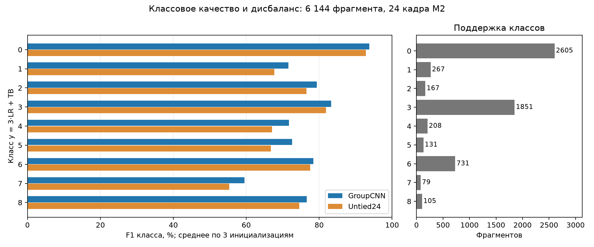
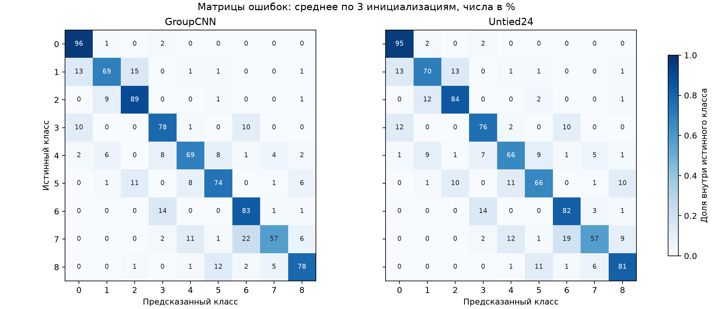
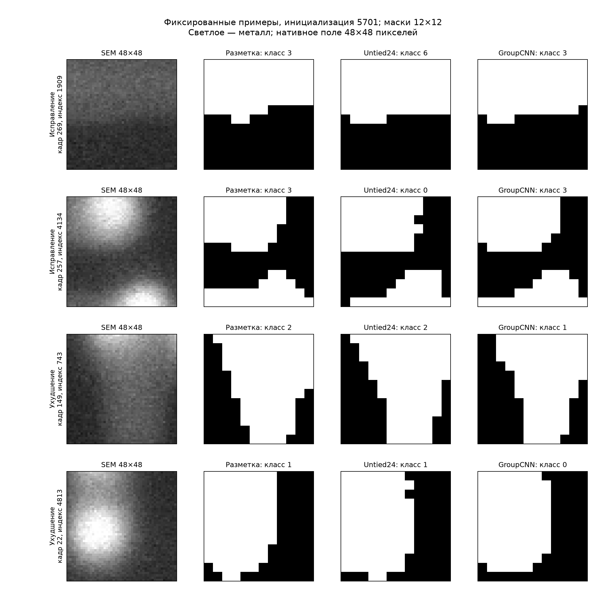
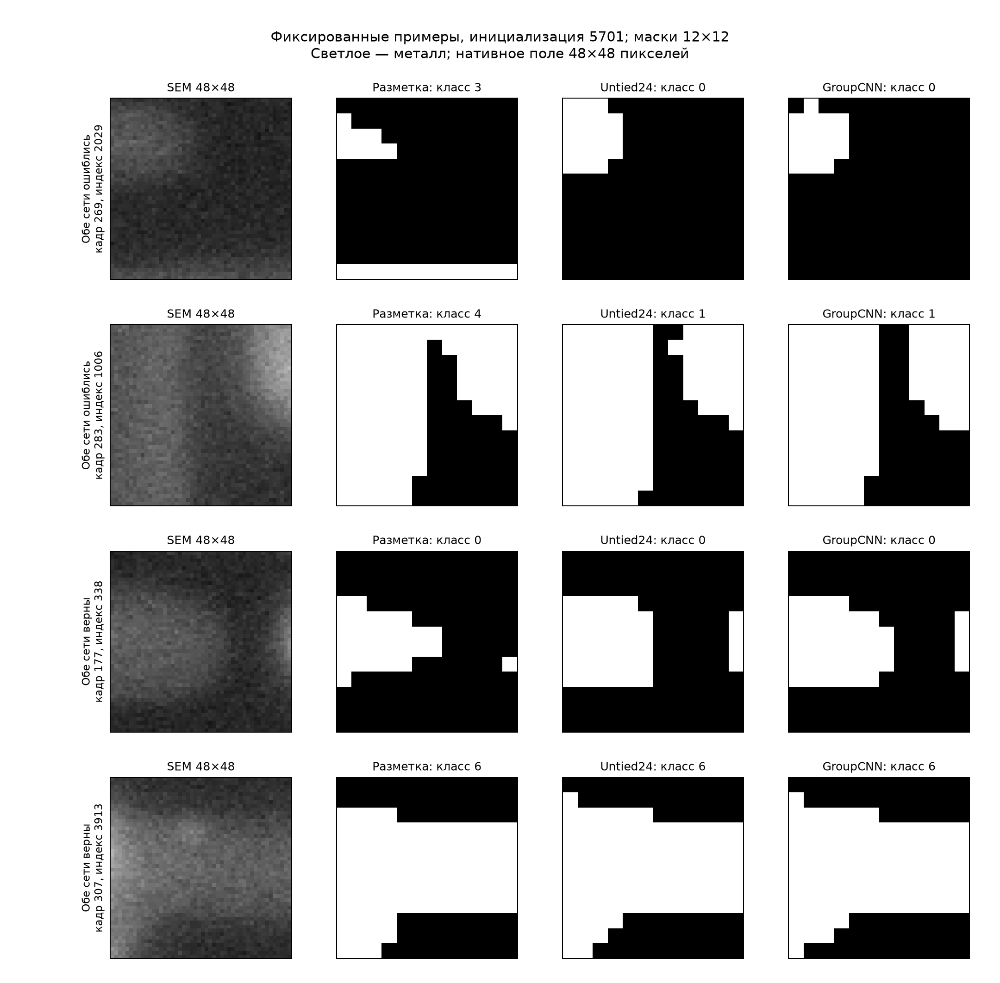

# Разбор ошибок GroupCNN и Untied24

Описательный разбор сохранённого закрытого опыта от 3 ноября 2026 года: 6 144 фрагмента, 24 кадра металлизации M2 одной ИС, три инициализации. Новых обучений и подбора порогов нет. Используется финальная калибровка, зафиксированная до новых кадров.

Средняя Macro-F1: GroupCNN 76.288%, Untied24 73.348%, разность +2.940 п.п. Это среднее трёх отдельных F1, а не F1 ансамбля.

## Какие классы различаются

Класс задаётся как `y = 3·LR + TB`: в каждом направлении 0 означает отсутствие пути между границами маски, 1 и 2 — наличие пути с нормированной геометрической проводимостью ниже и не ниже 0,5. Например, класс 0 — (0,0), класс 3 — (1,0), класс 8 — (2,2). Это геометрические состояния маски.

| Класс (LR, TB) | Фрагментов | F1 Group, % | F1 Untied, % | ΔF1, п.п. |
|---|---:|---:|---:|---:|
| 0 (0, 0) | 2605 | 93.72 | 92.79 | +0.93 |
| 1 (0, 1) | 267 | 71.52 | 67.72 | +3.81 |
| 2 (0, 2) | 167 | 79.33 | 76.52 | +2.81 |
| 3 (1, 0) | 1851 | 83.28 | 81.85 | +1.43 |
| 4 (1, 1) | 208 | 71.70 | 67.11 | +4.59 |
| 5 (1, 2) | 131 | 72.58 | 66.75 | +5.83 |
| 6 (2, 0) | 731 | 78.37 | 77.51 | +0.86 |
| 7 (2, 1) | 79 | 59.49 | 55.34 | +4.15 |
| 8 (2, 2) | 105 | 76.59 | 74.54 | +2.05 |

F1 каждого класса сначала вычислена отдельно каждой инициализации, затем усреднена. Precision, recall и исходные матрицы также сохранены в [RESULT.json](RESULT.json). Редкие классы имеют только 79–208 фрагментов: большая разность для одного из них требует осторожной трактовки.





## Парные исправления и ухудшения

| Инициализация | Исправлений Group | Ухудшений Group | Обе ошиблись | Обе верны |
|---|---:|---:|---:|---:|
| 5701 | 283 | 155 | 713 | 4993 |
| 5721 | 236 | 139 | 814 | 4955 |
| 5757 | 207 | 140 | 698 | 5099 |
| Сумма по трём | 726 | 434 | 2225 | 15047 |

Сумма содержит 18 432 пары «фрагмент × инициализация» с повторным использованием тех же 6 144 изображений. Исправлений больше ухудшений на 292; это разность числа верных ответов, её нельзя приравнивать к разности Macro-F1. Категория «обе ошиблись» включает как одинаковые, так и разные ошибочные классы.

## Какие ошибки геометрии возникают

Числа ниже суммируют ошибки по трём инициализациям. Ложное соединение — истинное состояние 0, предсказанное 1/2; пропущенное — истинное 1/2, предсказанное 0. Перепутанная градация — 1↔2 при сохранённом наличии пути. Для ложных соединений знаменатель — число истинно несоединённых пар, для двух остальных ошибок — число истинно соединённых пар.

| Направление / ошибка | Group | Untied | Δ числа ошибок Group−Untied |
|---|---:|---:|---:|
| LR: Ложное соединение | 233 | 224 | +9 |
| LR: Пропущенное соединение | 687 | 805 | -118 |
| LR: Градация 1↔2 | 1005 | 1036 | -31 |
| TB: Ложное соединение | 264 | 416 | -152 |
| TB: Пропущенное соединение | 235 | 219 | +16 |
| TB: Градация 1↔2 | 316 | 350 | -34 |

Ошибка связи между границами маски не равнозначна реальному замыканию или обрыву цепи: электрические измерения и экспертные типы производственных дефектов здесь отсутствуют. По этим частотам нельзя установить, что именно вызвало выигрыш архитектуры.

## Примеры для ВКР

Для инициализации 5701 выбраны по два примера каждой категории по фиксированному SHA-ранжированию, описанному в [протоколе](PROTOCOL.md). Показаны улучшения, ухудшения и общие исходы; примеры не ранжировались по величине выигрыша или уверенности. Маски 12×12 увеличены без интерполяции. В левом столбце исходный SEM-фрагмент 48×48, из которого сеть получает усреднённое изображение 12×12.





Координаты и индексы всех восьми примеров сохранены в [EXAMPLES.json](EXAMPLES.json). Числовая проверка восстановила сетевой вход из каждого нативного фрагмента с ошибкой меньше 10⁻⁷.

## Границы интерпретации

Это разбор уже полученного результата, а не новый независимый тест. Классы выведены из SVG-масок; данные относятся к одной ИС и слою M2. Пул фрагментов отфильтрован с использованием истинных масок (однородность и точные повторы), хотя последующее SHA-ранжирование отбора не использовало класс или маску. Дисбаланс классов и зависимость фрагментов внутри кадров сохраняются. Новые интервалы, значимость, причинный механизм и перенос на другую ИС не заявляются.

Повторное воспроизведение без обучения и MPS:

```bash
.venv/bin/python -B gipoteza/sem_arch_error_analysis_20261103/analyze.py
```

[Исходный закрытый отчёт](../sem_arch_calibrated_confirmation_20261103/REPORT.md) · [Результаты](RESULT.json) · [Проверки](CHECKS.json) · [Зафиксированные входы](LOCK.json).
