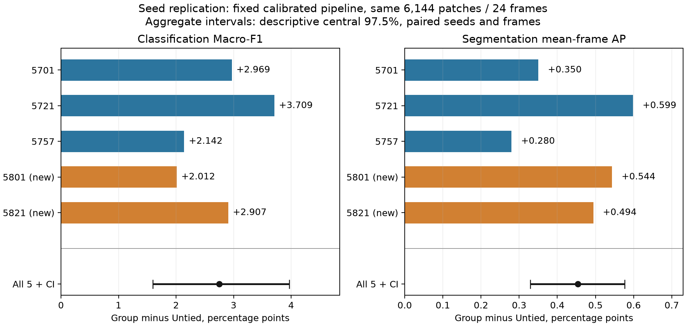

# Завершающие проверки архитектурной гипотезы

3 ноября 2026. Выполнены четыре дополнительных обучения, разбор ошибок и замер всего конвейера обработки. Основной вариант модели, обучение с общим вспомогательным геометрическим лоссом, данные и процедура калибровки сохранены.

## Устойчивость к инициализации

Для seed 5801 и 5821 обучены обе архитектуры. У каждой пары одинаковая начальная функция, фактическая ширина 24 канала и 1527552 MAC на фрагмент. Group имеет 2671 свободный параметр, Untied24 — 10681. Гиперпараметры, 27 полных масок, 1152 слабые метки, 2000 шагов и бюджет окончательной калибровки 512 классовых меток общие. Все новые веса и четыре порога сохранены. Лучшие seed не отбирались.

| Показатель, среднее пяти запусков | GroupCNN | Untied24 | Разность, п.п. |
|---|---:|---:|---:|
| Macro-F1 классификации, % | 75.9493 | 73.2017 | +2.7476 |
| Покадровый AP сегментации, % | 98.3479 | 97.8945 | +0.4534 |
| IoU сегментации, % | 86.8813 | 85.8343 | +1.0470 |

Два новых seed отдельно: ΔMacro-F1 +2.4594 п.п., ΔAP +0.5190 п.п., ΔIoU +1.1432 п.п. Оба дали положительный прирост по всем трём показателям. По пяти seed прирост F1 положителен в каждой паре.

Приближённые описательные 97,5%-интервалы пяти seed: ΔF1 [+1.5973; +3.9690] п.п.; ΔAP [+0.3295; +0.5762] п.п. Пересэмплируются парные инициализации и кадры, 10000 повторов, поправка на два исхода. Среднее — по отдельным запускам, не ансамбль.

Репликация проходит заранее заданные описательные критерии как для новых двух пар отдельно, так и для всех пяти. Тестовые изображения — те же 6144 фрагмента 24 кадров: это устойчивость к инициализации, не новая независимая когорта. Первое закрытое подтверждение трёх seed остаётся отдельным неизменённым опытом.

Диагностика при общем пороге 0,5 также даёт положительное среднее: ΔF1 пяти seed +1.0097 п.п. Но один прежний seed при 0,5 имеет отрицательную разность, поэтому универсальное преимущество при любом пороге не заявляется.

[Независимый аудит репликации](../sem_arch_seed_extension_20261103/AUDIT.json): 77/77. [Полный отчёт, код и веса](../sem_arch_seed_extension_20261103/REPORT.md).

## Разбор ошибок

На трёх прежних seed средний F1 Group выше для всех девяти классов. Исправлено 726 классификаций, ухудшено 434; это суммы по 18432 парам «фрагмент × seed» с повторным использованием 6144 изображений. По направлениям наблюдаются компромиссы: уменьшаются пропуски связей LR и ложные связи TB, но немного растут ложные связи LR и пропуски TB. Причинный механизм этими наблюдениями не доказывается.

[Таблицы, матрицы и восемь примеров, включая ухудшения](../sem_arch_error_analysis_20261103/REPORT.md). Примеры выбраны воспроизводимым SHA-ранжированием внутри фиксированных категорий; метрики и нативные входы проверены. Этот разбор относится к прежним трём seed.

## Время полного конвейера

На MPS и CPU медиана одиночного запроса с пустым кэшем классов — 0,9341 мс у Group и 0,9344 мс у Untied. Для пакета 16 — 2,5776 и 2,5830 мс соответственно (около 0,161 мс на фрагмент в пакете). По этому замеру скорости практически равны.

Учтены подготовка нативного фрагмента 48×48 до 12×12, переносы CPU↔MPS, CNN, бинаризация и геометрический классификатор. Исходный фрагмент уже в оперативной памяти; диск, загрузка весов и обработка целого кадра сюда не входят. 3672 запроса, три прежние инициализации, размеры пакета 1 и 16; warm/cold кэш разделены. Во всех запросах маски и классы совпали с архивом.

[Таблица задержек, p95, профиль этапов и код](../sem_arch_pipeline_timing_20261103/REPORT.md). Проверки артефактов и расчётов 13/13; отдельная проверка кода блокирующих замечаний не выявила. Это не независимый повтор аппаратного замера.

## Что теперь обосновано

В данной постановке архитектура с C4-связями весов воспроизводимо улучшает классификацию геометрии металлизации и качество её маски относительно свободной CNN24 при одинаковых ширине, MAC, обучающем надзоре и калибровке. Свободных параметров меньше примерно в четыре раза, время обработки сопоставимо. Результата достаточно для описания и обсуждения выполненного сравнительного эксперимента в ВКР; следующий практический шаг — оформить метод и экспериментальную главу, сохраняя неудачные абляции и ограничения.

Данные — один слой M2 одной ИС. Классы вычислены из SVG-масок и описывают геометрию, а не экспертные категории производственных дефектов или измеренные электрические обрывы/замыкания. Фильтрация кандидатов использует истинные маски. Перенос на другую ИС, промышленная эффективность и новизна самого известного C4-оператора остаются за пределами этих проверок.
