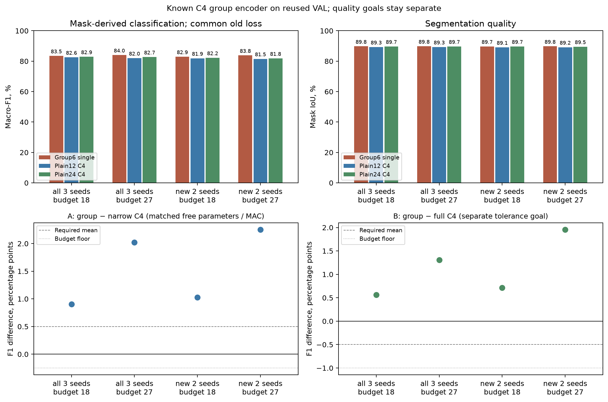

# Гипотеза: C4-групповой encoder для геометрических состояний металлизации M2

**Обновлено 2 ноября 2026 года после закрытой проверки:** основная цель **A подтверждена** на 4 096 новых фрагментах 16 полей той же ИС: Group6 превосходит узкую Plain12 C4 при близких свободных параметрах и MAC. Отдельная цель **B против полной Plain24 C4 не подтверждена**. Результаты разработки на прежней VAL сохранены ниже. Основной объект исследования — encoder CNN; BCE и прежняя geometry_loss одинаковы у всех моделей.

## Задача и данные

По SEM-фрагменту восстановить бинарную маску металлизации M2, затем определить **одно из девяти масочно-геометрических состояний**. Прежнее правило присваивает по три состояния направлениям LR и TB, совместный класс `y=3·sLR+sTB`. Это классы, вычисленные из SVG-масок резисторно-геометрическим правилом, **не экспертные метки дефектов и не измеренные электрические состояния**. При повороте на 90° направления меняются местами.

Исходные SEM и SVG — публичный набор Rothaug et al., *A Real-World Metal-Layer SEM Image Dataset with Partial Labels*, [DOI 10.17617/3.HY5SYN](https://doi.org/10.17617/3.HY5SYN), CC BY 4.0. Авторская работа: [*Towards Unsupervised SEM Image Segmentation for IC Layout Extraction*, ASHES 2023](https://doi.org/10.1145/3605769.3624000); [репозиторий авторов](https://github.com/emsec/unsupervised-ic-sem-segmentation).

Здесь используется только прежний M2 TRAIN/VAL одной физической ИС: TRAIN — кадры 0–5, VAL — 6–7. Вход 12×12 получен из нативного фрагмента 48×48 усреднением 4×4; SVG-маска уменьшается с порогом доли металла ≥0,5. Два бюджета: **18 или 27 dense-масок**, по 2 или 3 на класс; дополнительно **1 152 weak-примера** только с классовыми метками. VAL — **695 фрагментов**. Разбиение и точная D4-дедупликация унаследованы, subset seed 5303: [SUBSETS.json](../sem_architecture_pilot_20261102/SUBSETS.json), [подготовка данных](../sem_confirmation_20261028/prepare.py).

## Точная гипотеза и модели

**Основная гипотеза A:** замена обычного encoder с четырёхвидовым C4-pool на encoder с внутренним C4-разделением весов даст средний прирост классификационного Macro-F1 **не менее 0,5 п.п.** при близких числе свободных параметров и MAC — различие не более 3%. Ограничения: ΔF1 каждого бюджета ≥−0,25 п.п., средний ΔIoU ≥−0,2 п.п.

**Отдельная вторичная цель B:** сохранить качество относительно полной Plain24 C4 при четверти MAC: средний ΔF1 ≥−0,5 п.п., каждый бюджет ≥−1 п.п., ΔIoU ≥−0,2 п.п., отношение MAC ≤0,30. Это протокольный допуск на VAL, а не статистическое доказательство noninferiority и не замена A.

| Модель | Свободных параметров | Коэффициентов при исполнении | MAC / изображение | Видов |
|---|---:|---:|---:|---:|
| Group6 single | 2 671 | 10 681 связанных | 1 527 552 | 1 |
| Plain12 C4 | 2 749 | 2 749 общих для видов | 1 562 112 | 4 |
| Plain24 C4 | 10 681 | 10 681 общих для видов | 6 110 208 | 4 |

Используется известная конструкция [Cohen и Welling, *Group Equivariant Convolutional Networks*, 2016](https://proceedings.mlr.press/v48/cohenc16.html). Учёт вычислительного бюджета соответствует постановке [Roos и Kroon, *On Fairly Comparing Group Equivariant Networks*, 2024](https://proceedings.mlr.press/v251/roos24a.html). Мировой приоритет и готовность для Q1 не заявляются.

## Метод

```text
SEM 12×12 → lifting 6×4 ориентации, 3×3
          → group conv 6×4, dilation 2 → group conv 6×4, dilation 4
          → среднее четырёх ориентаций → 6 каналов → 1×1
          → вероятность металла → бинарная маска → прежний класс 0…8
```

После каждого слоя 3×3 — GELU. Связанные повёрнутые фильтры обеспечивают C4-эквивариантность маски; при deploy они один раз материализуются в обычные свёртки. Это не четыре независимых модели. Обычные CNN обучаются через inverse-aligned среднее вероятностей четырёх поворотов и используют его при оценке.

Все модели обучаются с нуля: **400 шагов dense BCE + 1 600 шагов dense BCE и прежней geometry_loss с весом 1**, AdamW, lr=0,0005, weight_decay=0,0001. Dense 8 и weak 8 выбираются общими последовательностями батчей; weak loss отключён во время warmup. Geometry_loss — общий вспомогательный надзор через предсказанную маску, не предлагаемая новая loss. Порог каждой итоговой маски выбирается на общей фиксированной сетке 0,10…0,90 с шагом 0,01. Старая сетка из 7 порогов сохранена как диагностика.

## Числа и рисунки

Историческое поле `mask_F1` — **Macro-F1 девяти классов из маски, не пиксельный F1**. IoU отдельно измеряет сегментацию. Числа ниже — проценты; среднее по бюджетам и seed, не ансамбль трёх seed.

| Seed | Group6 F1 / IoU | Plain12 C4 F1 / IoU | Plain24 C4 F1 / IoU |
|---|---:|---:|---:|
| Все три: 5701, 5721, 5757 | 83,751852 / 89,796203 | 82,288966 / 89,305125 | 82,817214 / 89,689694 |
| Только новые: 5721, 5757 | 83,360488 / 89,734690 | 81,722515 / 89,136544 | 82,028275 / 89,620907 |

| Группа seed / цель | Средний ΔF1, п.п. | ΔF1: бюджет 18 / 27, п.п. | Средний ΔIoU, п.п. | Критерий |
|---|---:|---:|---:|---|
| Все три / A, против Plain12 C4 | +1,462886 | +0,905253 / +2,020519 | +0,491078 | PASS |
| Новые два / A | +1,637973 | +1,025753 / +2,250193 | +0,598146 | PASS |
| Все три / B, против Plain24 C4 | +0,934637 | +0,564647 / +1,304627 | +0,106510 | PASS |
| Новые два / B | +1,332213 | +0,711783 / +1,952642 | +0,113783 | PASS |

Обе цели прошли **каждая одновременно на всех трёх и новых двух seed**. Технические аудиты: screen **35/35**, повторение **36/36**. Выполнено 18 различных fit и 36 000 обновлений; с предыдущей серией — 142 fit. Остановка сборки метаданных после первого обучения сохранена; его веса унаследованы один раз, без повторного fit. Полная история и точные JSON: [REPORT.md](REPORT.md), [AGGREGATE_RESULT.json](trials/groupcnn_replicate_s5721-5757_metadata_recovery_27b9055b42/AGGREGATE_RESULT.json).



[График задержки](figures/groupcnn_latency.png): измеряется только CNN-маршрут MPS, batch 32, с поворотами и pool. Подготовка данных, материализация и CPU geometric readout исключены; end-to-end время не измерено. Четверть MAC не означает четырёхкратного ускорения приложения.

## Закрытое подтверждение: 2 ноября 2026 года

После фиксации весов, кода и прежних VAL-порогов проверены **4 096 новых фрагментов, по 256 из 16 новых полей одной ИС**. Новых обучений нет. Первична прежняя плотная калибровка; 10 000 парных crossed-bootstrap повторов по seed и кадрам дают центральные 97,5%-интервалы с поправкой на два сравнения. Аудит данных — **17/17**, независимый аудит результата — **13/13**.

| Цель / контроль | Group F1, % | Контроль F1, % | ΔF1, п.п. | 97,5% CI ΔF1, п.п. | Group / контроль IoU, % | Подтверждение |
|---|---:|---:|---:|---|---:|---|
| A / Plain12 C4 | 75,895816 | 74,041449 | +1,854366 | [+0,352767; +3,695357] | 86,546016 / 85,355854 | Да |
| B / Plain24 C4 | 75,895816 | 74,912671 | +0,983144 | [−1,327855; +3,750616] | 86,546016 / 86,117015 | Нет |

В A практический порог **+0,5 п.п. относится к наблюдаемой точечной средней оценке**. Интервал с нижней границей +0,352767 п.п. поддерживает положительный эффект в заданной схеме пересэмплирования, но **не доказывает минимальный популяционный прирост ≥0,5 п.п.** Бюджетные и IoU-ограничения A пройдены.

В B положительная точечная разность +0,983144 п.п. не заменяет требование нижней границы **строго выше −0,5 п.п.** Фактическая граница −1,327855 п.п. его не проходит; статистическая noninferiority с этой границей не подтверждена. Прочие ограничения B пройдены. Вторичные семь порогов не заменяют первичный исход.

Это подтверждение конкретного сравнения encoder на новых полях **одной ИС**, с прежними девятью масочно-геометрическими состояниями, не экспертными метками дефектов. Оно не устанавливает перенос между изделиями или новизну известной C4-конструкции. Полный исход и ограничения: [закрытый отчёт](../sem_arch_groupcnn_confirmation_20261102/REPORT.md), [RESULT.json](../sem_arch_groupcnn_confirmation_20261102/RESULT.json), [DATA_AUDIT.json](../sem_arch_groupcnn_confirmation_20261102/DATA_AUDIT.json), [AUDIT.json](../sem_arch_groupcnn_confirmation_20261102/AUDIT.json).

## Немного кода

Загрузка **финального**, а не начального checkpoint для бюджета 27 и seed 5701; запуск из корня репозитория. Это один из трёх seed, не их ансамбль.

```python
from pathlib import Path
import sys
import torch

run = Path("gipoteza/sem_arch_groupcnn_20261102")
sys.path.insert(0, str(run.resolve()))
from model import GroupCNN

checkpoint = (run / "trials/groupcnn_screen_s5701_metadata_recovery_27b9055b42"
              / "models/group6_b27_s5701.pt")
saved = torch.load(checkpoint, map_location="cpu", weights_only=True)
net = GroupCNN().eval()
net.load_state_dict(saved["model"])
deployed = net.deploy()  # tied kernels → обычные свёртки; вне окна latency
# Вход: x = 5 * (X12 - 0.2), float32 [N, 1, 12, 12].
# Вероятность: deployed(x).sigmoid(); порог — из сохранённого RESULT.
```

Реализация: [model.py](model.py); исполняемый entrypoint: [recovery.py](recovery.py); заранее зафиксированные условия: [PROTOCOL.md](PROTOCOL.md), [CONFIG.json](CONFIG.json). Прежняя VAL уже многократно использовалась в разработке. Её результаты и последующее закрытое подтверждение A относятся к конкретной архитектурной гипотезе в данном протоколе; исход B и ограничения обобщения сохранены отдельно.
