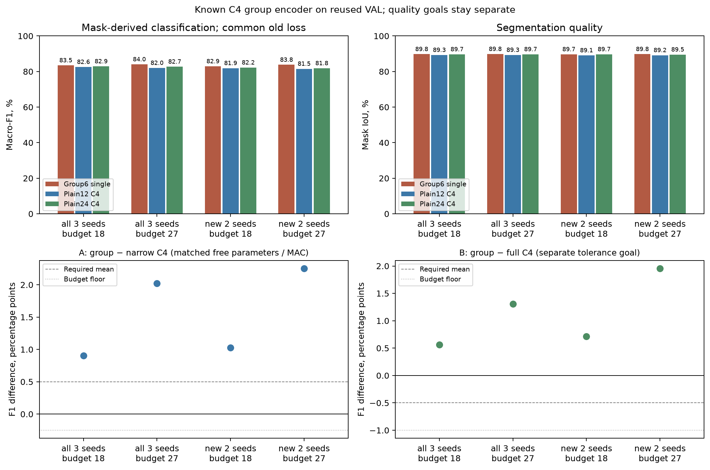
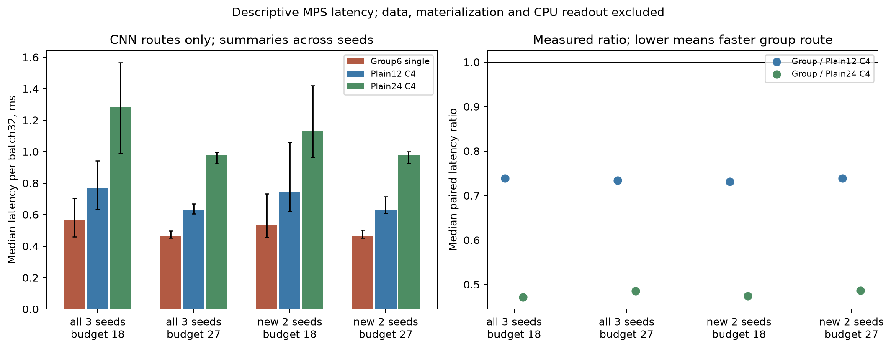

# C4-групповая CNN вместо обычного encoder

Изменяется encoder исходной масочной задачи: **SEM 12×12 → lifting 6×4 ориентации → group conv 6×4 (dilation 2) → group conv 6×4 (dilation 4) → среднее по ориентациям, 6 каналов → 1×1 → вероятность металла → бинарная маска → прежнее геометрическое правило класса**. После каждого слоя 3×3 применяется GELU. Это возврат к классификации, производной от предсказанной маски; прямые классовые головы этапов 9–11 остаются отдельными отрицательными ветками.

**Метрики:** историческое поле JSON `mask_F1` означает **Macro-F1 девяти классов, вычисленных из бинарной маски**, а не пиксельный F1 сегментации. Сегментация отдельно оценивается средним IoU предсказанной маски. В таблицах ниже Macro-F1 всегда относится к классификации.

**Все три seed:** Macro-F1 group6 **83.75%**, Plain12 C4 82.29%, Plain24 C4 82.82%. A PASS; B PASS. Это результат разработки на прежней VAL; нового закрытого подтверждения encoder пока нет.

Та же цель одновременно на всех трёх и новых двух seed: robust A **PASS**, robust B **PASS**. Основной ΔF1: все три +1.46 п.п.; новые два +1.64 п.п.

Использована известная конструкция C4 group-CNN с разделяемыми повёрнутыми весами ([Cohen и Welling, 2016](https://proceedings.mlr.press/v48/cohenc16.html)). Сравнение при близком вычислительном бюджете мотивировано работой [Roos и Kroon, 2024](https://proceedings.mlr.press/v251/roos24a.html). Новый общий оператор или глобальная оригинальность не заявляются.

## Общий протокол обучения и бюджет

Все три CNN обучаются с нуля, без чтения прежних весов. Для каждого бюджета и seed: 400 шагов dense BCE, затем 1 600 шагов dense BCE + прежняя geometry_loss с весом 1. AdamW: lr=0,0005, weight_decay=0,0001. На каждом шаге общий RNG выбирает 8 dense и 8 weak; во время warmup weak-индексы выбираются, но не входят в loss. Dense-бюджеты 18 и 27 (по 2 или 3 примера каждого класса), weak 1 152, VAL 695, subset seed 5303. Weak-маски не входят в оптимизатор. Новая функция потерь не исследуется.

Dense-примеры дают пиксельные SVG-маски для BCE. Weak-примеры дают только прежние метки двух направлений, полученные из классов 0…8: они входят в geometry_loss через предсказанную маску и её мягкую проводимость. Прямой обучаемой классовой головы здесь нет; при оценке класс вновь определяется жёстким геометрическим правилом бинарной маски.

Обе обычные CNN обучаются через тот же четырёхвидовой probability-pool, который используется при C4-инференсе. Четыре поворота объединены в один CNN-вызов с внутренним батчем 4N, затем вероятности обратно поворачиваются и усредняются. Group6 использует один вид и один проход. Identity-маршруты обычных CNN приведены как диагностика тех же весов и не являются дополнительными fit.

| Модель / основной маршрут | Свободных параметров | Коэффициентов при исполнении | MAC на изображение | Видов |
|---|---:|---:|---:|---:|
| Group6 single | 2 671 | 10 681 связанных коэффициентов | 1 527 552 | 1 |
| Plain12 C4 | 2 749 | 2 749, одни веса для 4 видов | 1 562 112 | 4 |
| Plain24 C4 | 10 681 | 10 681, одни веса для 4 видов | 6 110 208 | 4 |

Материализация group6 выполняется один раз: 10 681 коэффициент не означает 10 681 независимый обучаемый параметр. Group6 / Plain12: параметры −2,84%, MAC −2,21%; Group6 / Plain24 C4: MAC 0,25. MAC не отождествляется с измеренной задержкой.

Численная C4-эквивариантность и совпадение свободной/материализованной модели проверяются отдельно. Заранее заданный допуск вероятностей обученных моделей — 1e−5; допуск preflight — 1e−6. Фактические ошибки каждого маршрута приведены в таблицах и независимом аудите. Identity-маршруты обычных CNN не обязаны быть эквивариантными.

## Две заранее раздельные цели

**A_matched_quality (основная):** group6 против Plain12 C4 при различиях параметров и MAC не более 3%. Средний ΔMacro-F1 ≥+0,5 п.п.; каждый бюджет ≥−0,25 п.п.; средний ΔIoU ≥−0,2 п.п.

**B_full_efficiency (вторичная):** group6 против Plain24 C4. Средний ΔF1 ≥−0,5 п.п.; каждый бюджет ≥−1 п.п.; средний ΔIoU ≥−0,2 п.п.; MAC-отношение ≤0,30. Это заранее заданная допустимая потеря на использованной VAL, а не статистическое доказательство noninferiority. Прохождение B не переименовывается в превосходство A.

Порог каждой маски выбирается по общей сетке 0,10…0,90 с шагом 0,01 (81 значение); ранжирование: Macro-F1, затем IoU, близость к 0,5, затем меньший порог. Прежняя сетка из 7 порогов — только вторичная диагностика и не заменяет основную.

После независимого технического PASS любой пройденный критерий разрешает расширение seed. Для каждой заявляемой цели затем требуются **и все три seed, и отдельно новые два**: `(A_all3 AND A_new2) OR (B_all3 AND B_new2)`. Смешивать A одной группы seed с B другой нельзя.

Начато запусков 3, завершено 2, технических остановок 1, пока незавершённых 0. Различных завершённых обучений здесь **18**, обновлений **36 000**. Прежних обучений 124; всего **142**. Сохранённых fit-записей 19, унаследованных ссылок 1; оценочные маршруты, агрегаты и материализованные копии повторно не считаются.

## all 3 seeds: seed [5701, 5721, 5757]

Основная A: **PASS**; вторичная B: **PASS**.

| Цель | ΔF1, п.п. | ΔF1: 18 / 27, п.п. | ΔIoU, п.п. | Исход | Не пройдено |
|---|---:|---|---:|---|---|
| A_matched_quality | +1.46 | +0.91 / +2.02 | +0.49 | PASS | — |
| B_full_efficiency | +0.93 | +0.56 / +1.30 | +0.11 | PASS | — |

| Бюджет | Маршрут | Macro-F1, % | IoU, % | Macro-F1 по 7 порогам, % |
|---:|---|---:|---:|---:|
| 18 | group6_single | 83.47 | 89.77 | 83.06 |
| 18 | plain12_identity | 79.08 | 88.15 | 78.49 |
| 18 | plain12_C4 | 82.57 | 89.29 | 81.87 |
| 18 | plain24_identity | 79.82 | 88.28 | 79.49 |
| 18 | plain24_C4 | 82.91 | 89.68 | 82.59 |
| 27 | group6_single | 84.03 | 89.83 | 83.91 |
| 27 | plain12_identity | 78.40 | 87.92 | 77.61 |
| 27 | plain12_C4 | 82.01 | 89.32 | 81.68 |
| 27 | plain24_identity | 79.42 | 88.31 | 78.42 |
| 27 | plain24_C4 | 82.73 | 89.70 | 82.18 |

Одновременно все три и новые два seed: robust A **PASS**, robust B **PASS**; robust ANY_GOAL_PASS **PASS**.

## new 2 seeds: seed [5721, 5757]

Основная A: **PASS**; вторичная B: **PASS**.

| Цель | ΔF1, п.п. | ΔF1: 18 / 27, п.п. | ΔIoU, п.п. | Исход | Не пройдено |
|---|---:|---|---:|---|---|
| A_matched_quality | +1.64 | +1.03 / +2.25 | +0.60 | PASS | — |
| B_full_efficiency | +1.33 | +0.71 / +1.95 | +0.11 | PASS | — |

| Бюджет | Маршрут | Macro-F1, % | IoU, % | Macro-F1 по 7 порогам, % |
|---:|---|---:|---:|---:|
| 18 | group6_single | 82.93 | 89.69 | 82.74 |
| 18 | plain12_identity | 78.31 | 87.94 | 77.70 |
| 18 | plain12_C4 | 81.90 | 89.09 | 81.41 |
| 18 | plain24_identity | 79.86 | 88.28 | 79.60 |
| 18 | plain24_C4 | 82.22 | 89.71 | 81.94 |
| 27 | group6_single | 83.79 | 89.78 | 83.72 |
| 27 | plain12_identity | 77.95 | 87.73 | 77.34 |
| 27 | plain12_C4 | 81.54 | 89.18 | 81.04 |
| 27 | plain24_identity | 78.85 | 88.08 | 78.24 |
| 27 | plain24_C4 | 81.84 | 89.53 | 81.42 |

Точки показывают бюджетные разности; пунктир — требуемое среднее, точки не должны сравниваться с ним как отдельные бюджетные пороги. Бюджетный предел отмечен отдельно. Средние и все guard-критерии приведены в таблице; доверительные интервалы не оценивались.

## Измеренная задержка — описательный результат

MPS, batch 32, 10 прогревочных батчей на маршрут и 50 парных повторов со случайным порядком пяти маршрутов. Синхронизация выполняется до и после каждого измерения. Для обычной C4-CNN повороты и probability-pool входят во время, четыре вида выполняются одним вызовом с батчем 128. Материализация group-весов, загрузка данных, host-transfer и общий CPU geometric readout исключены. End-to-end задержка не измерена. Скорость не входит в A/B и не выводится только из MAC.

**all 3 seeds:**

| Бюджет | Seed | Маршрут | Median batch32, мс | p10 / p90, мс |
|---:|---:|---|---:|---|
| 18 | 5701 | group6_single | 0.569 | 0.542 / 0.704 |
| 18 | 5701 | plain12_identity | 0.401 | 0.365 / 0.555 |
| 18 | 5701 | plain12_C4 | 0.767 | 0.745 / 0.941 |
| 18 | 5701 | plain24_identity | 0.574 | 0.534 / 0.630 |
| 18 | 5701 | plain24_C4 | 1.287 | 1.145 / 1.566 |
| 27 | 5701 | group6_single | 0.442 | 0.438 / 0.483 |
| 27 | 5701 | plain12_identity | 0.327 | 0.291 / 0.372 |
| 27 | 5701 | plain12_C4 | 0.609 | 0.587 / 0.646 |
| 27 | 5701 | plain24_identity | 0.441 | 0.436 / 0.458 |
| 27 | 5701 | plain24_C4 | 0.945 | 0.891 / 0.958 |
| 18 | 5721 | group6_single | 0.607 | 0.459 / 0.811 |
| 18 | 5721 | plain12_identity | 0.409 | 0.336 / 0.674 |
| 18 | 5721 | plain12_C4 | 0.853 | 0.635 / 1.304 |
| 18 | 5721 | plain24_identity | 0.579 | 0.461 / 0.774 |
| 18 | 5721 | plain24_C4 | 1.285 | 0.990 / 1.656 |
| 18 | 5757 | group6_single | 0.465 | 0.454 / 0.653 |
| 18 | 5757 | plain12_identity | 0.339 | 0.307 / 0.547 |
| 18 | 5757 | plain12_C4 | 0.636 | 0.609 / 0.813 |
| 18 | 5757 | plain24_identity | 0.466 | 0.452 / 0.603 |
| 18 | 5757 | plain24_C4 | 0.982 | 0.937 / 1.184 |
| 27 | 5721 | group6_single | 0.464 | 0.453 / 0.507 |
| 27 | 5721 | plain12_identity | 0.337 | 0.304 / 0.376 |
| 27 | 5721 | plain12_C4 | 0.630 | 0.606 / 0.668 |
| 27 | 5721 | plain24_identity | 0.458 | 0.450 / 0.495 |
| 27 | 5721 | plain24_C4 | 0.979 | 0.928 / 0.996 |
| 27 | 5757 | group6_single | 0.462 | 0.453 / 0.496 |
| 27 | 5757 | plain12_identity | 0.340 | 0.303 / 0.432 |
| 27 | 5757 | plain12_C4 | 0.631 | 0.613 / 0.759 |
| 27 | 5757 | plain24_identity | 0.462 | 0.452 / 0.481 |
| 27 | 5757 | plain24_C4 | 0.978 | 0.925 / 1.003 |

| Бюджет | Seed | Парный Group / Plain12 C4 | Парный Group / Plain24 C4 | Материализация вне окна, с |
|---:|---:|---:|---:|---:|
| 18 | 5701 | 0.743 | 0.447 | 0.143523 |
| 27 | 5701 | 0.725 | 0.483 | 0.004302 |
| 18 | 5721 | 0.723 | 0.471 | 0.017802 |
| 18 | 5757 | 0.739 | 0.477 | 0.006141 |
| 27 | 5721 | 0.743 | 0.488 | 0.004130 |
| 27 | 5757 | 0.734 | 0.485 | 0.003661 |

**new 2 seeds:**

| Бюджет | Seed | Маршрут | Median batch32, мс | p10 / p90, мс |
|---:|---:|---|---:|---|
| 18 | 5721 | group6_single | 0.607 | 0.459 / 0.811 |
| 18 | 5721 | plain12_identity | 0.409 | 0.336 / 0.674 |
| 18 | 5721 | plain12_C4 | 0.853 | 0.635 / 1.304 |
| 18 | 5721 | plain24_identity | 0.579 | 0.461 / 0.774 |
| 18 | 5721 | plain24_C4 | 1.285 | 0.990 / 1.656 |
| 18 | 5757 | group6_single | 0.465 | 0.454 / 0.653 |
| 18 | 5757 | plain12_identity | 0.339 | 0.307 / 0.547 |
| 18 | 5757 | plain12_C4 | 0.636 | 0.609 / 0.813 |
| 18 | 5757 | plain24_identity | 0.466 | 0.452 / 0.603 |
| 18 | 5757 | plain24_C4 | 0.982 | 0.937 / 1.184 |
| 27 | 5721 | group6_single | 0.464 | 0.453 / 0.507 |
| 27 | 5721 | plain12_identity | 0.337 | 0.304 / 0.376 |
| 27 | 5721 | plain12_C4 | 0.630 | 0.606 / 0.668 |
| 27 | 5721 | plain24_identity | 0.458 | 0.450 / 0.495 |
| 27 | 5721 | plain24_C4 | 0.979 | 0.928 / 0.996 |
| 27 | 5757 | group6_single | 0.462 | 0.453 / 0.496 |
| 27 | 5757 | plain12_identity | 0.340 | 0.303 / 0.432 |
| 27 | 5757 | plain12_C4 | 0.631 | 0.613 / 0.759 |
| 27 | 5757 | plain24_identity | 0.462 | 0.452 / 0.481 |
| 27 | 5757 | plain24_C4 | 0.978 | 0.925 / 1.003 |

| Бюджет | Seed | Парный Group / Plain12 C4 | Парный Group / Plain24 C4 | Материализация вне окна, с |
|---:|---:|---:|---:|---:|
| 18 | 5721 | 0.723 | 0.471 | 0.017802 |
| 18 | 5757 | 0.739 | 0.477 | 0.006141 |
| 27 | 5721 | 0.743 | 0.488 | 0.004130 |
| 27 | 5757 | 0.734 | 0.485 | 0.003661 |

Для нескольких seed столбцы и концы диапазонов — медианы соответствующих seed-сводок, а не объединённый доверительный интервал. Парное отношение — медиана 50 отношений в каждом seed; при агрегировании показана медиана seed-сводок.

## Все сохранённые запуски

### groupcnn_screen_s5701_a571c57fcf

[FROZEN.json](trials/groupcnn_screen_s5701_a571c57fcf/FROZEN.json).

Сохранённая техническая остановка `TypeError`: dict() got multiple values for keyword argument 'free_parameters'. [FAILURE.json](trials/groupcnn_screen_s5701_a571c57fcf/FAILURE.json). Она не является результатом A/B; сохранённые веса учитываются по исходному выполнению.

Завершённых обучений с сохранёнными итоговыми весами: 1. Сохранённых оценочных строк: 0.

### groupcnn_screen_s5701_metadata_recovery_27b9055b42

[FROZEN.json](trials/groupcnn_screen_s5701_metadata_recovery_27b9055b42/FROZEN.json).

`COMPLETE_GROUPCNN_DEVELOPMENT`; screen; seed [5701]; 6 различных моделей в результате, 12 000 суммарных обновлений, 10 оценочных строк; 165.26 с этого запуска. [RESULT.json](trials/groupcnn_screen_s5701_metadata_recovery_27b9055b42/RESULT.json), SHA-256 `481442ee0480420c26f684dc27b94fd1b77c8bc008708ed5a90854647cebaf09`.

Восстановление скрининга: унаследованных обучений 1, выполненных здесь 5; новых обновлений 10 000. Повторная оценка прежней модели без оптимизатора не считается новым обучением. [RECOVERY_MANIFEST.json](trials/groupcnn_screen_s5701_metadata_recovery_27b9055b42/RECOVERY_MANIFEST.json) · [RECOVERY_PROOF.json](trials/groupcnn_screen_s5701_metadata_recovery_27b9055b42/RECOVERY_PROOF.json). Исправление относится к сборке метаданных; модель, данные, loss, батчи и научные критерии сохранены.

| Бюджет | Seed | Архитектура | Шагов | Warmup / joint | Время обучения, с |
|---:|---:|---|---:|---|---:|
| 18 | 5701 | group6 | 2000 | 400 / 1600 | 31.45 |
| 18 | 5701 | plain12_C4pooled | 2000 | 400 / 1600 | 24.16 |
| 18 | 5701 | plain24_C4pooled | 2000 | 400 / 1600 | 40.25 |
| 27 | 5701 | group6 | 2000 | 400 / 1600 | 31.18 |
| 27 | 5701 | plain12_C4pooled | 2000 | 400 / 1600 | 22.99 |
| 27 | 5701 | plain24_C4pooled | 2000 | 400 / 1600 | 28.42 |

| Бюджет | Seed | Маршрут | Порог | Macro-F1, % | IoU, % | C4 max error |
|---:|---:|---|---:|---:|---:|---:|
| 18 | 5701 | group6_single | 0.28 | 84.55 | 89.92 | 1.01e-06 |
| 18 | 5701 | plain12_identity | 0.28 | 80.61 | 88.58 | 0.998 |
| 18 | 5701 | plain12_C4 | 0.34 | 83.89 | 89.68 | 0 |
| 18 | 5701 | plain24_identity | 0.21 | 79.75 | 88.27 | 0.999 |
| 18 | 5701 | plain24_C4 | 0.27 | 84.28 | 89.62 | 0 |
| 27 | 5701 | group6_single | 0.31 | 84.52 | 89.92 | 8.64e-07 |
| 27 | 5701 | plain12_identity | 0.24 | 79.30 | 88.31 | 0.972 |
| 27 | 5701 | plain12_C4 | 0.30 | 82.96 | 89.60 | 0 |
| 27 | 5701 | plain24_identity | 0.24 | 80.58 | 88.77 | 0.999 |
| 27 | 5701 | plain24_C4 | 0.34 | 84.51 | 90.04 | 0 |

| Цель | ΔF1, п.п. | ΔF1: 18 / 27, п.п. | ΔIoU, п.п. | Исход | Не пройдено |
|---|---:|---|---:|---|---|
| A_matched_quality | +1.11 | +0.66 / +1.56 | +0.28 | PASS | — |
| B_full_efficiency | +0.14 | +0.27 / +0.01 | +0.09 | PASS | — |

Независимый CPU-аудит: **PASS_AUDIT**, 35 / 35. [AUDIT.json](trials/groupcnn_screen_s5701_metadata_recovery_27b9055b42/AUDIT.json).

### groupcnn_replicate_s5721-5757_metadata_recovery_27b9055b42

[FROZEN.json](trials/groupcnn_replicate_s5721-5757_metadata_recovery_27b9055b42/FROZEN.json).

`COMPLETE_GROUPCNN_DEVELOPMENT`; replicate; seed [5721, 5757]; 12 различных моделей в результате, 24 000 суммарных обновлений, 20 оценочных строк; 370.47 с этого запуска. [RESULT.json](trials/groupcnn_replicate_s5721-5757_metadata_recovery_27b9055b42/RESULT.json), SHA-256 `f73c438c7b5667fd36ccc064bf5c68c99d28566fc460a52bb9cd93224d7d908c`.

Расширение через recovery.py: унаследованных обучений 0, выполненных здесь 12; новых обновлений 24 000. Повторная оценка прежней модели без оптимизатора не считается новым обучением. [RECOVERY_MANIFEST.json](trials/groupcnn_replicate_s5721-5757_metadata_recovery_27b9055b42/RECOVERY_MANIFEST.json) · [RECOVERY_PROOF.json](trials/groupcnn_replicate_s5721-5757_metadata_recovery_27b9055b42/RECOVERY_PROOF.json). Исправление относится к сборке метаданных; модель, данные, loss, батчи и научные критерии сохранены.

| Бюджет | Seed | Архитектура | Шагов | Warmup / joint | Время обучения, с |
|---:|---:|---|---:|---|---:|
| 18 | 5721 | group6 | 2000 | 400 / 1600 | 30.77 |
| 18 | 5721 | plain12_C4pooled | 2000 | 400 / 1600 | 22.54 |
| 18 | 5721 | plain24_C4pooled | 2000 | 400 / 1600 | 34.05 |
| 18 | 5757 | group6 | 2000 | 400 / 1600 | 29.70 |
| 18 | 5757 | plain12_C4pooled | 2000 | 400 / 1600 | 23.98 |
| 18 | 5757 | plain24_C4pooled | 2000 | 400 / 1600 | 31.63 |
| 27 | 5721 | group6 | 2000 | 400 / 1600 | 27.31 |
| 27 | 5721 | plain12_C4pooled | 2000 | 400 / 1600 | 23.27 |
| 27 | 5721 | plain24_C4pooled | 2000 | 400 / 1600 | 30.66 |
| 27 | 5757 | group6 | 2000 | 400 / 1600 | 27.05 |
| 27 | 5757 | plain12_C4pooled | 2000 | 400 / 1600 | 23.31 |
| 27 | 5757 | plain24_C4pooled | 2000 | 400 / 1600 | 30.94 |

| Бюджет | Seed | Маршрут | Порог | Macro-F1, % | IoU, % | C4 max error |
|---:|---:|---|---:|---:|---:|---:|
| 18 | 5721 | group6_single | 0.30 | 80.96 | 89.25 | 9.83e-07 |
| 18 | 5721 | plain12_identity | 0.33 | 79.05 | 88.00 | 0.995 |
| 18 | 5721 | plain12_C4 | 0.30 | 80.24 | 88.54 | 0 |
| 18 | 5721 | plain24_identity | 0.23 | 79.67 | 87.90 | 0.998 |
| 18 | 5721 | plain24_C4 | 0.31 | 81.58 | 89.37 | 0 |
| 18 | 5757 | group6_single | 0.42 | 84.89 | 90.14 | 8.34e-07 |
| 18 | 5757 | plain12_identity | 0.34 | 77.57 | 87.88 | 0.996 |
| 18 | 5757 | plain12_C4 | 0.34 | 83.57 | 89.64 | 0 |
| 18 | 5757 | plain24_identity | 0.43 | 80.06 | 88.67 | 0.994 |
| 18 | 5757 | plain24_C4 | 0.38 | 82.86 | 90.05 | 0 |
| 27 | 5721 | group6_single | 0.30 | 81.89 | 89.48 | 1.22e-06 |
| 27 | 5721 | plain12_identity | 0.33 | 78.57 | 87.83 | 0.993 |
| 27 | 5721 | plain12_C4 | 0.35 | 79.97 | 88.76 | 0 |
| 27 | 5721 | plain24_identity | 0.35 | 78.30 | 87.91 | 0.997 |
| 27 | 5721 | plain24_C4 | 0.34 | 80.88 | 89.27 | 0 |
| 27 | 5757 | group6_single | 0.38 | 85.69 | 90.07 | 1.25e-06 |
| 27 | 5757 | plain12_identity | 0.21 | 77.32 | 87.63 | 0.995 |
| 27 | 5757 | plain12_C4 | 0.37 | 83.12 | 89.60 | 0 |
| 27 | 5757 | plain24_identity | 0.28 | 79.40 | 88.26 | 0.999 |
| 27 | 5757 | plain24_C4 | 0.33 | 82.80 | 89.80 | 0 |

| Цель | ΔF1, п.п. | ΔF1: 18 / 27, п.п. | ΔIoU, п.п. | Исход | Не пройдено |
|---|---:|---|---:|---|---|
| A_matched_quality | +1.64 | +1.03 / +2.25 | +0.60 | PASS | — |
| B_full_efficiency | +1.33 | +0.71 / +1.95 | +0.11 | PASS | — |

Независимый CPU-аудит: **PASS_AUDIT**, 36 / 36. [AUDIT.json](trials/groupcnn_replicate_s5721-5757_metadata_recovery_27b9055b42/AUDIT.json).

[AGGREGATE_RESULT.json](trials/groupcnn_replicate_s5721-5757_metadata_recovery_27b9055b42/AGGREGATE_RESULT.json) содержит исходные и новые seed; его fit и маршруты повторно не суммируются.

## История попыток и границы вывода

Число запусков приведено из manifest каждого этапа; общие CNN-контроли входят в число fit только в месте их выполнения. Закрытое подтверждение — отдельная оценка без обучения.

| Этап | Запусков | Новых различных обучений | Сохранённый исход |
|---|---:|---:|---|
| [sem_arch_iterative_20261102](../sem_arch_iterative_20261102/REPORT.md) | 4 | 22 | η2: direct / split / FiLM / gated; отрицательные исходы |
| [sem_arch_amplitude4_20261102](../sem_arch_amplitude4_20261102/REPORT.md) | 2 | 12 | η4 FiLM; физический критерий и сравнение с дообученной CNN не пройдены |
| [sem_arch_joint_adaptation_20261102](../sem_arch_joint_adaptation_20261102/REPORT.md) | 1 | 6 | Совместная адаптация; A/B не пройдены |
| [sem_arch_early_skip_20261102](../sem_arch_early_skip_20261102/REPORT.md) | 1 | 6 | Early skip; A/B/C не пройдены |
| [sem_arch_native_detail_20261102](../sem_arch_native_detail_20261102/REPORT.md) | 1 | 6 | Native48 detail; A/B/C не пройдены |
| [sem_arch_orbit_pool_20261102](../sem_arch_orbit_pool_20261102/REPORT.md) | 2 | 4 | Известный равномерный C4: старые VAL-критерии пройдены; 4 новых CNN-контроля |
| [sem_arch_orbit_confirmation_20261102](../sem_arch_orbit_confirmation_20261102/REPORT.md) | оценка | 0 | Закрытое C4-подтверждение на 8 полях: FAIL_PILOT |
| [sem_arch_learned_orbit_20261102](../sem_arch_learned_orbit_20261102/REPORT.md) | 1 | 16 | Обучаемые веса видов; A/B/D не пройдены |
| [sem_arch_orbit_residual_20261102](../sem_arch_orbit_residual_20261102/REPORT.md) | 1 | 12 | Residual-поправка маски; A/B/C не пройдены |
| [sem_arch_classification_readout_20261102](../sem_arch_classification_readout_20261102/REPORT.md) | 1 | 12 | Прямая flat9-классификация; A/B/C не пройдены |
| [sem_arch_directional_readout_20261102](../sem_arch_directional_readout_20261102/REPORT.md) | 1 | 12 | Прямая directional-классификация; A/B/C не пройдены |
| [sem_arch_anchored_readout_20261102](../sem_arch_anchored_readout_20261102/REPORT.md) | 2 | 16 | Прямой anchored-readout; CNN_SUCCESS не пройден; техническая остановка сохранена |
| Текущая групповая CNN | 3 | 18 | Отдельные A/B и технические запуски показаны выше |

Это многократно использованные TRAIN/VAL одной серии, без нового закрытого подтверждения group-CNN. Прежний FAIL_PILOT равномерного C4 на восьми свежих полях той же ИС сохранён и не переопределён как проверка нового encoder. Данные этого закрытого подтверждения здесь не использовались. Новые seed повторяют обучение на той же VAL и не являются независимым тестом.

Классы получены из SVG-масок прежним бинарным геометрическим правилом, а не экспертной типологией дефектов или измерением электрического состояния. Технический PASS не заменяет критерий качества. Перенос между изделиями, статистическое закрытое подтверждение и готовность результата для Q1 не установлены.

[PROTOCOL.md](PROTOCOL.md) · [CONFIG.json](CONFIG.json) · [LEDGER.json](LEDGER.json) · [model.py](model.py) · [исходный runner.py](runner.py) · [исполняемый recovery.py](recovery.py) · [audit.py](audit.py).
