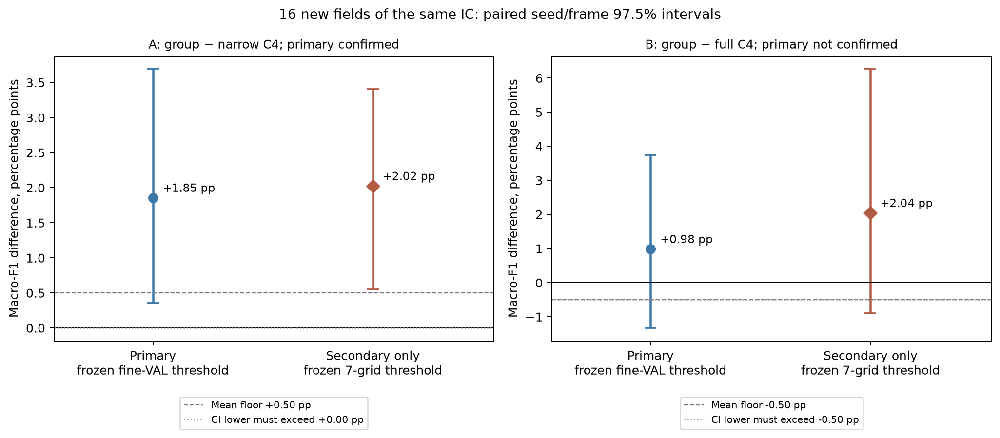
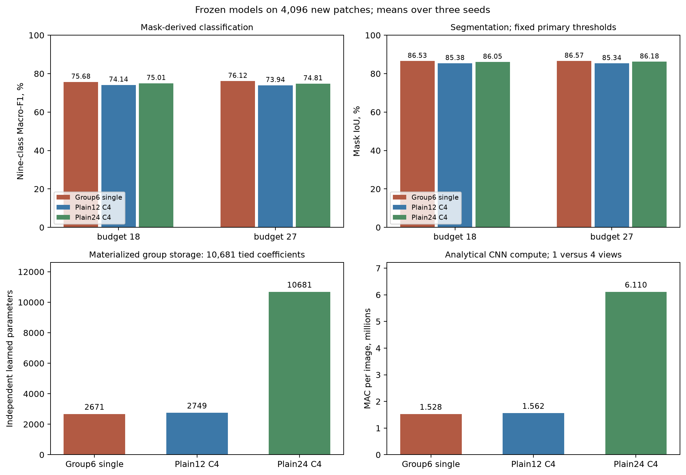

# Закрытое подтверждение C4-группового encoder

Зафиксированная Group6 CNN одним проходом предсказывает маску металлизации M2. Обычные Plain12 и Plain24 используют четырёхвидовое C4-усреднение вероятностей. Класс 0…8 вычисляется из бинарной маски прежним геометрическим правилом по направлениям LR/TB. Это девять модельных геометрических состояний, а не экспертные типы дефектов или измеренное электрическое состояние.

**`mask_F1` в JSON — Macro-F1 девяти классов из маски, не пиксельный F1.** Сегментация измеряется отдельно средним IoU. Для всех моделей сохранены прежние BCE и geometry_loss; на новых данных нет обучения, поиска порога или выбора модели.

**Первичный исход: PASS_CONFIRMATION.** Оба независимых итоговых аудита сохранены и прошли.

Подтверждение отдельных целей: **A_matched_quality: подтверждена**; **B_full_efficiency: не подтверждена**. Общий PASS означает хотя бы одну подтверждённую цель; он не заменяет исход каждой цели.

Основной подтверждённый вывод: этот encoder улучшает Macro-F1 масочно-геометрических классов относительно узкой Plain12 C4 при заранее согласованных свободных параметрах и MAC на новых полях той же ИС. Вывод относится к этому архитектурному сравнению и протоколу.

Отдельная цель B к полной Plain24 C4 не подтверждена. Даже положительная точечная разность не заменяет требуемую нижнюю границу интервала и остальные ограничения B.

Новых обучений **0**; прежних различных fit **142**. Проверяются 18 фиксированных состояний: три модели × два бюджета 18/27 × три seed 5701/5721/5757. Шесть материализованных group-checkpoint повторно не считаются обучениями. Две заранее фиксированные калибровки используют одни предсказанные вероятности.

[Архитектурная гипотеза](../sem_arch_groupcnn_20261102/HYPOTHESIS.md) и [результаты разработки с полной историей попыток](../sem_arch_groupcnn_20261102/REPORT.md) сохраняют исходы на прежней VAL. Этот отчёт не переписывает их новым исходом.

## Две отдельные цели подтверждения

**A_matched_quality:** Group6 против Plain12 C4 при близких свободных параметрах и MAC (различия ≤3%). Средний ΔF1 ≥+0,5 п.п.; нижняя граница 97,5%-интервала **строго >0**; каждый бюджет ΔF1 ≥−0,25 п.п.; средний ΔIoU ≥−0,2 п.п.

Порог +0,5 п.п. — практический порог **наблюдаемой точечной средней оценки**. Условие CI lower >0 поддерживает положительный эффект в заданной схеме пересэмплирования; оно не доказывает, что минимальный популяционный прирост составляет ≥0,5 п.п.

**B_full_efficiency:** Group6 против Plain24 C4. Средний ΔF1 ≥−0,5 п.п.; нижняя граница 97,5%-интервала **строго >−0,5 п.п.**; каждый бюджет ΔF1 ≥−1 п.п.; средний ΔIoU ≥−0,2 п.п.; отношение MAC ≤0,30. Это отдельная цель допустимой потери качества и экономии вычислений. Успех B не переименовывается в превосходство A.

Каждая цель дополнительно требует своего прежнего допуска на **всех трёх и новых двух seed одновременно**. Основные пороги выбраны до новых изображений на прежней VAL-сетке 81 значения. Семиточечные пороги — только вторичная чувствительность, без возможности заменить первичный исход.

Интервалы: 10 000 парных crossed-bootstrap повторов, seed 202611027. Сначала выбираются три seed с возвращением, затем 16 кадров с возвращением; одни индексы общие для моделей, бюджетов, калибровок и сравнений. Для каждого выбранного seed/бюджета confusion суммируется по выбранным кадрам, затем вычисляется Macro-F1; потом усредняются F1 по seed и бюджетам. Confusion разных seed не объединяются перед F1. Центральные квантили [0,0125; 0,9875] дают поправку Бонферрони для двух заранее заданных сравнений. Пиксели и фрагменты не считаются независимыми bootstrap-единицами.

## Первичная оценка

| Цель | Group F1, % | Контроль F1, % | ΔF1, п.п. | 97,5% CI ΔF1, п.п. | ΔF1: 18 / 27, п.п. | ΔIoU, п.п. | Все численные условия | Подтверждение |
|---|---:|---:|---:|---|---|---:|---|---|
| A_matched_quality | 75.90 | 74.04 | +1.854366 | [+0.352767; +3.695357] | +1.535273 / +2.173460 | +1.190161 | PASS | да |
| B_full_efficiency | 75.90 | 74.91 | +0.983144 | [-1.327855; +3.750616] | +0.664478 / +1.301811 | +0.429001 | FAIL | нет |

| Цель | Проверка | Исход |
|---|---|---|
| A_matched_quality | mean_F1 | PASS |
| A_matched_quality | CI_lower | PASS |
| A_matched_quality | budget_guard | PASS |
| A_matched_quality | IoU_guard | PASS |
| A_matched_quality | parameter_match | PASS |
| A_matched_quality | MAC_match | PASS |
| A_matched_quality | development_eligible | PASS |
| B_full_efficiency | mean_F1 | PASS |
| B_full_efficiency | CI_lower | FAIL |
| B_full_efficiency | budget_guard | PASS |
| B_full_efficiency | IoU_guard | PASS |
| B_full_efficiency | MAC_ratio | PASS |
| B_full_efficiency | development_eligible | PASS |

## Вторичная чувствительность: 7 порогов

| Цель | Group F1, % | Контроль F1, % | ΔF1, п.п. | 97,5% CI ΔF1, п.п. | ΔF1: 18 / 27, п.п. | ΔIoU, п.п. | Все численные условия | Подтверждение |
|---|---:|---:|---:|---|---|---:|---|---|
| A_matched_quality | 76.03 | 74.00 | +2.022036 | [+0.551135; +3.404379] | +1.456258 / +2.587814 | +1.246874 | PASS | не применяется |
| B_full_efficiency | 76.03 | 73.99 | +2.041043 | [-0.895315; +6.271230] | +1.692048 / +2.390038 | +0.826820 | FAIL | не применяется |

| Цель | Проверка | Исход |
|---|---|---|
| A_matched_quality | mean_F1 | PASS |
| A_matched_quality | CI_lower | PASS |
| A_matched_quality | budget_guard | PASS |
| A_matched_quality | IoU_guard | PASS |
| A_matched_quality | parameter_match | PASS |
| A_matched_quality | MAC_match | PASS |
| A_matched_quality | development_eligible | PASS |
| B_full_efficiency | mean_F1 | PASS |
| B_full_efficiency | CI_lower | FAIL |
| B_full_efficiency | budget_guard | PASS |
| B_full_efficiency | IoU_guard | PASS |
| B_full_efficiency | MAC_ratio | PASS |
| B_full_efficiency | development_eligible | PASS |

Точки — средние приросты, линии — процентильные интервалы. У A порог среднего +0,5 п.п. отличается от строгого порога нижней границы 0. У B оба численных уровня −0,5 п.п., но нижняя граница должна быть строго выше. Вторичные интервалы не меняют подтверждение.

## Абсолютное качество и вычисления

| Маршрут | Macro-F1, % | IoU, % | Свободных параметров | Коэффициентов хранения | MAC / изображение | Видов |
|---|---:|---:|---:|---:|---:|---:|
| group6_single | 75.90 | 86.55 | 2671 | 10681 | 1527552 | 1 |
| plain12_C4 | 74.04 | 85.36 | 2749 | 2749 | 1562112 | 4 |
| plain24_C4 | 74.91 | 86.12 | 10681 | 10681 | 6110208 | 4 |

Качество показано при первичных фиксированных порогах. Значения по бюджетам усредняются по трём seed; это не ансамбль трёх моделей. У group 10 681 материализованный коэффициент связан с 2 671 свободным параметром. MAC-отношение к полному C4 равно 0,25; оно не равно отношению wall-clock времени.

Рандомизированный CNN-only latency benchmark выполнен при разработке и сохранён [отдельно](../sem_arch_groupcnn_20261102/REPORT.md). Он включает повороты и pool, но исключает материализацию, данные, host-transfer и CPU geometric readout. End-to-end время здесь не заявляется. Времена последовательной проверки новых данных не заменяют тот парный benchmark.

## Все зафиксированные модели

| Маршрут | Бюджет | Seed | Порог primary / secondary | Primary F1, % | Primary IoU, % | Secondary F1, % |
|---|---:|---:|---|---:|---:|---:|
| group6_single | 18 | 5701 | 0.28 / 0.30 | 77.48 | 87.02 | 77.72 |
| group6_single | 18 | 5721 | 0.30 / 0.30 | 71.61 | 85.16 | 71.61 |
| group6_single | 18 | 5757 | 0.42 / 0.45 | 77.94 | 87.40 | 78.49 |
| group6_single | 27 | 5701 | 0.31 / 0.30 | 76.94 | 86.77 | 76.91 |
| group6_single | 27 | 5721 | 0.30 / 0.30 | 72.84 | 85.64 | 72.84 |
| group6_single | 27 | 5757 | 0.38 / 0.40 | 78.57 | 87.29 | 78.59 |
| plain12_C4 | 18 | 5701 | 0.34 / 0.30 | 77.05 | 86.38 | 76.23 |
| plain12_C4 | 18 | 5721 | 0.30 / 0.30 | 70.60 | 83.79 | 70.60 |
| plain12_C4 | 18 | 5757 | 0.34 / 0.45 | 74.78 | 85.95 | 76.62 |
| plain12_C4 | 27 | 5701 | 0.30 / 0.30 | 75.24 | 85.80 | 75.24 |
| plain12_C4 | 27 | 5721 | 0.35 / 0.30 | 71.43 | 84.21 | 69.59 |
| plain12_C4 | 27 | 5757 | 0.37 / 0.40 | 75.16 | 86.00 | 75.74 |
| plain24_C4 | 18 | 5701 | 0.27 / 0.30 | 75.87 | 85.69 | 76.86 |
| plain24_C4 | 18 | 5721 | 0.31 / 0.30 | 73.99 | 85.45 | 73.67 |
| plain24_C4 | 18 | 5757 | 0.38 / 0.30 | 75.17 | 87.01 | 72.21 |
| plain24_C4 | 27 | 5701 | 0.34 / 0.30 | 77.40 | 86.75 | 76.11 |
| plain24_C4 | 27 | 5721 | 0.34 / 0.30 | 72.55 | 85.43 | 71.75 |
| plain24_C4 | 27 | 5757 | 0.33 / 0.30 | 74.49 | 86.37 | 73.31 |

Полное время оценки и статистики 12.30 с. [PREDICTIONS.npz](PREDICTIONS.npz) сохраняет вероятности, классы, упакованные маски и IoU; [BOOTSTRAP.npz](BOOTSTRAP.npz) — frame-confusion, общие seed/frame-индексы и все bootstrap-разности. [RESULT.json](RESULT.json) хранит полный численный исход, включая не пройденные условия.

## Описательная проверка ошибок направлений

Этот разбор добавлен после оценки и **не является заранее заданным критерием, доказательством механизма или производственной частотой дефектов**. Используются только сохранённые первичные классы: `LR=y//3`, `TB=y%3`. Состояние 0 — отсутствие граничного соединения по прежнему геометрическому правилу; 1 и 2 — две ненулевые градации ответа. Это состояние вычисленной маски, не электрическое измерение.

В таблице — среднее число событий по шести состояниям seed×бюджет, из 8192 решений LR/TB в каждом. Один фрагмент может дать ошибку обоих направлений. Отрицательная разность означает меньше таких ошибок у Group6. Это разложение ошибок направлений, а не математическое разложение Macro-F1 девяти классов.

| Ошибка | GT → prediction | Group6 | Plain12 C4 | Δ Group−Plain12 | Δ LR | Δ TB |
|---|---|---:|---:|---:|---:|---:|
| Ложное граничное соединение | 0 → 1/2 | 143.833 | 153.833 | -10.000 | -2.333 | -7.667 |
| Пропущенное соединение | 1/2 → 0 | 115.833 | 121.500 | -5.667 | -7.333 | +1.667 |
| Путаница ненулевых градаций | 1 ↔ 2 | 327.333 | 371.833 | -44.500 | -32.667 | -11.833 |

Числа описывают, какие типы несовпадений изменились в этой фиксированной выборке. Они не устанавливают причинный механизм улучшения и не использовались для выбора модели или порога.

## Фиксированная выборка и происхождение

16 новых полей съёмки, по 256 фрагментов, всего 4 096. До скачивания исключены 94 прежних кадра; точные D4-повторы исходных интенсивностей и масок удалены по шести прежним манифестам и внутри нового набора. Среди оставшихся фрагментов ранжирование использует только SHA интенсивностей; маска и класс не входят в ranking. Нужно ≥8 фрагментов и ≥3 кадров каждого класса. Недостаточное покрытие означает недостаточность фиксированного набора, без замены кадров или пересэмплирования.

Полный новый [TEST.npz](TEST.npz) содержит **24748** уникальных фрагментов только новых кадров, без добавления TRAIN/VAL. Для модельной проверки используется заранее заданный EVAL, а не весь TEST. Остаток тех же кадров не является ещё одним независимым подтверждением.

Фиксированные кадры: **[61, 87, 81, 212, 100, 16, 183, 252, 32, 150, 157, 192, 254, 200, 70, 123]**. [SOURCE_PLAN.json](SOURCE_PLAN.json), SHA-256 `1b24124effc19ba2bca720e61a674da1e760b4e5e42a5b6bbf676441b8098d65`.

Data gate: `PASS_EVAL_DATA_GATE`; фрагментов 4096. [EVAL_INDEX.json](EVAL_INDEX.json) · [DATA_MANIFEST.json](DATA_MANIFEST.json).

| Класс | Фрагментов | Различных кадров |
|---:|---:|---:|
| 0 | 1773 | 16 |
| 1 | 192 | 16 |
| 2 | 129 | 16 |
| 3 | 1198 | 16 |
| 4 | 160 | 16 |
| 5 | 69 | 16 |
| 6 | 481 | 16 |
| 7 | 37 | 14 |
| 8 | 57 | 15 |

До новых изображений [SELECTION.json](SELECTION.json), SHA-256 `5369a202a2e4d27aef3fb09aa873a6b81aca98ae70485e55c5ec07ae9e754b21`, связывает все 18 весов, оба порога каждого маршрута, код и [MODEL_LOCK.json](MODEL_LOCK.json). Перед первым новым предсказанием отдельно сохраняется [EVALUATION_FROZEN.json](EVALUATION_FROZEN.json). Аудит данных связывает SHA проверенного EVAL, индекса и манифеста с тем набором, который получает оценщик.

| Независимая проверка | Статус | Проверок |
|---|---|---|
| [PRE_LOCK_AUDIT.json](PRE_LOCK_AUDIT.json) | PASS_PRE_LOCK_AUDIT | 22 / 22 |
| [PRE_DOWNLOAD_AUDIT.json](PRE_DOWNLOAD_AUDIT.json) | PASS_PRE_DOWNLOAD_AUDIT | 24 / 24 |
| [DATA_AUDIT.json](DATA_AUDIT.json) | PASS_DATA_AUDIT | 17 / 17 |
| [AUDIT.json](AUDIT.json) | PASS_AUDIT | 13 / 13 |

Технический PASS отделён от научных целей A/B. До скачивания выполнена настоящая проверка 18 маршрутов на 17 прежних VAL-примерах с батчем 16, включая неполный батч, и независимая синтетическая проверка bootstrap. Это техническая проверка прежних данных, не новое подтверждение качества. [OLD_VAL_PREFLIGHT.json](OLD_VAL_PREFLIGHT.json). Предыдущие версии аудитов и source-снимки сохраняются.

Сохранённый предыдущий аудит: [PRE_LOCK_AUDIT_PREVIOUS_40643a5c87bd.json](PRE_LOCK_AUDIT_PREVIOUS_40643a5c87bd.json).

Сохранённые технические остановки разработки: [groupcnn_screen_s5701_a571c57fcf](../sem_arch_groupcnn_20261102/trials/groupcnn_screen_s5701_a571c57fcf/FAILURE.json). Первое обучение унаследовано по SHA без повторного fit; цепочка учёта остаётся в отчёте разработки.

## Границы вывода

Это новые поля **той же физической ИС**, а не независимые изделия. Фрагменты одного кадра зависимы; D4-дедупликация не устраняет все похожие структуры и пространственные связи. Разброс dense-подвыборок не оценивался: использован один розыгрыш 5303. Отбор архитектуры на прежней VAL был адаптивным. Новая проверка относится к замороженному encoder и порогам в этом протоколе.

Известная C4 group-CNN не объявляется новым общим методом. Перенос между изделиями и публикационная готовность для Q1 не установлены. Прежний отдельный FAIL_PILOT равномерного C4 сохранён [в его отчёте](../sem_arch_orbit_confirmation_20261102/REPORT.md); он не заменяется исходом этой архитектуры.

[PROTOCOL.md](PROTOCOL.md) · [CONFIG.json](CONFIG.json) · [SELECTION.json](SELECTION.json) · [evaluate.py](evaluate.py) · [confirmation_stats.py](confirmation_stats.py) · [audit.py](audit.py).
