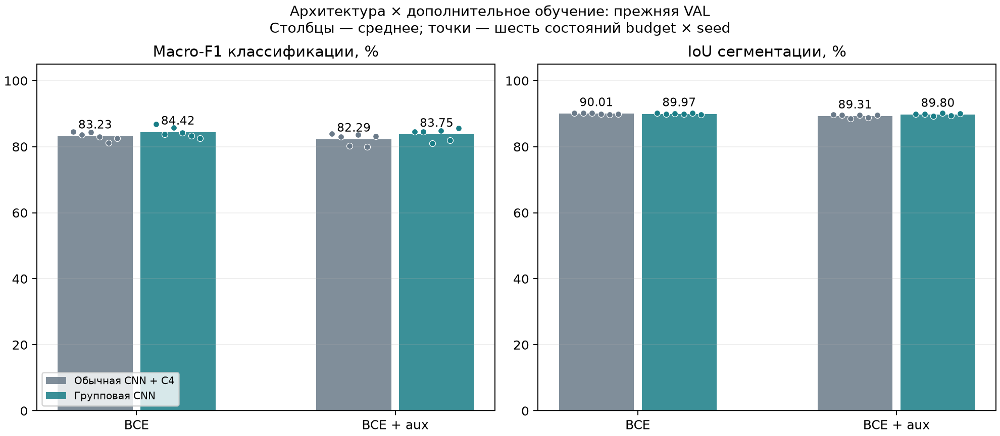
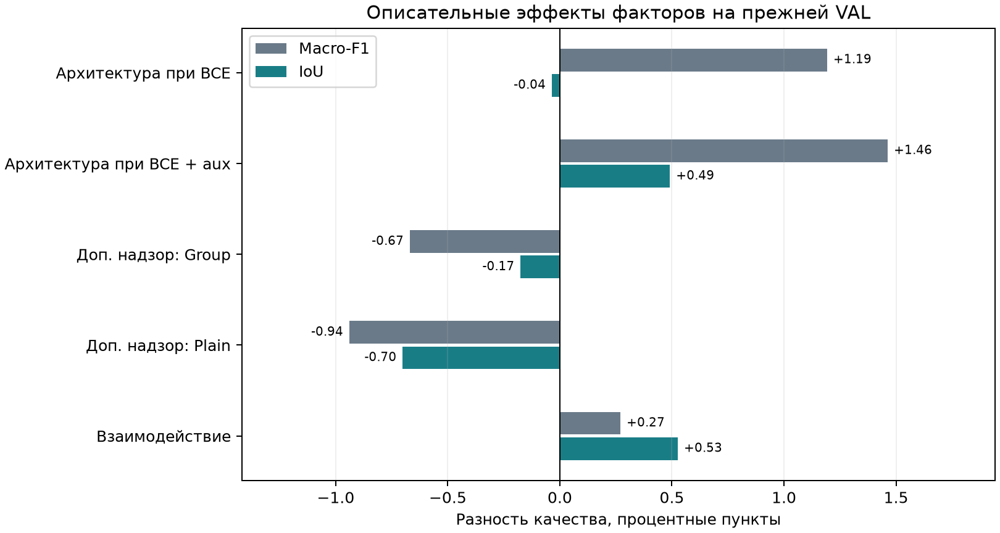

# Абляция архитектуры и дополнительного обучения

3 ноября 2026 года. Все 12 новых обучений закончены на MPS; 24 000 новых обновлений оптимизатора. Для режима с дополнительным надзором повторно использованы 12 прежних обучений без изменения весов.

Заданный описательный критерий архитектурного преимущества без дополнительного надзора пройден. При BCE средний ΔMacro-F1 Group−Plain равен +1.193 п.п., ΔIoU — -0.035 п.п. Все исходы сохранены независимо от этого критерия.

Это анализ компонентов на прежней, многократно использованной VAL (695 фрагментов двух кадров), с выбором порога и оценкой на этой же VAL. Он не является новым независимым подтверждением. Закрытые 16 кадров новым обучением и оценкой не читались.

## Что сравнивается

GroupCNN: 2 671 независимый параметр, 1 527 552 MAC на изображение. Контроль Plain12: 2 749 параметров, 1 562 112 MAC; он обучается и оценивается через среднее вероятностей четырёх совмещённых поворотов. У Group поворотные связи находятся внутри свёрточных слоёв.

BCE использует только 18 или 27 полных масок. BCE + aux дополнительно использует прежнюю geometry_loss по 1 152 классовым меткам. Поэтому разность этих режимов оценивает весь пакет дополнительного надзора, а не только формулу лосса при одинаковой информации в метках. Внутри каждого режима обе архитектуры имеют одинаковый доступ к разметке.

Три seed: 5701, 5721, 5757; два бюджета масок: 18 и 27. AdamW, 2 000 шагов, lr=0,0005, weight decay=0,0001, dense batch=8. Начальные веса и последовательности батчей внутри пар режимов совпадают. После первых 400 шагов у BCE-only сохраняется прямой проход dense8+weak8 для одинаковой формы вычислений, но слабые выходы имеют нулевой градиент. Сами слабые метки в BCE-only не используются.

## Основные результаты

Порог маски выбирается из общей фиксированной сетки 81 значения 0,10…0,90 по прежнему правилу. Ниже — среднее индивидуальных метрик по трём seed и двум бюджетам; это не ансамбль моделей. Macro-F1 относится к девяти геометрическим классам из маски; IoU — к сегментации металла.

| Режим | Модель | Macro-F1, % | IoU, % |
|---|---|---:|---:|
| BCE | Обычная CNN + C4 | 83.228 | 90.006 |
| BCE | Групповая CNN | 84.421 | 89.971 |
| BCE + дополнительный надзор | Обычная CNN + C4 | 82.289 | 89.305 |
| BCE + дополнительный надзор | Групповая CNN | 83.752 | 89.796 |



| Сравнение | ΔMacro-F1, п.п. | ΔIoU, п.п. |
|---|---:|---:|
| Архитектура при BCE: Group − Plain | +1.193 | -0.035 |
| Архитектура при BCE + aux: Group − Plain | +1.463 | +0.491 |
| Дополнительный надзор у Group | -0.669 | -0.175 |
| Дополнительный надзор у Plain | -0.939 | -0.701 |
| Взаимодействие: Δархитектуры aux − Δархитектуры BCE | +0.270 | +0.526 |

При обычном BCE Macro-F1 Group выше контроля в 6 из 6 пар бюджет × seed. Это поддерживает самостоятельную полезность архитектурного изменения на прежней VAL. Средний IoU при BCE изменился на -0.035 п.п.; улучшения всех метрик одновременно нет.

Дополнительный надзор в среднем не повысил Macro-F1 на этой VAL: его эффект у Group -0.669 п.п., у Plain -0.939 п.п. Поэтому самостоятельная польза этого компонента здесь не показана. Прежняя закрытая проверка сравнивала архитектуры при включённом aux; более высокую VAL-оценку BCE нельзя автоматически переносить на закрытые кадры или объявлять независимым основанием для замены основного режима.



Положительное взаимодействие означает, что архитектурная разность сильнее при дополнительном надзоре. Отрицательное — что она сильнее при BCE. Это описательная разность разностей, без утверждения статистической значимости.

## Проверка заданного критерия

| Условие | Исход |
|---|---|
| Средний ΔF1 ≥ +0,5 п.п. | PASS |
| ΔF1 каждого бюджета ≥ −0,25 п.п. | PASS |
| Средний ΔIoU ≥ −0,2 п.п. | PASS |
| Разница свободных параметров ≤ 3% | PASS |
| Разница MAC ≤ 3% | PASS |

## Чувствительность к порогу: общее значение 0,5

| Сравнение | ΔMacro-F1, п.п. | ΔIoU, п.п. |
|---|---:|---:|
| Архитектура при BCE: Group − Plain | +1.540 | -0.242 |
| Архитектура при BCE + aux: Group − Plain | +1.559 | +0.195 |
| Дополнительный надзор у Group | -4.471 | -0.033 |
| Дополнительный надзор у Plain | -4.490 | -0.470 |
| Взаимодействие: Δархитектуры aux − Δархитектуры BCE | +0.019 | +0.437 |

Фиксированный порог — вторичная диагностика. Он не заменяет основной критерий и не используется для смены исхода.

## Все 24 состояния

| Режим | Модель | Масок | Seed | Порог | Macro-F1, % | IoU, % |
|---|---|---:|---:|---:|---:|---:|
| BCE | Групповая CNN | 18 | 5701 | 0.46 | 86.787 | 90.152 |
| BCE | Групповая CNN | 18 | 5721 | 0.20 | 83.848 | 89.830 |
| BCE | Групповая CNN | 18 | 5757 | 0.20 | 85.723 | 90.024 |
| BCE | Групповая CNN | 27 | 5701 | 0.44 | 84.173 | 89.926 |
| BCE | Групповая CNN | 27 | 5721 | 0.25 | 83.400 | 90.210 |
| BCE | Групповая CNN | 27 | 5757 | 0.39 | 82.592 | 89.685 |
| BCE | Обычная CNN + C4 | 18 | 5701 | 0.45 | 84.617 | 90.230 |
| BCE | Обычная CNN + C4 | 18 | 5721 | 0.31 | 83.616 | 90.147 |
| BCE | Обычная CNN + C4 | 18 | 5757 | 0.42 | 84.319 | 90.165 |
| BCE | Обычная CNN + C4 | 27 | 5701 | 0.45 | 83.059 | 89.836 |
| BCE | Обычная CNN + C4 | 27 | 5721 | 0.32 | 81.186 | 89.761 |
| BCE | Обычная CNN + C4 | 27 | 5757 | 0.44 | 82.571 | 89.900 |
| BCE + дополнительный надзор | Групповая CNN | 18 | 5701 | 0.28 | 84.553 | 89.916 |
| BCE + дополнительный надзор | Групповая CNN | 18 | 5721 | 0.30 | 80.965 | 89.250 |
| BCE + дополнительный надзор | Групповая CNN | 18 | 5757 | 0.42 | 84.894 | 90.136 |
| BCE + дополнительный надзор | Групповая CNN | 27 | 5701 | 0.31 | 84.517 | 89.923 |
| BCE + дополнительный надзор | Групповая CNN | 27 | 5721 | 0.30 | 81.891 | 89.483 |
| BCE + дополнительный надзор | Групповая CNN | 27 | 5757 | 0.38 | 85.693 | 90.070 |
| BCE + дополнительный надзор | Обычная CNN + C4 | 18 | 5701 | 0.34 | 83.888 | 89.684 |
| BCE + дополнительный надзор | Обычная CNN + C4 | 18 | 5721 | 0.30 | 80.240 | 88.542 |
| BCE + дополнительный надзор | Обычная CNN + C4 | 18 | 5757 | 0.34 | 83.567 | 89.644 |
| BCE + дополнительный надзор | Обычная CNN + C4 | 27 | 5701 | 0.30 | 82.955 | 89.600 |
| BCE + дополнительный надзор | Обычная CNN + C4 | 27 | 5721 | 0.35 | 79.966 | 88.764 |
| BCE + дополнительный надзор | Обычная CNN + C4 | 27 | 5757 | 0.37 | 83.117 | 89.596 |

## Проверка и воспроизведение

Независимый аудит: 31/31. Сохранены начальные и конечные веса, материализованные GroupCNN, пробы градиентов, вероятности, все пороги и маски, прогресс и хеши. Доверительные интервалы по адаптивной VAL не строились.

[Протокол](PROTOCOL.md) · [Конфигурация](CONFIG.json) · [Фиксация входов](LOCK.json) · [Скрипт обучения](runner.py) · [Результат JSON](RESULT.json) · [Независимый аудит](AUDIT.json).

Прежняя модель с дополнительным надзором и её закрытый результат зафиксированы отдельно: [паспорт модели](../sem_model_freeze_20261103/MODEL_CARD.md). Новая абляция не переписывает исход той закрытой проверки.

Классы — геометрические состояния металлизации одной ИС, вычисленные из SVG-масок; это не экспертные типы производственных дефектов. Известная групповая свёртка не заявляется новым оператором.

Повторное построение этого отчёта без обучения:

```bash
.venv/bin/python -B gipoteza/sem_arch_loss_factorial_20261103/report.py
```
