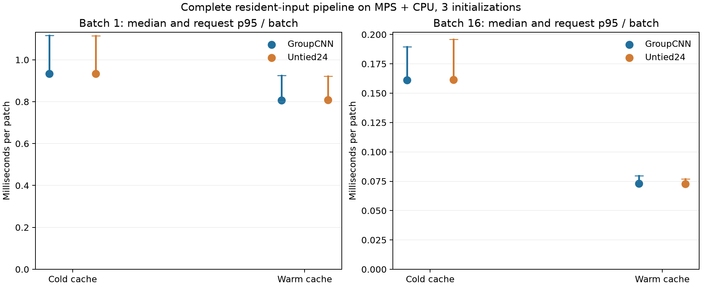

# Время полного конвейера на MPS и CPU

3 ноября 2026. Замер шести неизменённых моделей на 96 фрагментах из всех 24 кадров. Для GroupCNN и Untied24 использованы одинаковые фрагменты, три прежние инициализации и ранее зафиксированные окончательные пороги. Новых обучений в этом замере нет.

Время включает подготовку нативного входа 48×48, усреднение до 12×12 и нормировку, перенос на MPS, CNN, sigmoid, перенос вероятностей на CPU, бинаризацию и вычисление геометрического класса на CPU. Исходный фрагмент уже находится в оперативной памяти. Чтение PNG, загрузка весов, материализация групповых ядер, склейка кадров и запуск интерпретатора вынесены за пределы запроса. Это не задержка обработки целой пластины.

| Пакет | Кэш классов | Модель | Медиана запроса, мс | p95 запроса, мс | Медиана / фрагмент, мс |
|---:|---|---|---:|---:|---:|
| 1 | cold | GroupCNN | 0.9341 | 1.1166 | 0.9341 |
| 1 | cold | Untied24 | 0.9344 | 1.1145 | 0.9344 |
| 1 | warm | GroupCNN | 0.8076 | 0.9246 | 0.8076 |
| 1 | warm | Untied24 | 0.8086 | 0.9225 | 0.8086 |
| 16 | cold | GroupCNN | 2.5776 | 3.0340 | 0.1611 |
| 16 | cold | Untied24 | 2.5830 | 3.1335 | 0.1614 |
| 16 | warm | GroupCNN | 1.1704 | 1.2762 | 0.0732 |
| 16 | warm | Untied24 | 1.1624 | 1.2326 | 0.0726 |

Cold: кэш ранее полученных классов пуст в начале каждого запроса; повторяющиеся маски внутри пакета разрешено объединять. Warm: все маски выбранных фрагментов заранее присутствуют в кэше. Warm относится к повторным маскам и не характеризует обычный поток новых изображений.

Нормировка времени пакета на число фрагментов показывает пропускную способность последовательной обработки пакетов. Она не равна задержке отдельного запроса размера 1. p95 характеризует запрос, а не независимые длительности его элементов.

Три повтора для каждого размера пакета, парный случайный порядок моделей и режимов. Медианы и p95 объединяют запросы трёх инициализаций; измерения не являются независимыми образцами производительности разных машин. Статистическое превосходство по скорости не проверяется.

## Отношение медиан Group / Untied

- Пакет 1, cold: 1.000.
- Пакет 1, warm: 0.999.
- Пакет 16, cold: 0.998.
- Пакет 16, warm: 1.007.

Отношение меньше 1 означает меньшую измеренную медиану Group. Архитектуры используют одинаковые 1527552 MAC и одинаковую развёрнутую 24-канальную форму свёрток, поэтому эти замеры не обосновывают универсальное ускорение GroupCNN.

## Вспомогательный профиль этапов

Среднее время в мс для пакета 16/cold. В этом отдельном профиле добавлены синхронизации между этапами; суммы не заменяют основной замер полного запроса.

| Этап | GroupCNN | Untied24 |
|---|---:|---:|
| Подготовка на CPU | 0.0781 | 0.0782 |
| Перенос CPU → MPS | 0.3395 | 0.3379 |
| CNN и sigmoid | 0.7458 | 0.7597 |
| Перенос MPS → CPU | 0.2170 | 0.2028 |
| Бинаризация | 0.0025 | 0.0024 |
| Геометрический класс и финальная синхронизация | 1.4253 | 1.4386 |

Подготовка измерительного окружения: 2.37 с. Включает чтение исходных PNG, загрузку моделей, подготовку решателя и кэша и прогрев; это не отдельно измеренное время развёртывания одной модели.

Среда: `macOS-26.4-arm64-arm-64bit-Mach-O`, PyTorch `2.10.0`, MPS, 2 потока CPU. Автоматический MPS fallback отключён.

Все выходные вероятности проверены с допуском 1e-5 относительно архива; маски и классы совпали точно во всех основных измерениях. Исходные файлы и веса проверены по SHA-256 до и после замера. Длительности каждого запроса и синхронизированного профиля сохранены в [TIMING.json](TIMING.json).

Воспроизведение: [benchmark.py](benchmark.py), [протокол](PROTOCOL.md), [фиксация входов](LOCK.json). Скрипт отказывается перезаписывать завершённый замер.
