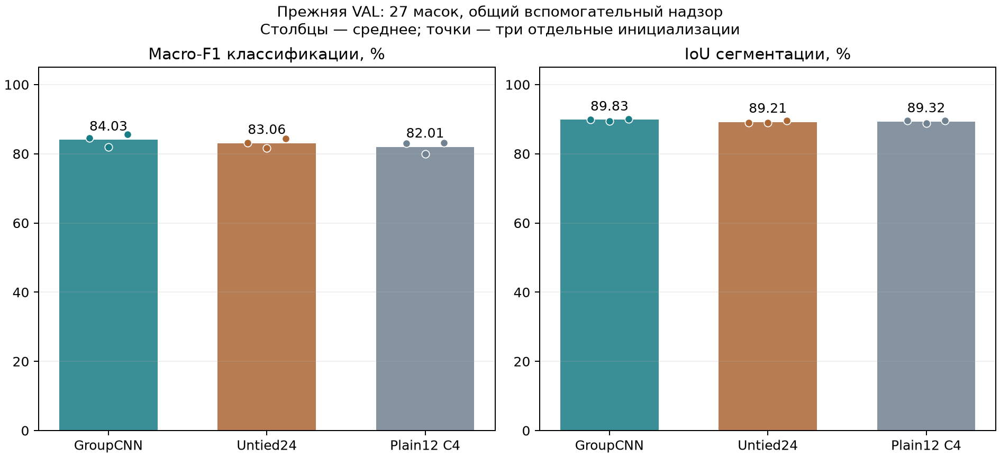
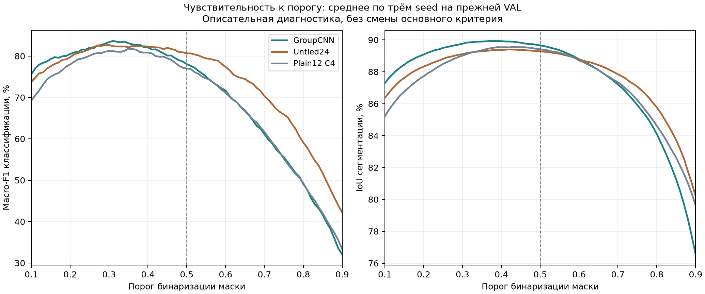

# Контроль связывания весов внутри CNN

3 ноября 2026 года. Заданный описательный критерий GroupCNN против Untied24 пройден: ΔMacro-F1 +0.973 п.п., ΔIoU +0.617 п.п. Выполнены три новых обучения контроля с независимыми весами; шесть прежних состояний GroupCNN и Plain12 C4 использованы повторно. Отдельный допуск к закрытому подтверждению не пройден.

Это исследование механизма на прежней многократно использованной VAL: 695 фрагментов двух кадров. Выбор порога и оценка производятся на этой же VAL. Результат является описательным и не заменяет закрытого подтверждения. Прежние закрытые кадры и их предсказания в этот опыт не включались.

## Что именно изменено

Новый Untied24 имеет те же 24 канала, последовательность свёрток 3×3 с dilation 1/2/4, GELU и выход 1×1, что материализованная GroupCNN. Используется один прямой проход без внешнего усреднения поворотов. Его начальные коэффициенты получены развёртыванием архивного начального состояния GroupCNN, до прежнего обучения. Численное совпадение стартовой функции проверено до запуска.

После развёртывания все коэффициенты Untied24 обучаются независимо, включая первоначально совпадавшие повёрнутые фильтры и коэффициенты выходного слоя. GroupCNN сохраняет связывание. Это сравнение при одинаковой ширине и MAC; число независимых параметров различается как следствие снятия ограничений. Оно не является сравнением сетей с одинаковым числом свободных параметров.

| Модель | Свободных параметров | MAC / фрагмент | Маршрут |
|---|---:|---:|---|
| GroupCNN: связанные веса | 2671 | 1527552 | 1 прямой проход |
| CNN24: независимые веса | 10681 | 1527552 | 1 прямой проход |
| CNN12: четыре вида C4 | 2749 | 1562112 | 4 обратно совмещённых поворота |

Прежний узкий Plain12 C4 сохранён как отдельный контроль при близком числе параметров и вычислений. Он обучался через четырёхвидовое усреднение вероятностей, а не только получил его при оценке.

## Общие условия обучения

Бюджет — 27 dense-масок, по три на геометрический класс; 1 152 weak-примера имеют только классовую метку. Seed: 5701, 5721, 5757. Во всех моделях прежний вспомогательный надзор одинаков: 400 шагов BCE по маскам, затем 1 600 шагов BCE и неизменённой geometry_loss с весом 1. AdamW, lr=0,0005, weight decay=0,0001, dense batch 8 и weak batch 8. Последовательности батчей совпадают с соответствующими прежними Group-fit.

Начальная функция совпадает, но параметризация и последующая оптимизация различаются: у одного оператора коэффициенты связаны, у другого свободны. Веса прежних обученных сетей не использовались для инициализации контроля. Три новых обучения выполнены полностью независимо от промежуточных метрик.

## Результаты при выбранных VAL-порогах

Для каждого состояния сохранена общая сетка 81 значения 0,10…0,90 с шагом 0,01 и прежнее правило выбора: Macro-F1, IoU, близость к 0,5, меньший порог. Macro-F1 относится к девяти классам из бинарной маски, IoU — к сегментации металла. Среднее по трём seed не является ансамблем.

| Модель | Macro-F1, % | IoU, % |
|---|---:|---:|
| GroupCNN: связанные веса | 84.033 | 89.825 |
| CNN24: независимые веса | 83.061 | 89.208 |
| CNN12: четыре вида C4 | 82.013 | 89.320 |

| Разность | ΔMacro-F1, п.п. | ΔIoU, п.п. |
|---|---:|---:|
| GroupCNN − Untied24 | +0.973 | +0.617 |
| GroupCNN − Plain12 C4 | +2.021 | +0.505 |



## Заранее установленный критерий

| Условие | Исход |
|---|---|
| Средний ΔMacro-F1 Group−Untied ≥ +0,5 п.п. | PASS |
| ΔMacro-F1 каждого seed ≥ −1 п.п. | PASS |
| Средний ΔIoU Group−Untied ≥ −0,2 п.п. | PASS |
| MAC Group и Untied совпадают | PASS |
| Начальная функция совпадает с установленным допуском | PASS |

Этот gate относится к прежней VAL. Его прохождение само по себе не доказывает перенос или статистически значимое преимущество. Непрохождение сохраняется и не заменяется более удобным порогом.

## Отдельный допуск к закрытому подтверждению

Дополнительный фильтр не пройден. Для перехода к новым кадрам одновременно требуются основной gate, средний ΔF1 Group−Untied при общем пороге 0,5 ≥0 и средний ΔIoU при этом пороге ≥−0,2 п.п. Это заранее установленное дополнительное ограничение, которое может закрыть допуск, но не может спасти основной отрицательный результат.

| Дополнительное условие | Исход |
|---|---|
| Основной описательный критерий пройден | PASS |
| Средний ΔF1 при общем пороге 0,5 ≥0 | FAIL |
| Средний ΔIoU при общем пороге 0,5 ≥−0,2 п.п. | PASS |

При отсутствии допуска новые кадры для этого варианта не загружаются. Направление Group−Untied не меняется по результатам на победившую модель. При прохождении допуска следующий этап требует отдельного протокола до просмотра ещё не использованных кадров.

## Чувствительность к порогу

Общий порог 0,5 и полные кривые — описательная диагностика. Они показывают зависимость результата от калибровки и не заменяют первичный критерий; значения при 0,5 также входят в отдельный заранее заданный фильтр допуска выше.

| Разность | ΔMacro-F1, п.п. | ΔIoU, п.п. |
|---|---:|---:|
| GroupCNN − Untied24 | -2.609 | +0.371 |
| GroupCNN − Plain12 C4 | +1.060 | +0.236 |



Кривые усредняют три значения качества при каждом общем пороге. Это отличается от среднего качества после выбора индивидуального лучшего порога каждого состояния.

## Все девять состояний

| Модель | Seed | VAL-порог | Macro-F1, % | IoU, % | F1 при 0,5, % | IoU при 0,5, % |
|---|---:|---:|---:|---:|---:|---:|
| GroupCNN | 5701 | 0.31 | 84.517 | 89.923 | 73.030 | 89.144 |
| GroupCNN | 5721 | 0.30 | 81.891 | 89.483 | 78.911 | 89.931 |
| GroupCNN | 5757 | 0.38 | 85.693 | 90.070 | 82.168 | 89.878 |
| Untied24 | 5701 | 0.30 | 83.144 | 88.921 | 79.140 | 89.032 |
| Untied24 | 5721 | 0.31 | 81.694 | 89.039 | 79.520 | 89.140 |
| Untied24 | 5757 | 0.45 | 84.343 | 89.664 | 83.278 | 89.667 |
| Plain12 C4 | 5701 | 0.30 | 82.955 | 89.600 | 75.295 | 89.306 |
| Plain12 C4 | 5721 | 0.35 | 79.966 | 88.764 | 77.479 | 89.524 |
| Plain12 C4 | 5757 | 0.37 | 83.117 | 89.596 | 78.156 | 89.416 |

## Проверка и воспроизведение

Независимый аудит — 32/32. Отчёт проверяет соответствие аудированных входов, текущего RESULT и LOCK перед построением графиков. Сохранены начальные/конечные веса, пробы градиента, вероятности, все пороги, маски, классы и прогресс.

Данные — SEM металлизации M2 одной физической ИС. Классы получены из SVG-масок геометрическим правилом; они не являются экспертными типами производственных дефектов или электрическими измерениями. Межчиповый перенос этим опытом не проверялся. Известная конструкция C4-свёртки не заявляется новым оператором.

[Протокол](PROTOCOL.md) · [Конфигурация](CONFIG.json) · [Фиксация](LOCK.json) · [Обучение](runner.py) · [Результат](RESULT.json) · [Аудит](AUDIT.json) · [Прежняя архитектура](../sem_arch_groupcnn_20261102/model.py) · [Зафиксированный основной вариант](../sem_model_freeze_20261103/MODEL_CARD.md).

Повторное построение отчёта без обучения:

```bash
.venv/bin/python -B gipoteza/sem_arch_untied_control_20261103/report.py
```
