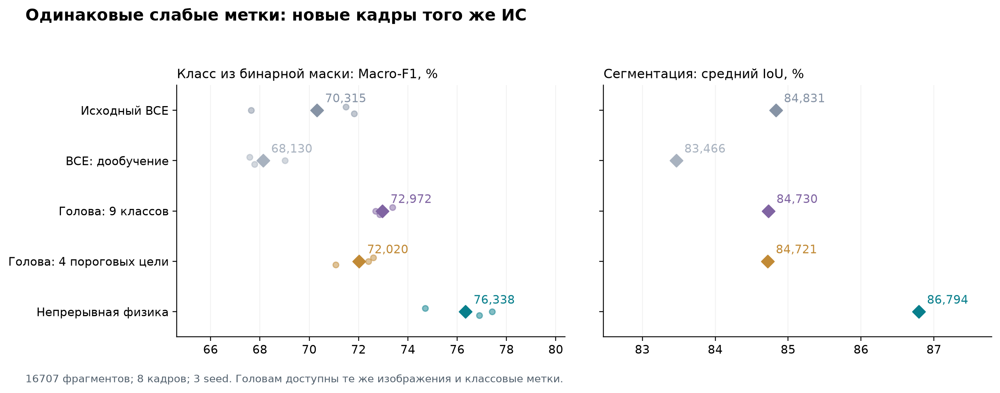
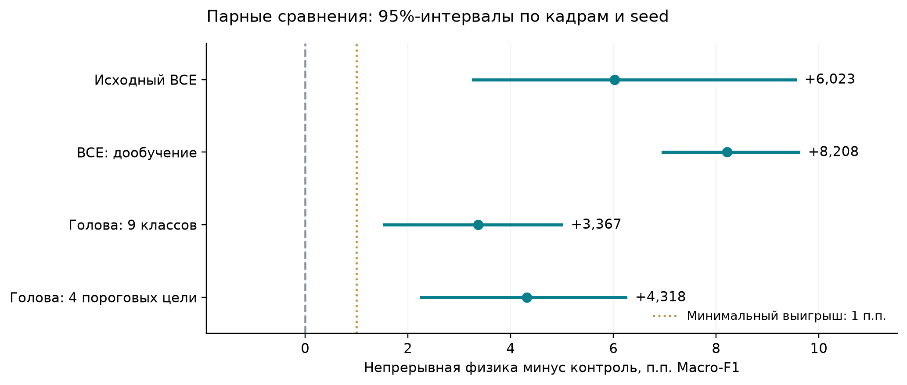

# Сравнение геометрической регуляризации с одинаковым дополнительным надзором

28 октября 2026 года. **PASS_PILOT**. Технический аудит: **PASS_AUDIT**.

Пилот поддержал преимущество непрерывной регуляризации при одинаковых дополнительных метках.

## Что проверялось

Одинаковые 54 плотные маски,1152 дополнительных SEM с геометрическими классами,
одинаковый сегментатор и число его обновлений. Сравниваются непрерывная физика,
обычное BCE-дообучение и две обучаемые классификационные головы. Основная
метрика всех вариантов — класс, вычисленный из бинарной сегментации.
Прямой класс головы показан отдельно.

TEST: **16707 фрагментов восьми ранее не использовавшихся кадров**:
37, 77, 84, 88, 171, 179, 199, 206. Три новые инициализации:
2801, 2833, 2887. Это один физический чип, а не восемь
независимых изделий. Точные D4-мотивы и полутоновые фрагменты не пересекаются
между частями; по краям удалено 512 нативных пикселей.

## Результаты

| Метод | Macro-F1 из маски, % | IoU, % | Прямой выход головы, % |
|---|---:|---:|---:|
| Исходный BCE | 70,315 | 84,831 | — |
| BCE: дообучение | 68,130 | 83,466 | — |
| Голова: 9 классов | 72,972 | 84,730 | 59,515 |
| Голова: 4 пороговых цели | 72,020 | 84,721 | 60,934 |
| Непрерывная физика | 76,338 | 86,794 | — |

Критерий: выигрыш soft минимум 1 п.п. и положительная нижняя граница 95%-интервала
против replay и выбранной по VAL головы; IoU не хуже более 2 п.п. Каждый критерий
обязателен. Голова выбрана **до TEST**: **head9**. Интервалы —4000 парных
crossed-bootstrap-повторов с независимым пересэмплированием кадров и seed.

| Контроль | Разность F1, п.п. | 95%-интервал, п.п. | Критерий этого сравнения |
|---|---:|---|---|
| Исходный BCE | +6,023 | [+3,273; +9,537] | PASS |
| BCE: дообучение | +8,208 | [+6,964; +9,606] | PASS |
| Голова: 9 классов | +3,367 | [+1,539; +4,988] | PASS |
| Голова: 4 пороговых цели | +4,318 | [+2,266; +6,240] | PASS |

Исходный BCE не дообучался; остальные варианты получили по 2000 дополнительных
шагов из одинаковых прогретых весов соответствующего seed. У каждой головы
есть дополнительные параметры и 200 head-only обновлений с замороженным
backbone; равенство ёмкости или полного времени вычислений не заявляется.
Все сравнения сообщаются, а не только выбранное главное.

## Выбор параметров и ограничения

Для каждого семейства вес выбран из 0.1/0.4/1.0 по VAL на двух разработочных
seed. Выбранные веса: soft=1.0,
head9=0.1,
head4=0.4. У двух семейств голов
совокупный бюджет поиска больше, чем у одного soft. TEST не выбирал
параметры, эпоху, тип головы или итоговый seed.

Головы и их веса выбирались по качеству класса из сегментации. Поэтому
вторичные числа прямых голов не заменяют сравнение с отдельно настроенным
классификатором, оптимизированным именно для прямого выхода.

Первая проверка допуска данных остановилась: редкий VAL-класс имел 31 вместо
заданных 32 мотивов. До подготовки TEST и обучения опубликована
[поправка минимума до 30](AMENDMENT_01.md); все 31 примера сохранены. TEST,
методы и критерий выигрыша не менялись. Исходный FAIL_DATA_GATE сохранён
в [первой попытке](attempt1_data_gate/RESULT.json). Это ограничивает статус
опыта разработочным пилотом.

При первом запуске выявлена ошибка совместного переноса dtype/device MPS↔CPU.
Исправлен порядок преобразований в отдельном адаптере; аналитическая потеря
и CPU-градиент совпали точно, прямой и обратный MPS-проходы проверены.
Исходная попытка сохранена в attempt2_mps_transfer/. Новое обучение
перезапущено с исходных фиксированных seed, до открытия TEST.

Классы рассчитываются по двумерной резисторной модели SVG-геометрии.
Измеренной электрической проводимости, типов производственных отказов
и независимого другого чипа в этом опыте нет. Результат ничего не добавляет
к проверке мирового приоритета и не гарантирует публикационную новизну.

## Время и аудит

Финальный исправный запуск обучения: **5.43 мин**,44000 обновлений
backbone,33 сохранённых checkpoint. Оценка: **20.54 с**.
Это не включает загрузку и написание кода.

Аудит проверил SHA источников/данных/весов, разбиение и D4-ключи,
пересчёт Macro-F1 через sklearn, все IoU из сохранённых масок, независимый
bootstrap через веса групп, декодирование порядковой головы, CPU/MPS-вывод
и 384 классов другим разреженным решателем.
Максимальное расхождение вероятностей CPU/MPS: 6.56e-06;
bootstrap: 0.
Технический PASS не подменяет научный критерий.

## Файлы

- [Протокол версии 2](PROTOCOL.md), [поправка](AMENDMENT_01.md).
- [Данные и разбиение](DATA_MANIFEST.json), [замороженные входы](FROZEN.json).
- [Выбор по VAL](SELECTION.json), [все разработочные оценки](DEV_RESULTS.json).
- [Результат](RESULT.json), [аудит](AUDIT.json), [веса и их SHA](CHECKPOINT_HASHES.json).
- [Код подготовки](prepare.py), [обучения](train.py), [MPS-адаптер](physics_adapter.py),
  [оценки](evaluate.py), [аудита](audit.py), [графиков и отчёта](report.py).

Сохранены DATA.npz, PREDICTIONS.npz с полными бинарными масками/классами,
BOOTSTRAP.npz, исходные PNG/SVG и все веса models/. Текущий документ гипотезы
и старые результаты не переписывались.
